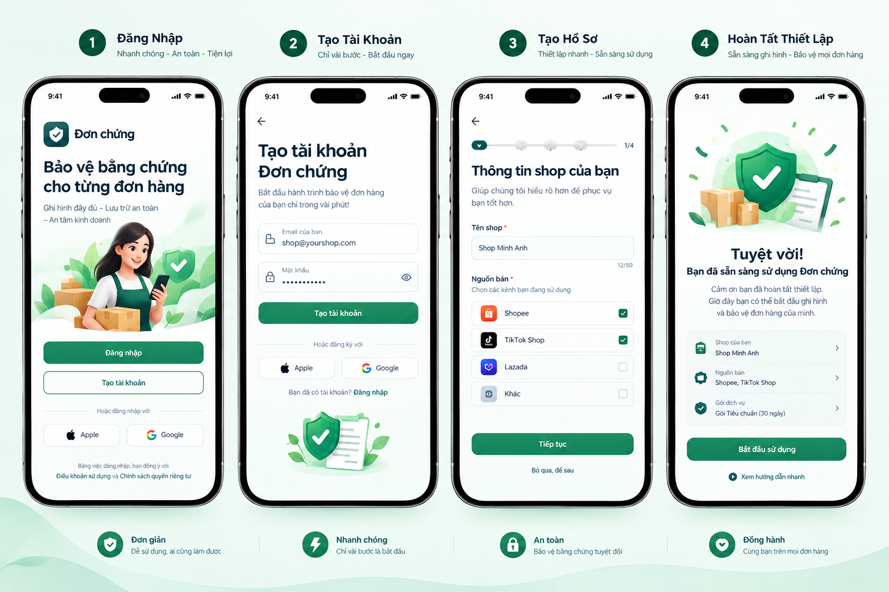
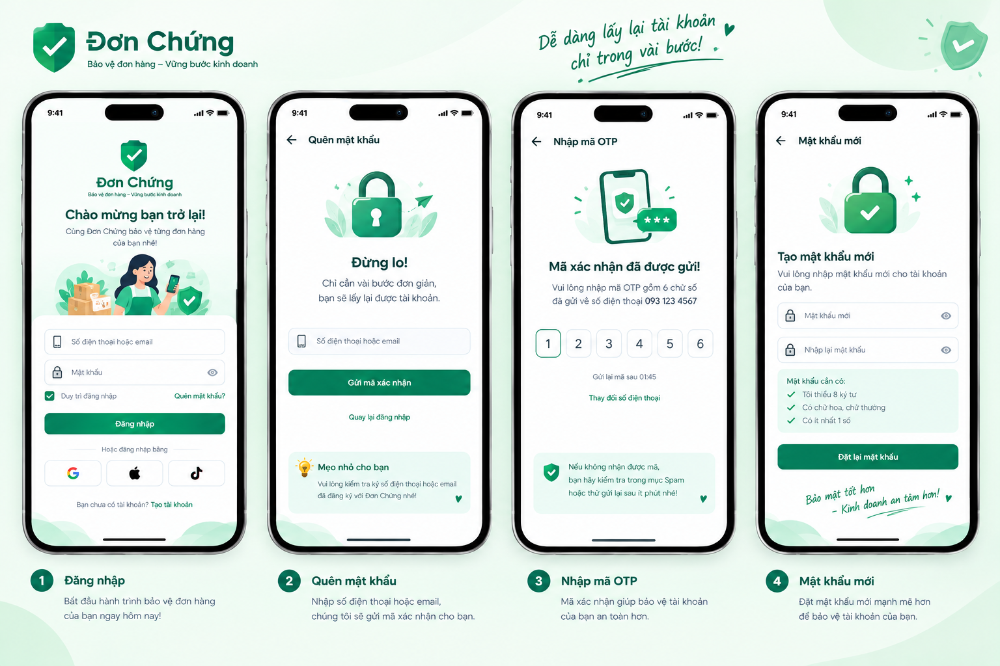
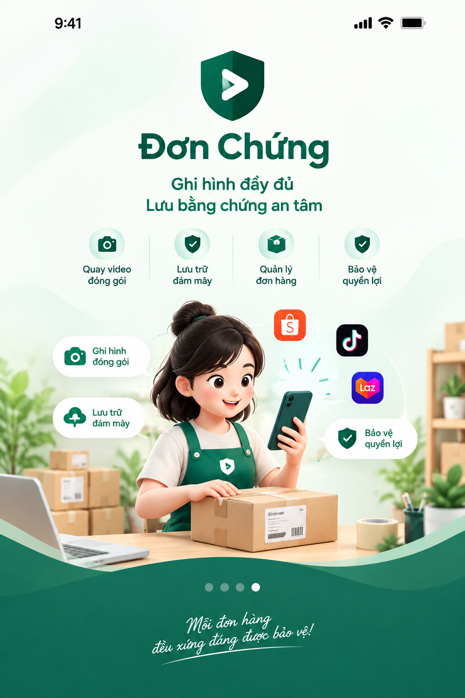
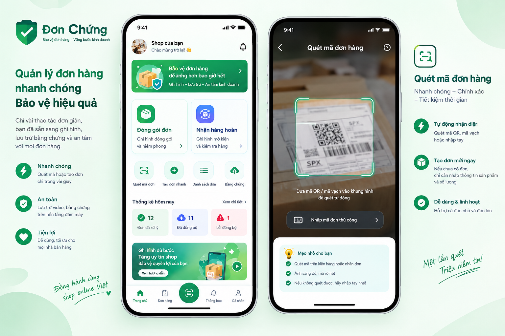
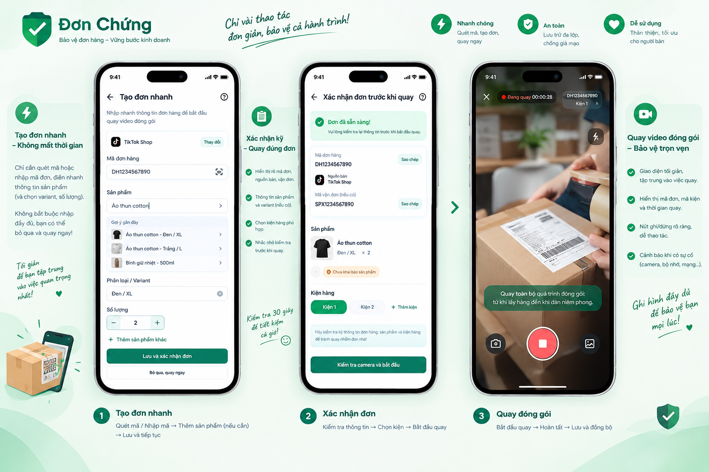
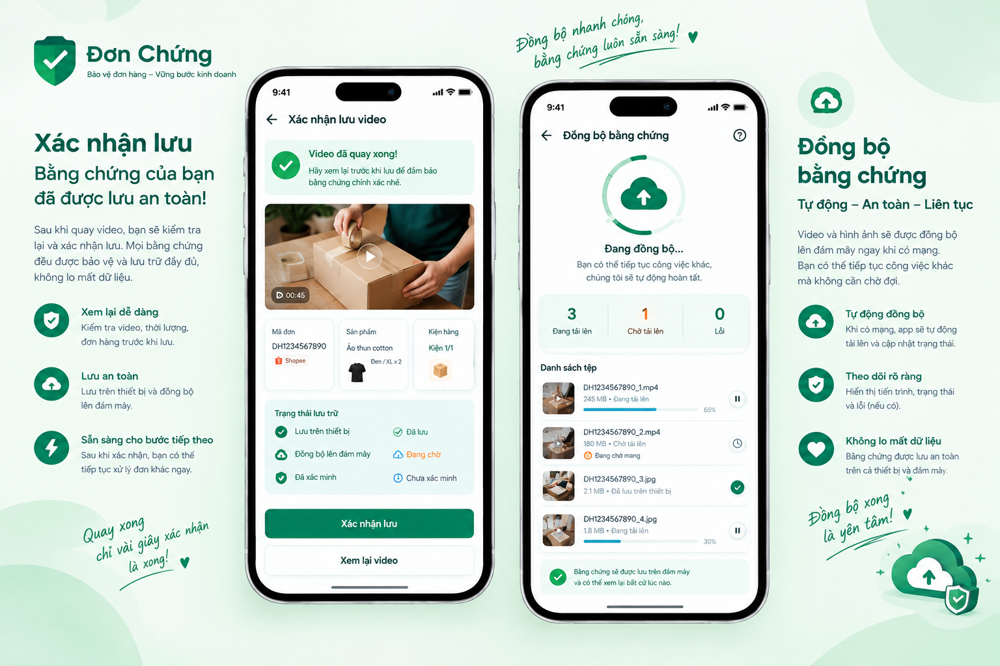

# 09 — Thiết kế UI/UX

Hướng thiết kế cho ứng dụng iOS/Android. Tài liệu này nói **giao diện và tương tác**; hành vi nghiệp vụ, trạng thái và quy tắc dữ liệu vẫn do [02](02-domain-model-and-states.md)–[08](08-acceptance-qa-risks.md) quy định. Khi hai nơi khác nhau, nghiệp vụ thắng và phải sửa tài liệu này. Wireframe, màu và số liệu ở đây là định hướng, **chưa phải thiết kế đã dựng (Figma) hay ứng dụng đã triển khai**.

Đơn Chứng không được trông như một ERP thu nhỏ: đó là công cụ ghi nhận bằng chứng nhanh, rõ, có kiểm soát, luôn cho người dùng biết bằng chứng đang ở đâu. Người dùng thường đang cầm hàng, quét mã, quay video — không ngồi nhập liệu.

## Mã màn hình trong tài liệu này

Danh mục màn hình dùng tiền tố **`UI-`** (UI-A01…UI-J15) để không trùng với mã đặc tả quy trình `A01–A08` (đóng gói, [04](04-screen-spec-packing.md)) và `B01–B08` (hàng hoàn, [05](05-screen-spec-returns.md)). Bảng ánh xạ nằm ở cuối mục "Danh mục màn hình".

## 1. Triết lý

1. **Scan first, type less.** Từ Tổng quan chạm một nút là tới camera quét; chỉ hỏi phần còn thiếu; không bắt nhập tên sản phẩm trước khi quay (D-10).
2. **Evidence first, administration second.** Quay và lưu bằng chứng là hành động chính; sản phẩm, lịch sử, cài đặt đứng sau.
3. **Trạng thái trung thực.** Phân biệt lưu trên máy / đang tải / đã tải lên / đã xác minh; không dùng một dấu tick xanh cho tất cả.
4. **Một tay.** Nút chính ở vùng dễ chạm, nhãn chữ rõ, không phụ thuộc icon khó đoán.
5. **Không làm mất bằng chứng.** Không tự xóa video chưa đồng bộ, không ghi đè bản gốc, không ghép đoạn gián đoạn thành video có vẻ liên tục.

## 2. Kiến trúc thông tin

Thanh tab dưới, 5 mục (**D-16**, theo mockup 02; thay phương án 4 tab của D-11):

| Mục | Vai trò |
|---|---|
| **Trang chủ** | Điểm bắt đầu: *Đóng gói đơn*, *Nhận hàng hoàn*, lối tắt, thống kê hôm nay; lối vào Hàng hoàn và Đồng bộ |
| **Đơn hàng** | Tìm, lọc, mở hồ sơ đơn và bằng chứng liên quan |
| **Quét** (nút tròn nổi ở giữa) | Không phải tab: mở màn quét mã đơn hàng toàn màn hình, ẩn thanh tab |
| **Thông báo** | Danh sách thông báo (UI-I07, khung; O-26) |
| **Cá nhân** | Hồ sơ shop, thành viên, gói dịch vụ, lưu trữ, cài đặt, trợ giúp |

Hàng hoàn (nhóm D) và Đồng bộ (nhóm F) **không còn là tab**: mở từ Trang chủ, không có thanh tab, có nút quay lại. Tranh chấp (nhóm G) không phải tab: đi vào từ hồ sơ đơn, hồ sơ hàng hoàn hoặc "việc cần xử lý" — xem O-14.

Quy tắc điều hướng:
- Bắt đầu tác vụ chính trong ≤ 2–3 thao tác (Tổng quan → *Đóng gói đơn* → quét → quay).
- **Khi đang quay: giao diện quay chuyên biệt, ẩn thanh tab**, không cho rời bằng thao tác vô tình; rời phải cảnh báo hậu quả.
- Mỗi màn chỉ một hành động chính nổi bật; sửa/xóa/xuất ở vị trí phụ.
- Video đã lưu an toàn trên máy → được chuyển đơn tiếp theo, không chờ tải lên.
- Luôn có đường quay lại an toàn.

Luồng tổng thể: Mở app (kiểm tra phiên, shop, trạng thái lưu video) → Đóng gói *hoặc* Nhận hàng hoàn → Hồ sơ bằng chứng → (khi có tranh chấp) Hồ sơ vụ việc → chọn bằng chứng → xuất/chia sẻ theo khả năng hệ thống.

## 3. Design system

**Màu** (định hướng; kiểm tra tương phản đạt chuẩn trước khi chốt):

| Vai trò | Màu |
|---|---|
| Thương hiệu | Xanh rừng |
| Nền màn hình | Trắng ngà |
| Thành công (đã lưu/đã xác minh) | Xanh thành công |
| Cần chú ý / đang chờ | Cam cảnh báo |
| Lỗi, hành động phá hủy, nguy cơ mất dữ liệu | Đỏ — chỉ dùng cho các trường hợp này, **ngoại lệ duy nhất: chấm "đang ghi hình" trên màn quay** (chủ sản phẩm chấp nhận, [D-18](README.md#đã-chốt); luôn kèm chữ và đồng hồ) |

Màu không bao giờ là tín hiệu duy nhất: mọi trạng thái có **chữ + biểu tượng**. Hai trạng thái cùng sắc xanh (*Đã tải lên*, *Đã xác minh*) phải khác nhau rõ về nhãn và biểu tượng. Cần bản chế độ sáng; chế độ tối là quyết định mở.

**Chữ và kích thước:** font hệ thống hoặc sans-serif hỗ trợ đầy đủ tiếng Việt; tiêu đề màn 24–28 pt, tiêu đề khu vực 17–20 pt, nội dung 15–17 pt, chú thích ≥ 12–13 pt (không dùng cho thông tin quan trọng). Vùng chạm tối thiểu 44 pt (iOS) / 48 dp (Android). Tôn trọng Dynamic Type/font scale, vùng an toàn, bàn phím hệ thống. Bo góc vừa phải, ít đổ bóng/gradient/hiệu ứng trang trí.

**Ngoại lệ nhóm chữ form (chờ BA xác nhận):** theo yêu cầu bám thiết kế mockup 03 (người dùng đã duyệt), các màn dạng form/quy trình — Tạo đơn nhanh (UI-B04) và Xác nhận đơn (UI-C01) — dùng nhóm chữ nhỏ hơn mức "nội dung 15–17 pt" ở trên: `formLabel 13`, `formBody 14`, `formButton 14`, `formButtonSmall 13` (sp, vẫn co theo cỡ chữ hệ thống, không khóa `allowFontScaling`). Phạm vi: hai màn này, **tab Đơn hàng (danh sách UI-E01, bộ lọc, chi tiết UI-E02, trạng thái rỗng/lỗi; mở rộng theo yêu cầu người dùng, decisions.md Q-18m)** và các thành phần dùng trong chúng (nhãn ô nhập, tên/variant sản phẩm, nút). Không dùng nhóm này cho thông báo lỗi/cảnh báo quan trọng (các thông báo đó giữ cỡ nội dung hoặc chú thích ≥ 12 pt). Chữ trên lớp phủ camera của màn quay (huy hiệu, mã đơn + kiện) là `overlay 12` (tối thiểu bằng chú thích) và **không** được co nhỏ hơn bằng tự co chữ; mã dài thì cắt giữa và xem đủ qua nhãn trợ năng. Số liệu này được khóa bằng `src/core/theme/theme.test.ts` (đổi một bên phải đổi bên kia). **Chưa kiểm chứng** với chữ lớn hệ thống trên máy thật; BA cần xác nhận hoặc bác ngoại lệ (decisions.md Q-17l).

**Thành phần dùng chung:** nút chính cố định gần đáy; thanh trạng thái bằng chứng có nhãn; ô quét/tìm/nhập nhanh; thẻ đơn, dòng sản phẩm, thumbnail video; bottom sheet cho lựa chọn ngắn (trang riêng cho tác vụ phức tạp); dialog xác nhận chỉ cho hành động quan trọng; skeleton khi tải; empty state có hành động cụ thể.

### Chuẩn hiển thị trạng thái bằng chứng

Nhãn thống nhất toàn app, ánh xạ với vòng đời tệp ở [02](02-domain-model-and-states.md):

| Nhãn hiển thị | Ý nghĩa | Trạng thái nghiệp vụ |
|---|---|---|
| **Đã lưu trên máy** | Lưu cục bộ, đọc được; chưa có bản trên máy chủ | Chờ tải lên (sau khi lưu xong) |
| **Chờ tải lên** | Đang chờ mạng/lượt xử lý; ghi lý do (ví dụ mất mạng) | Chờ tải lên |
| **Đang tải lên** | Có tiến độ khi xác định được | Đang tải lên |
| **Đã tải lên** | Máy chủ đã nhận đủ tệp | Đã tải lên |
| **Đã xác minh** | Mã băm trên máy chủ khớp bản gốc | Đã xác minh |
| **Lỗi – cần xử lý** | Nguyên nhân dễ hiểu + nút thử lại/cách khắc phục | Các trạng thái lỗi |

Trong lúc ghi (*Đang ghi*, *Đang lưu trên thiết bị*) màn quay hiển thị trạng thái riêng, không dùng các nhãn trên.

Quy tắc diễn đạt:
- Cụm "Đã lưu an toàn trên máy chủ" chỉ dùng cho **Đã xác minh** (khớp [06](06-evidence-retention-policy.md)). *Đã tải lên* mô tả đúng điều đó, không thêm "an toàn".
- "Đã xác minh" chỉ nói điều hệ thống thực sự kiểm tra (tính toàn vẹn tệp). Không diễn đạt thành "chắc chắn được sàn chấp nhận" hay "video chứng minh ai đúng ai sai".
- Thông tin người dùng khai báo không bị trình bày như dữ liệu đã xác minh từ sàn.
- Không dùng "Hoàn tất toàn bộ" khi còn lỗi hoặc bước bắt buộc dang dở; không dùng nút "OK/Tiếp tục" mơ hồ khi có thể dùng nhãn cụ thể (ví dụ *Giữ video và quay lại*).

## 4. Danh mục màn hình

Mỗi màn: mục đích, thành phần, hành động chính. Quy tắc nghiệp vụ chi tiết, mã lỗi, nghiệm thu: xem cột "Đặc tả".

### Nhóm A — Khởi động và thiết lập

| Mã | Màn | Nội dung chính |
|---|---|---|
| UI-A01 | Splash | Logo; kiểm tra phiên/cấu hình/đồng bộ ở nền; không đứng lâu; mất mạng vẫn vào được phần công việc cục bộ nếu phiên và dữ liệu cho phép. **Đã làm** (cổng phiên giả): tĩnh, không nút, hiện tối thiểu 2 giây (tính từ lúc Splash của app thật sự hiện), chờ phiên tối đa 3 giây từ lúc mở app, rồi tự chuyển theo phiên; chi tiết và điểm đã duyệt giữ nguyên theo thiết kế ở [mục 5.7](#57-splash--ui-a01) |
| UI-A02 | Chào mừng | "Bảo vệ bằng chứng cho từng đơn hàng"; CTA *Đăng nhập* / *Tạo tài khoản*; liên kết Điều khoản và Quyền riêng tư; không onboarding nhiều trang; nút *Apple*/*Google* (bật bằng cờ cấu hình, O-15); liên kết pháp lý hiện là URL giữ chỗ, chưa có trang thật |
| UI-A03 | Đăng nhập / tạo tài khoản | Kiểm tra dữ liệu tại trường; quên mật khẩu, xác thực email, trạng thái đang xử lý; không báo thành công trước khi máy chủ xác nhận. Phương thức đăng nhập: O-15. **Biến thể đăng ký (`/sign-up`) và đăng nhập (`/sign-in`) đã làm** (chi tiết ở 5.1 và 5.6) |
| UI-A04 | Tạo hồ sơ shop | Tên shop là chính (bắt buộc, 1-50 ký tự); nguồn bán chọn nhiều (Shopee, TikTok Shop, Lazada, Khác), bỏ qua được; không bắt địa chỉ, mã số thuế, dữ liệu khách hàng. Thanh tiến trình 3 bước (hiện 2/3). Đã làm (chi tiết ở 5.1) |
| UI-A05 | Giải thích quyền | Vì sao cần camera/micro/ảnh–tệp/thông báo; **chỉ xin quyền khi bắt đầu tác vụ liên quan**; bị từ chối → hướng dẫn mở Cài đặt, không lặp popup; không xin danh bạ/vị trí |
| UI-A06 | Hoàn tất thiết lập | "Quét mã đơn để bắt đầu"; CTA *Bắt đầu sử dụng*; bỏ qua hướng dẫn được. Thẻ tóm tắt shop + nguồn bán, **không** hiện gói dịch vụ. Đã làm (chi tiết ở 5.1) |
| UI-A07 | Quên mật khẩu | Nhập email; gửi mã xác minh; **trung tính** (không tiết lộ email có tài khoản hay không); thẻ Mẹo. Đã làm (5.6) |
| UI-A08 | Nhập mã xác minh | 6 chữ số, tự xác minh khi đủ, đếm ngược gửi lại, mô tả với email đã che. Không dùng nếu chọn phương án C của O-22. Đã làm với cổng giả (5.6) |
| UI-A09 | Mật khẩu mới | Hai ô + khối "Mật khẩu nên có" (một dòng: ít nhất 8 ký tự); xong về Đăng nhập kèm banner thành công. Đã làm (5.6) |

### Nhóm B — Tổng quan và bắt đầu công việc

| Mã | Màn | Nội dung chính |
|---|---|---|
| UI-B01 | Tổng quan | Thứ tự trên xuống: tên shop + menu tài khoản; khối đồng bộ (nếu có lỗi/tệp chờ); hai nút lớn *Đóng gói đơn*, *Nhận hàng hoàn*; đơn gần đây; việc cần xử lý (video lỗi, phiên chưa hoàn tất, dung lượng). **Không** biểu đồ doanh thu/lợi nhuận |
| UI-B02 | Trung tâm quét mã | Camera quét ngay; đèn pin, nhập tay, tìm đơn đã lưu; hiện mã vừa quét; quét xong tự tra cứu (không nút "Tìm"); chống quét lặp; mã không nhận diện → nhập lại hoặc tạo nhanh |
| UI-B03 | Tìm đơn thủ công | Ô tìm lớn theo mã đơn/vận đơn; lịch sử tìm; kết quả: mã đơn, nguồn bán, ngày, trạng thái bằng chứng; trùng mã giữa nhiều nguồn → bắt chọn đúng hồ sơ |
| UI-B04 | Tạo hồ sơ đơn nhanh | Mã đơn (điền từ mã quét), nguồn bán, mã vận đơn (tùy chọn), sản phẩm (gợi ý từ lịch sử), variant, số lượng (tăng/giảm nhanh, mặc định 1). Nút chính *Lưu và quay video*; phụ *Bỏ qua thông tin sản phẩm*. Mã chưa có → "Chưa có hồ sơ đơn này", không giả vờ lấy dữ liệu từ sàn |
| UI-B05 | Chế độ xử lý liên tục | Đếm số đơn đã quét trong phiên; mỗi mã một mục trong danh sách tạm; quét tiếp/sửa nhanh/mở để quay; khi quay khóa đúng đơn và kiện; **không tự chuyển đơn khi video đang ghi** |

### Nhóm C — Đóng gói và quay video gửi hàng

Luồng rút gọn: Quét/nhập mã → tra cứu hoặc tạo nhanh → (kiểm tra ngầm) → quay → lưu an toàn → tải nền → đơn tiếp theo.

| Mã | Màn | Nội dung chính |
|---|---|---|
| UI-C01 | Xem nhanh đơn trước khi quay | Mã đơn + nguồn bán nổi bật; sản phẩm dạng tóm tắt; nhãn *Chưa khai báo sản phẩm* nếu có; thêm nhiều dòng; đơn nhiều kiện → chọn/tạo kiện. CTA chính **Bắt đầu quay** (đồng thời là bước tạo phiên) |
| UI-C02 | Kiểm tra trước khi quay | Camera, micro, bộ nhớ đủ cho phiên dự kiến, quyền, khả năng lưu cục bộ. **Chạy ngầm; chỉ hiện khi có điều kiện không đạt**, kèm cách khắc phục cụ thể. Chỉ cho quay khi đủ điều kiện ghi và lưu an toàn |
| UI-C03 | Quay video | Khung camera chiếm phần lớn; mã đơn, mã kiện, đồng hồ luôn hiện; nút ghi/dừng rõ; cảnh báo camera gián đoạn/gần hết bộ nhớ; **không** bộ lọc/làm đẹp/chỉnh sửa; không đổi đơn khi đang quay; gián đoạn phải ghi nhận và hiển thị |
| UI-C04 | Kết thúc và xác nhận | Thumbnail, thời lượng, mã đơn; xem lại / ghi thêm đoạn riêng / dùng video; nhãn "phiên quay bị gián đoạn" nếu có; CTA *Lưu bằng chứng* — báo lưu thành công chỉ sau khi tệp đã ghi an toàn |
| UI-C05 | Lưu và đồng bộ | Trạng thái cục bộ tách khỏi cloud; tiến độ khi xác định được; được làm tiếp trong lúc tải; mất mạng → *Chờ tải lên* và tự thử lại; không xóa tệp cục bộ trước khi máy chủ xác nhận và chính sách cho phép. Không bắt đứng nhìn thanh tiến trình |
| UI-C06 | Hoàn tất đóng gói | Tóm tắt số video + trạng thái; chưa tải xong → "Video đã lưu trên thiết bị — đang chờ đồng bộ"; CTA chính *Đóng gói đơn tiếp theo*, phụ *Xem bằng chứng* |

### Nhóm D — Nhận hàng hoàn

Phải khác luồng đóng gói: ghi nhận tình trạng kiện **trước** khi mở rồi mới kiểm hàng; không chỉ đổi tiêu đề của màn quay.

| Mã | Màn | Nội dung chính |
|---|---|---|
| UI-D01 | Danh sách hàng hoàn | Tìm theo mã đơn/vận đơn/mã hoàn; gần đây; lọc: đang tiếp nhận, đang kiểm tra, đã kiểm tra, có sai lệch, chưa đồng bộ; CTA *Tiếp nhận hàng hoàn* |
| UI-D02 | Tìm đơn gốc | Quét/nhập; thấy đơn → hiện nguồn bán và dữ liệu khai báo ban đầu; không thấy → tạo hồ sơ hoàn chưa ghép đơn; nhiều kết quả → bắt chọn chính xác; **không tự ghép vì mã gần giống** |
| UI-D03 | Ghi nhận kiện bên ngoài | Ảnh tổng thể + nhãn vận chuyển; tình trạng (nguyên vẹn, móp, rách, ướt, niêm phong bất thường, nhãn không đọc được, khác, chưa xác định); ghi chú ngắn; không bắt mô tả dài; CTA *Tiếp tục ghi hình mở kiện* |
| UI-D04 | Quay video mở kiện | Giao diện camera giống đóng gói để giảm học; mã hồ sơ hoàn cố định; hướng dẫn "Quay từ trước khi mở niêm phong đến khi lấy hết hàng ra"; kiện đã mở trước → ghi ngoại lệ; gián đoạn → lưu từng phiên riêng, hiển thị rõ |
| UI-D05 | Kiểm tra hàng thực nhận | Mỗi dòng: tên + variant khai báo, SL dự kiến vs thực nhận, tình trạng (bình thường, hư hỏng, thiếu phụ kiện, khác), kết quả đối chiếu (khớp, thiếu, thừa, sai variant, hư hỏng, chưa xác định). Dữ liệu ban đầu chỉ để đối chiếu, **không bị ghi đè** |
| UI-D06 | Xác nhận kết quả kiểm tra | Tóm tắt kiện + sản phẩm + sai lệch; sửa trước khi xác nhận; lưu lịch sử sửa; **không kết luận ai có lỗi** — chỉ ghi điều quan sát và khai báo |
| UI-D07 | Hoàn tất tiếp nhận | Trạng thái nghiệp vụ tách khỏi trạng thái tải lên; liệt kê bằng chứng đã lưu/chưa tải/lỗi; CTA *Xem hồ sơ hàng hoàn*, phụ *Tạo hồ sơ tranh chấp*; chưa đồng bộ → cảnh báo rõ nhưng không mất dữ liệu kiểm tra đã lưu |

### Nhóm E — Đơn hàng và hồ sơ bằng chứng

| Mã | Màn | Nội dung chính |
|---|---|---|
| UI-E01 | Danh sách đơn | Tìm theo mã đơn/vận đơn; lọc nguồn bán, thời gian, trạng thái bằng chứng; thẻ: mã, nguồn bán, ngày, số video — không nhồi nhiều trường |
| UI-E02 | Chi tiết đơn | Khu vực thu gọn được: nhận diện; sản phẩm/variant khai báo; kiện; bằng chứng đóng gói; hàng hoàn liên quan; lịch sử. CTA chính *Xem bằng chứng*; sửa thông tin là hành động phụ |
| UI-E03 | Danh sách bằng chứng | Thumbnail; loại (đóng gói, mở kiện hoàn, ảnh tình trạng kiện, ảnh kiểm hàng); thời gian, thời lượng; trạng thái theo chuẩn mục 3 — không chỉ thumbnail xanh/dấu tick |
| UI-E04 | Chi tiết video | Trình phát; mã đơn/kiện, thời điểm, thời lượng; trạng thái tải lên/xác minh; thông tin phiên quay kể cả gián đoạn; chia sẻ/xuất nếu được phép. Thêm phiên mới không ghi đè bản gốc |
| UI-E05 | Lịch sử thay đổi | Ai, lúc nào, trường nào; trường quan trọng có giá trị trước/sau; phân biệt dữ liệu người dùng nhập với dữ liệu xác nhận từ nguồn tích hợp (nếu có sau này); không sửa/xóa theo cách thông thường |

### Nhóm F — Đồng bộ, lỗi, dung lượng

| Mã | Màn | Nội dung chính |
|---|---|---|
| UI-F01 | Trung tâm đồng bộ | Lọc: Đang tải lên, Chờ tải lên, Lỗi, Đã tải lên; mỗi tệp: tên hồ sơ, dung lượng, tiến độ/lý do chờ; thử lại, chi tiết, mở hồ sơ; thử lại hàng loạt cho tệp đủ điều kiện; **không có "Xóa tất cả"** |
| UI-F02 | Chi tiết lỗi đồng bộ | Ví dụ: "Video vẫn được lưu trên thiết bị. Chưa thể tải lên vì kết nối mạng không ổn định."; nêu nguyên nhân, nêu dữ liệu còn ở đâu; CTA *Thử tải lên lại*; không bắt quay lại nếu tệp gốc còn nguyên |
| UI-F03 | Dung lượng và lưu trữ | Riêng biệt: dung lượng cục bộ, tệp chờ tải, cloud đã dùng, giới hạn + thời hạn theo gói, tệp giải phóng được an toàn. Không tự xóa tệp chưa tải/bằng chứng bị giữ; trước dọn phải nêu tệp nào bị xóa và bản nào vẫn còn |
| UI-F04 | Ngoại tuyến | Banner nhỏ "Đang ngoại tuyến — bằng chứng sẽ được đồng bộ khi có mạng"; tiếp tục ghi nhận nếu lưu cục bộ được; thao tác cần máy chủ đánh dấu riêng; có mạng lại thì tự đồng bộ; phiên đăng nhập hết hạn không bị bỏ qua âm thầm |

### Nhóm G — Tranh chấp và xuất bằng chứng

| Mã | Màn | Nội dung chính |
|---|---|---|
| UI-G01 | Danh sách tranh chấp | Mã vụ việc/đơn; ngày tạo; trạng thái; số bằng chứng; nhãn thiếu bằng chứng/chưa đồng bộ; không tự kết luận kết quả |
| UI-G02 | Tạo hồ sơ tranh chấp | Chọn đơn hoặc hồ sơ hoàn; vấn đề (thiếu hàng, sai variant, hư hỏng, tình trạng kiện, khác); mô tả ngắn; không bắt khai lại thông tin đã có |
| UI-G03 | Chọn bằng chứng | Video/ảnh theo thời gian; chọn nhiều; cảnh báo tệp chưa tải/gián đoạn; trạng thái đầy đủ của bộ; có tranh chấp → đánh dấu giữ bằng chứng |
| UI-G04 | Xem trước và xuất | Danh sách nội dung; thông tin đơn, thời điểm, trạng thái tệp; bản tóm tắt + gói file theo định dạng hỗ trợ; tệp chưa trên cloud → báo trước; không gắn nhãn "đầy đủ" khi thiếu thành phần bắt buộc |
| UI-G05 | Chi tiết và đóng hồ sơ | Lý do, đơn liên quan, bằng chứng, lịch sử; bổ sung tệp/ghi chú; xác nhận trước khi đóng; chỉ bỏ trạng thái giữ theo quy tắc nghiệp vụ, không xóa dữ liệu chỉ vì đổi trạng thái |

Lưu ý: xuất PDF/ZIP/chia sẻ phải được xác định trong đặc tả và kiểm thử riêng. App không tuyên bố "đã gửi" khi mới tạo file hoặc mở màn chia sẻ (O-08).

### Nhóm H — Gói dịch vụ và thanh toán

| Mã | Màn | Nội dung chính |
|---|---|---|
| UI-H01 | Gói hiện tại | Tên gói, trạng thái, thời hạn; giới hạn lưu trữ + thời gian lưu; cảnh báo sắp đạt giới hạn; CTA *Xem các gói* |
| UI-H02 | So sánh gói | Thời gian lưu, dung lượng cloud, số thành viên/thiết bị, xuất hồ sơ + tính năng nâng cao, giá/chu kỳ/gia hạn; **nêu rõ điều gì xảy ra với dữ liệu khi hết hạn gói**, không chỉ làm nổi giá |
| UI-H03 | Xác nhận thanh toán | Gói, giá, chu kỳ, điều kiện gia hạn; phương thức hỗ trợ; điều khoản quan trọng; thành công/thất bại lấy từ kết quả thật của nhà cung cấp thanh toán. Kênh thanh toán: O-16 |
| UI-H04 | Gần/vượt giới hạn | Báo giới hạn cụ thể bị ảnh hưởng; đề xuất nâng gói / giải phóng an toàn / chờ gia hạn; không mất video đang chờ tải; không khóa người dùng khỏi truy cập bằng chứng hiện có chỉ vì đổi gói |

### Nhóm I — Hồ sơ, shop, thành viên, cài đặt

| Mã | Màn | Nội dung chính |
|---|---|---|
| UI-I01 | Hồ sơ tài khoản | Tên hiển thị, email, shop đang dùng, gói, bảo mật, trợ giúp, đăng xuất |
| UI-I02 | Cài đặt shop | Tên shop, nguồn bán, tùy chọn mặc định; không thành trang quản lý danh mục sản phẩm; đổi tên shop không đổi lịch sử bằng chứng đã ghi |
| UI-I03 | Thành viên và quyền | Danh sách thành viên; vai trò theo [07](07-roles-permissions-security.md); mời, thu hồi, trạng thái lời mời; mọi thao tác trong phạm vi shop |
| UI-I04 | Thông báo | Chọn: upload lỗi/cần xử lý; đồng bộ hoàn tất (tùy chọn); dung lượng sắp đầy; gói sắp hết hạn. Không báo từng video tải thành công |
| UI-I05 | Bảo mật và dữ liệu | Đăng xuất thiết bị; quản lý phiên/thiết bị nếu hỗ trợ; chính sách lưu trữ và xóa; yêu cầu tải dữ liệu/xóa tài khoản; **cảnh báo dữ liệu chưa đồng bộ trước khi đăng xuất hoặc xóa app** |
| UI-I06 | Trợ giúp | Hướng dẫn đóng gói đúng cách; ghi hình hàng hoàn; giải thích trạng thái upload; xử lý mất mạng/hết dung lượng; liên hệ + báo lỗi |
| UI-I07 | Thông báo (tab) | **Thêm theo D-16/O-26.** Danh sách thông báo của shop; hiện là khung có trạng thái rỗng, chưa có nội dung đặc tả. Khác UI-I04 (chọn loại thông báo muốn nhận) |

### Nhóm J — Trạng thái ngoại lệ bắt buộc thiết kế

| Mã | Tình huống | UI/UX cần xử lý | Đặc tả liên quan |
|---|---|---|---|
| UI-J01 | Mã không tìm thấy | Tạo hồ sơ nhanh hoặc tiếp tục dạng chưa ghép đơn | `ORDER_NOT_FOUND`, `SOURCE_ORDER_NOT_FOUND` |
| UI-J02 | Mã trùng | Liệt kê hồ sơ phù hợp để chọn | `ORDER_DUPLICATE`, `SOURCE_ORDER_AMBIGUOUS` |
| UI-J03 | Camera/micro bị từ chối | Hướng dẫn cấp quyền, không báo lỗi mơ hồ | `CAMERA_PERMISSION_DENIED`, `MIC_PERMISSION_DENIED` |
| UI-J04 | Bộ nhớ sắp đầy | Cảnh báo trước khi quay; đề xuất giải phóng an toàn | `INSUFFICIENT_STORAGE` |
| UI-J05 | Hết bộ nhớ khi đang quay | Xử lý tệp hiện có, ghi phiên không hoàn chỉnh, không tuyên bố thành công | QA-12 |
| UI-J06 | App bị đóng / hệ điều hành ngắt | Khôi phục phần khôi phục được; ghi nhận gián đoạn | QA-04 |
| UI-J07 | Mất mạng | Lưu cục bộ nếu được, xếp hàng đồng bộ | QA-02 |
| UI-J08 | Máy chủ nhận file nhưng mất phản hồi | Thử lại an toàn, tránh bản sao/upload trùng | QA-05 |
| UI-J09 | Mã băm không khớp | Đánh dấu lỗi xác minh, không gắn "Đã xác minh" | QA-09 |
| UI-J10 | Gói hết hạn | Giải thích quyền lợi bị ảnh hưởng và trạng thái dữ liệu hiện có | [06](06-evidence-retention-policy.md) |
| UI-J11 | Sắp xóa theo thời hạn lưu | Thông báo trước; tôn trọng bằng chứng bị giữ do tranh chấp | QA-10 |
| UI-J12 | Đổi shop / tài khoản | Xác nhận phạm vi dữ liệu; không gắn nhầm video sang shop khác. Phụ thuộc O-03 | QA-11 |
| UI-J13 | Nhiều nhân viên cùng sửa đơn | Giải quyết xung đột, bảo toàn lịch sử, không ghi đè âm thầm | "Thông tin đơn đã thay đổi ở thiết bị khác" |
| UI-J14 | Phiên quay bị gián đoạn | Hiển thị từng đoạn và mốc gián đoạn; không giả lập liên tục | A05, B05 |
| UI-J15 | Xóa app / đăng xuất khi còn tệp cục bộ | Cảnh báo dữ liệu chưa đồng bộ và yêu cầu xác nhận rõ ràng | UI-I05 |

### Ánh xạ với đặc tả quy trình

| Mã `UI-` | Đặc tả quy trình |
|---|---|
| UI-B02, UI-B03, UI-B04 | A02 (quét, nhập, tạo đơn) |
| UI-C01 | A03 (xem nhanh đơn và kiện, bắt đầu quay) |
| UI-C02 | A04 (kiểm tra sẵn sàng — chạy ngầm) |
| UI-C03 | A05 |
| UI-C04 | A06 |
| UI-C05 | A07 |
| UI-C06 | A08 |
| UI-B01 | A01 (danh sách công việc) |
| UI-D01 | B01 |
| UI-D02 | B02 |
| UI-D03 | B03 |
| UI-D04 | B04 (kiểm tra ngầm) + B05 |
| UI-D05 | B06 |
| UI-D06 | B07 |
| UI-D07 | B08 |

Các nhóm A (khởi động), E, F, G, H, I chưa có đặc tả quy trình riêng ở 04/05; cần đặc tả theo khung "mục đích, thành phần, hành động, trạng thái, lỗi, nghiệm thu" trước khi bàn giao lập trình (xem mục 8).

## 5. Bản thiết kế mẫu (concept mockups)

Các tấm hình dưới đây là **mockup khái niệm**, lưu ở `docs/assets/ui/`. Chúng minh họa hướng thị giác (xanh rừng, bo góc, thẻ lớn) và bố cục các luồng chính; **chưa phải thiết kế cuối**: chưa có Figma, chưa kiểm thử với người dùng, và có một số chỗ trái với đặc tả (xem bảng đối chiếu bên dưới). Chữ trong ảnh có vài lỗi chính tả hoặc đoạn vô nghĩa (ví dụ "Binh giữ nhiệt", dòng quảng cáo ở màn Tổng quan) — không sao chép nguyên văn; các câu quảng bá viết tay và khẩu hiệu cạnh màn hình là phần trình bày, không phải nội dung giao diện.

### 5.1 Khởi động và thiết lập — UI-A02, A03, A04, A06

**Chi tiết đã chốt cho UI-A03 (đăng ký), UI-A04, UI-A06** (đã làm, dùng cổng giả; kỹ thuật ở [layout.md mục 2.2](engineering/layout.md#22-ba-màn-thiết-lập-ui-a03-đăng-ký-ui-a04-ui-a06) và [decisions.md Q-13](engineering/decisions.md)):

- *Tạo tài khoản:* email + mật khẩu (>= 8 ký tự), nút hiện/ẩn mật khẩu có nhãn truy cập; lỗi hiện từng ô ngay khi nhập sau lần chạm đầu (không báo lỗi khi mới mở màn); nút chính khóa khi đang xử lý, chống bấm đúp; **vị trí lỗi theo ô**: lỗi gắn với một ô hiện ngay DƯỚI ô đó, viền ô đỏ + biểu tượng cảnh báo nhỏ + chữ (không chỉ dựa vào màu): email trống/sai định dạng/đã dùng dưới ô Email; mật khẩu trống/ngắn/yếu dưới ô Mật khẩu; lỗi tự mất khi người dùng sửa ô đó; giá trị đã nhập luôn được giữ. **Quay lại sau khi tài khoản đã tạo** (Back từ bước tạo shop): màn **không sửa/tạo lần hai** — ô Email và Mật khẩu bị khóa (chỉ đọc; mật khẩu hiện chấm cố định vì app không còn giữ mật khẩu), nút chính đổi thành **Tiếp tục** và đi thẳng sang tạo shop, không gọi lại cổng đăng ký. **"Email đã dùng" nói rõ**: "Email này đã có tài khoản." kèm nút **Đăng nhập** (đi `/sign-in`) ngay trong dòng lỗi, vùng chạm đủ 44/48dp (thay bản trung tính trước đó; đánh đổi và biện pháp ở decisions.md Q-13 mục g). **Lỗi chung** (mất mạng, hệ thống bận) hiện trong khung phía trên nút *Tạo tài khoản*, nền hồng nhạt, chữ tối, câu đầu in đậm, có nút **Thử lại** gửi lại đúng thao tác vừa lỗi (vẫn chống bấm đúp). Thông báo là `role=alert` để trình đọc màn hình đọc khi xuất hiện; tự cuộn lỗi vào vùng nhìn khi bàn phím đang mở. Bỏ câu trấn an "tài khoản chưa được tạo" ở màn này. Tên thương hiệu "Đơn Chứng" dùng khoảng trắng không ngắt (U+00A0) để không rớt một chữ xuống dòng; *Hoặc đăng ký với* Apple/Google theo cờ cấu hình của Chào mừng; không báo thành công khi chưa có máy chủ xác nhận. Email chưa xác thực **không chặn** (chưa có UI nhắc).
- *Tạo hồ sơ shop:* thanh tiến trình **3 đoạn** đếm theo luồng thật (Tạo tài khoản, Thông tin shop, Hoàn tất), màn này là **2/3** (mockup ghi 1/4). **Tên shop bắt buộc** (1-50 ký tự sau khi bỏ khoảng trắng đầu/cuối, có bộ đếm, chặn nhập quá 50). **Nguồn bán không có dấu `*`**, không chọn gì vẫn tiếp tục được; chọn nhiều, "Khác" là một lựa chọn; giá trị lưu là enum. *Bỏ qua, để sau* = tiếp tục không chọn nguồn bán (xóa lựa chọn) nhưng tên shop vẫn bắt buộc. **Shop chỉ được tạo một lần mỗi luồng:** quay lại từ Hoàn tất rồi sửa tên/nguồn bán thì app gọi **cập nhật** shop đã có (`updateShop`), không tạo shop thứ hai; không sửa gì thì không gọi cổng. Cổng thật phải idempotent theo tài khoản (decisions.md Q-13 b, n).
- *Hoàn tất:* tiêu đề hai mức, thẻ tóm tắt **chỉ có hai hàng** (Shop của bạn, Nguồn bán; chưa chọn thì hiện "Chưa chọn"); **không hiện hàng Gói dịch vụ** (O-06 chưa chốt). Hai hàng dẫn tới Cài đặt shop (màn khung). *Bắt đầu sử dụng* vào Tổng quan và xóa lịch sử thiết lập (Back không quay lại màn thiết lập); không có nút Back trên màn này. *Xem hướng dẫn nhanh* mở Trợ giúp.

#### Quy ước viết thông báo lỗi

Áp dụng cho mọi thông báo lỗi hiển thị cho người dùng (thay quy ước "ba phần: điều gì xảy ra, ảnh hưởng, làm gì tiếp" trước đây):

- **Tối đa 2 câu, dưới 20 từ, một ý.** Câu đầu nói điều đã xảy ra (in đậm khi có hai câu), câu sau nói việc làm tiếp.
- **Từ thường ngày**, không thuật ngữ ("dịch vụ tài khoản", "yêu cầu", "xác thực"...); không đổ lỗi cho người dùng; không phủ định kép; không "Có lỗi xảy ra" khi xác định được nguyên nhân.
- **Chỉ nêu "ảnh hưởng" khi người dùng có thể lo mất dữ liệu** (ví dụ video đã lưu trên máy nhưng chưa tải lên); lỗi nhập liệu hay mất mạng lúc đăng ký không cần câu trấn an.
- **Có nút hành động khi có việc làm ngay** (Thử lại, Đăng nhập...) thay vì chỉ bảo người dùng "hãy thử lại".
- **Đặt lỗi đúng chỗ:** lỗi của một ô nằm ngay dưới ô đó; lỗi chung nằm trong khung gần nút chính. Chữ tối trên nền nhạt, chỉ biểu tượng và viền màu đỏ; luôn kèm chữ.
- Nhóm `AUTH_*` và `signUp.errors` có test chất lượng câu chữ (`src/core/i18n/error-copy.test.ts`).

*Việc sau:* các thông báo của màn khác (docs/04, docs/05, mã `ORDER_*`, `CAMERA_*`, `RETURN_*`...) vẫn theo mẫu cũ, chưa viết lại theo quy ước này; cần BA rà soát từng màn.

### 5.6 Đăng nhập và khôi phục mật khẩu — UI-A03 (đăng nhập), UI-A07, A08, A09

Đã làm với **cổng giả** (chưa Firebase thật, không gửi email/SMS thật); kỹ thuật ở [layout.md mục 2.3](engineering/layout.md) và [decisions.md Q-14](engineering/decisions.md). Chữ ngoài khung điện thoại (khẩu hiệu, nhãn bước, chữ viết tay) là phần trình bày, không đưa vào app.

- *Đăng nhập (`/sign-in`):* logo xếp dọc, "Chào mừng bạn trở lại!", ô Email + Mật khẩu (hiện/ẩn), "Quên mật khẩu?" căn phải dưới ô mật khẩu, nút Đăng nhập (khóa + vòng xoay, chống bấm đúp), "Hoặc đăng nhập bằng" + nút chỉ có biểu tượng Google/Apple (theo cờ cấu hình của Chào mừng; cờ tắt thì ẩn cả đường kẻ), "Bạn chưa có tài khoản? Tạo tài khoản". **Không có toast "đăng nhập thành công"**: thành công thì xóa lịch sử và vào Tổng quan (chưa có shop thì sang tạo shop). Sai thông tin báo **chung** ("Email hoặc mật khẩu chưa chính xác. Bạn kiểm tra lại nhé!"), không nói cái nào sai. Email điền sẵn (từ màn đăng ký hoặc sau khi đặt lại mật khẩu) đi qua **trạng thái luồng trong bộ nhớ, dùng một lần** (không đặt vào tham số/URL); hiện banner thành công **một lần** sau khi đặt lại mật khẩu.
- *Quên mật khẩu:* nhập email, "Gửi mã xác minh", luôn sang màn Nhập mã (trung tính), thẻ "Mẹo nhỏ cho bạn", "Quay lại đăng nhập".
- *Nhập mã:* "Nếu email này đã đăng ký, mã 6 chữ số đã được gửi đến da•••@example.com." (email đã che, giữ 2 ký tự đầu + miền); một ô nhập thật vẽ thành 6 ô (chỉ chữ số, dán được, gợi ý mã tự điền của hệ điều hành); tự xác minh khi đủ 6 số, vẫn có nút Xác minh; đếm ngược "Gửi lại mã sau 00:30" tính theo mốc thời gian; thẻ "Mẹo bảo mật". Sai mã: ô đỏ + giữ các số đã nhập.
- *Mật khẩu mới:* hai ô, khối "Mật khẩu nên có" **một dòng** "Ít nhất 8 ký tự" tích theo thời gian thực, nút khóa tới khi hợp lệ và khớp; lỗi "Hai mật khẩu chưa khớp nhau. Bạn kiểm tra lại nhé!"; phiên hết hạn có nút "Quay lại bước đầu". Không vào được màn Nhập mã/Mật khẩu mới bằng Back hoặc đường dẫn trực tiếp khi chưa qua bước trước, **và cũng không vào lại được sau khi đã rời luồng**: email đã xin mã, mốc gửi lại và vé bị xóa khi người dùng đổi sang email khác, đặt lại mật khẩu xong, hoặc rời luồng về Đăng nhập/Chào mừng (Back ra khỏi Quên mật khẩu, "Quay lại đăng nhập"); vé còn hết hạn theo hạn cổng báo. Kết quả từ máy chủ đến muộn sau khi người dùng đã bấm Back/đi chỗ khác **không** tự điều hướng thay họ. Nếu mật khẩu đã được đổi trong lúc đó, **chủ ý** không báo ngay (không toast): banner "đã đặt lại" và email điền sẵn được giữ và hiện một lần ở lần mở Đăng nhập kế tiếp. Ô nhập mã chấp nhận dán "123 456"/"123-456" (lọc chữ số rồi tự xác minh).

**Điểm lệch có chủ ý so với mockup 05 / đặc tả gốc** (D-13, Q-14):

| # | Mockup / đặc tả | App |
|---|---|---|
| 1 | Ô "Số điện thoại hoặc email", OTP gửi về số điện thoại | Chỉ **Email** ở bản đầu; mọi chỗ nhắc số điện thoại đổi thành email |
| 2 | Ô "Duy trì đăng nhập" | **Bỏ**: phiên luôn được giữ (tải nền cần phiên) |
| 3 | Ba nút Google, Apple, TikTok | Chỉ **Google và Apple** (cờ cấu hình); không TikTok |
| 4 | Mật khẩu cần 8 ký tự + chữ hoa/thường + 1 số | Chỉ **từ 8 ký tự** (dùng đúng hàm kiểm tra của màn đăng ký); bỏ câu lỗi "chưa đáp ứng các yêu cầu bảo mật" |
| 5 | (Đặc tả gốc) báo "Đăng nhập thành công" | Không toast; thành công thì chuyển màn |
| 6 | "Mã xác nhận đã được gửi" khẳng định | Mô tả **trung tính** ("Nếu email này đã đăng ký..."); không tiết lộ email có tài khoản |
| 7 | Ô nhập chỉ có chữ giữ chỗ | Giữ nhãn nhỏ luôn hiện phía trên (đồng nhất màn đăng ký, dễ đọc cho trình đọc màn hình) |
| 8 | Hình cô gái, ổ khóa, điện thoại, tia sáng | Dựng bằng View + Ionicons (hình ở Đăng nhập dùng lại hình khiên + hộp của Chào mừng thu nhỏ, không có nhân vật); thay bằng hình thật ở `AuthIllustrations.tsx`/`WelcomeIllustration.tsx` |
| 9 | Câu chữ có "vui lòng", "yêu cầu" | Đổi theo quy ước 5.1 (không dùng "vui lòng"/"yêu cầu"): vd. "Hãy nhập email của bạn.", "Bạn xin mã mới nhé." |

### 5.7 Splash — UI-A01

Đã làm với **cổng phiên giả** (chưa Firebase, chưa chặn truy cập); kỹ thuật ở [layout.md mục 2.4](engineering/layout.md) và [decisions.md Q-15](engineering/decisions.md); quyết định sản phẩm D-15. Ảnh thiết kế `docs/assets/ui/06-splash-design.png` (thanh trạng thái 9:41 là của mockup, không đưa vào app; **không có 4 chấm phân trang**).

- **Mục đích:** cho thấy thương hiệu trong lúc app khôi phục phiên, rồi đưa người dùng tới đúng màn đầu. Không phải màn giới thiệu, không nhiều trang.
- **Thành phần (theo thiết kế):** logo khiên xanh rừng có mũi tên play + chữ "Đơn Chứng"; "Ghi hình đầy đủ / Lưu bằng chứng an tâm"; hàng bốn tính năng (Quay video đóng gói, Lưu trữ đám mây, Quản lý đơn hàng, Bảo vệ quyền lợi); ảnh minh họa 3D (cô gái, bong bóng, logo sàn); sóng xanh đậm ở đáy với câu viết tay trắng "Mỗi đơn hàng đều xứng đáng được bảo vệ!"; nền xanh rất nhạt có hình loang.
- **Hành động:** không có. Màn tự chuyển: đã đăng nhập và có shop -> Tổng quan; đã đăng nhập chưa có shop -> Tạo shop; chưa đăng nhập, cổng lỗi hoặc quá hạn -> Chào mừng. Chuyển bằng `reset` nên Back không quay lại Splash.
- **Trạng thái / thời gian:** Splash của app hiện **tối thiểu 2 giây kể từ lúc thật sự hiện ra** (khi ảnh minh họa đã tải xong và splash hệ điều hành đã ẩn; không tính thời gian splash hệ điều hành còn che), không nháy. Khôi phục phiên chạy ngay khi mở app, song song với việc tải ảnh; chuyển khi phiên xong và đủ 2 giây hiển thị, còn **chờ phiên không quá 3 giây kể từ lúc mở app** (quá hạn = chưa đăng nhập, nhưng vẫn không chuyển trước khi đủ 2 giây hiển thị). Nếu ảnh quá 4 giây thì coi như đã hiện. Không có hiệu ứng chuyển động (nên không cần xử lý "giảm chuyển động"). Splash hệ điều hành (nền xanh nhạt + khiên) hiện trước và được giữ tới khi ảnh minh họa tải xong; không giữ để chờ phiên.
- **Lỗi:** không có thông báo lỗi trên màn này. Cổng phiên lỗi hoặc quá hạn được coi là chưa đăng nhập (đi Chào mừng); không bao giờ hiện như đã đăng nhập khi chưa có xác nhận.
- **Bố cục:** khối đầu (logo, tên, khẩu hiệu, hàng tính năng) neo trên vùng an toàn; sóng và câu viết tay neo dưới vùng an toàn; ảnh minh họa ở giữa, rộng bằng màn, bàn đè lên mép trên của sóng. Màn thấp ẩn dần: câu viết tay, hàng tính năng, khẩu hiệu, rồi thu nhỏ ảnh; logo và tên luôn hiện. Chữ hệ thống lớn (>= 125%): ẩn hàng tính năng và khẩu hiệu. Nhãn tính năng >= 12dp.
- **Trợ năng:** toàn bộ trang trí (logo, ảnh, sóng, chữ) ẩn khỏi trình đọc màn hình; chỉ đọc tên "Đơn Chứng".
- **Nghiệm thu (đánh dấu khi đã kiểm tra thật trên thiết bị):**
  - [ ] Giống ảnh thiết kế trên iPhone và Android (không có chấm phân trang)
  - [ ] Hiện tối thiểu 2 giây (tính từ lúc thật sự thấy Splash của app, kể cả khi ảnh tải chậm) rồi tự chuyển; không treo khi mạng chậm/mất mạng
  - [ ] Splash hệ điều hành chuyển sang Splash của app không nhấp nháy (iOS và Android, gồm Android 12+)
  - [ ] Vùng an toàn, tràn viền Android, màn nhỏ (320x568) và chữ lớn không vỡ bố cục
  - [ ] Back không quay lại Splash
- **Điểm trái nguyên tắc, đã được chủ sản phẩm duyệt giữ nguyên theo thiết kế (D-15):** nhãn *Quản lý đơn hàng* trái D-10 (Đơn Chứng không quản lý bán hàng); *Bảo vệ quyền lợi* (hai nơi), *Lưu bằng chứng an tâm*, *Mỗi đơn hàng đều xứng đáng được bảo vệ!* hứa hơi quá so với mục A.5 ở bảng 5.5 (không chứng minh tính chân thực, không hứa thắng khiếu nại); logo Shopee/TikTok/Lazada nằm sẵn trong ảnh minh họa có thể gợi ý đã tích hợp (chưa có tích hợp). Cần BA/pháp lý rà lại trước phát hành. Test chuỗi giữ danh sách ngoại lệ có chú thích chỉ gồm các khóa này.
- **Bản tạm:** logo khiên-play vẽ lại bằng SVG (chưa phải tệp chuẩn), ảnh 3D là bản chính thức tạm, phông hệ thống thay cho phông trong thiết kế, icon ứng dụng tạm (O-23, O-24, O-25).

### 5.2 Tổng quan và quét mã — UI-B01, B02

### 5.3 Tạo đơn nhanh, xem nhanh đơn, quay video — UI-B04, C01, C03

**Đã dựng** (giao diện theo mẫu, lưu cục bộ; [decisions.md Q-17](engineering/decisions.md), [layout.md mục 2.5](engineering/layout.md)) với các điểm sửa ở mục 5.5 phần A đã xử lý: dòng 5 (bỏ "chống giả mạo"), 6 (nhãn *Chưa khai báo sản phẩm* chỉ khi chưa có dòng), 7 (tên và variant tách riêng, gợi ý tên rồi variant), 8 (số lượng mặc định 1), 11 (nút X qua hộp thoại), 12 (bỏ "Kiểm tra 30 giây…"). Màn quay **chưa ghi video**: camera chỉ xem trước và luôn có dải "Bản thử giao diện: chưa ghi video" (không nói dối "Đang quay"); không có nút thư viện ảnh (O-02) và nút chụp ảnh (không có đặc tả).

### 5.4 Xác nhận lưu và đồng bộ — UI-C04, C05, F01

### 5.5 Đối chiếu mockup với đặc tả

Phần đúng hướng: bảng màu và phong cách khớp mục 3; Tổng quan có hai nút lớn *Đóng gói đơn* / *Nhận hàng hoàn*; màn quay ẩn thanh tab, cố định mã đơn + kiện + đồng hồ, có hướng dẫn "quay từ khi lấy hàng đến khi dán niêm phong"; có nhãn *Chưa khai báo sản phẩm* và lối *Bỏ qua, quay ngay*; gợi ý sản phẩm từ lịch sử; chọn kiện và thêm kiện; danh sách đồng bộ có lý do chờ ("Đang chờ mạng").

**A. Cần sửa trong mockup** (trái nguyên tắc nghiệp vụ trong `CLAUDE.md`; không cần quyết định thêm):

| # | Mockup | Vấn đề | Cách sửa |
|---|---|---|---|
| 1 | 04: tiêu đề "Bằng chứng của bạn đã được lưu an toàn!", "Không lo mất dữ liệu", "lưu an toàn trên cả thiết bị và đám mây" | Ở bước xác nhận lưu, video mới nằm trên máy. Cụm "an toàn" chỉ dùng khi **Đã xác minh** | Ví dụ "Video đã lưu trên thiết bị. Đang chờ tải lên." |
| 2 | 04, sync: dòng `.jpg` "Đã lưu trên thiết bị" có **dấu tick xanh tròn** | Tick xanh cho trạng thái chỉ-trên-máy, đúng điều mục 1 cấm | Dùng nhãn + biểu tượng riêng (không phải tick thành công) cho *Đã lưu trên máy* |
| 3 | 04, "Trạng thái lưu trữ": lưới 6 mục hiện cùng lúc cả "Đã xác minh" (tick) lẫn "Chưa xác minh" | Không rõ trạng thái hiện tại là gì | Hiện **một** trạng thái hiện tại của từng tệp, hoặc chuỗi bước có chỉ rõ bước đang ở |
| 4 | 04, sync: "chúng tôi sẽ tự động hoàn tất" | Hứa quá mức, vì tải nền bị hệ điều hành giới hạn | "Sẽ tiếp tục khi có thể; mở app nếu bị tạm dừng" |
| 5 | 01: "Bảo vệ bằng chứng tuyệt đối"; 03: "Lưu trữ đa lớp, **chống giả mạo**"; 02: "Tăng uy tín shop", "Bảo vệ quyền lợi của bạn" | Hứa quá mức ("tuyệt đối", chống giả mạo — mã băm không chứng minh tính chân thực) | Bỏ hoặc viết "Ghi nhận có cấu trúc, kiểm tra toàn vẹn tệp" |
| 6 | 03, màn xác nhận đơn: hiện sản phẩm "Áo thun cotton Đen/XL ×2" **đồng thời** nhãn "Chưa khai báo sản phẩm" | Mâu thuẫn | Nhãn chỉ hiện khi chưa có dòng sản phẩm nào |
| 7 | 03, màn tạo đơn nhanh: dòng gợi ý gộp "Áo thun cotton - Đen / XL" | Spec: tên và variant là hai trường riêng, gợi ý tên rồi gợi ý variant | Tách; chọn gợi ý tên thì gợi ý variant gần đây |
| 8 | 03: số lượng mặc định 2 | Spec: mặc định 1 | Mặc định 1 |
| 9 | 02, Tổng quan: thống kê "Đơn đã xử lý", "Đã đồng bộ" | "Đã xử lý"/"Đã đồng bộ" mơ hồ, không khớp nhãn trạng thái | Dùng nhãn mục 3 (ví dụ "Chờ tải lên", "Lỗi – cần xử lý") |
| 10 | 02, Tổng quan: hai banner quảng bá chiếm nhiều chỗ; thiếu "đơn gần đây" và "việc cần xử lý" | Mục UI-B01 ưu tiên khối đồng bộ, việc dang dở, đơn gần đây | Thay banner bằng các khối đó; hướng dẫn nhanh đặt ở Trợ giúp |
| 11 | 03, màn quay: nút X góc trên trái | Rời phiên đang quay phải cảnh báo hậu quả | Bấm X → hộp thoại "Giữ video và quay lại" / "Kết thúc phiên" |
| 12 | 03, tiêu đề "Kiểm tra 30 giây để tiết kiệm cả giờ" | Con số không có căn cứ | Bỏ |
| 13 | 01: màn tạo hồ sơ shop ghi "Nguồn bán *" (bắt buộc) | UI-A04: bỏ qua được (có "Bỏ qua, để sau") | Bỏ dấu `*` (đã làm trong UI-A04) |
| 14 | 01: "Gói Tiêu chuẩn (30 ngày)" | Tên gói và thời hạn chưa chốt (O-06); khung gói là Cơ bản/Tăng trưởng/Vận hành lớn | Đã bỏ hàng Gói dịch vụ khỏi UI-A06 (không hiện tên gói/thời hạn) |
| 15 | 02, màn quét: thiếu đèn pin và tìm đơn đã lưu | UI-B02 yêu cầu | Thêm |
| 16 | 06 (Splash): "Quản lý đơn hàng", "Bảo vệ quyền lợi" (hai nơi), "Lưu bằng chứng an tâm", "Mỗi đơn hàng đều xứng đáng được bảo vệ!"; logo sàn trong ảnh minh họa; 4 chấm phân trang | Cùng loại với dòng 5 (hứa quá) và trái D-10; logo sàn gợi ý tích hợp | **Ngoại lệ do chủ sản phẩm duyệt (D-15): giữ nguyên chữ và ảnh**, ghi rủi ro, cần rà trước phát hành ([mục 5.7](#57-splash--ui-a01)). Bỏ 4 chấm phân trang (Splash không có nhiều trang) |

**B. Cần quyết định** (mockup khác đặc tả; chưa sửa tài liệu theo mockup):

| Mã | Điểm khác | Phương án / khuyến nghị |
|---|---|---|
| O-18 | ~~Mockup 02 có thanh dưới: Trang chủ, Đơn hàng, **nút Quét ở giữa**, Thông báo, Cá nhân. D-11 quy định 4 tab~~ | **Đã chốt theo mockup (D-16).** Hệ quả mở: O-26, O-27 |
| O-19 | Đóng gói đơn mới đi qua **3 màn** trước camera: Tạo đơn nhanh → nút "Lưu và xác nhận đơn" → Xác nhận đơn → "Kiểm tra camera và bắt đầu". Spec (D-10) muốn một lần chạm | Khuyến nghị: nút chính ở Tạo đơn nhanh là **Lưu và quay video**, thẳng sang màn Xem nhanh đơn đã gộp nút bắt đầu, hoặc bỏ hẳn màn Xác nhận khi vừa mới tạo đơn (người dùng vừa nhập xong). Màn Xác nhận chỉ cần khi quét ra đơn có sẵn. **Hiện làm theo mockup 03 (chưa chốt):** *Lưu và xác nhận đơn* đi qua màn Xác nhận; *Bỏ qua, quay ngay* đi thẳng tới camera (Q-17e) |
| O-02 | Màn quay có nút **thư viện ảnh** ở góc dưới phải | Nhập từ thư viện đang là câu hỏi mở. Nếu chưa chốt thì bỏ nút khỏi màn quay; nếu cho nhập, đặt ở nơi khác và gắn nhãn nguồn "nhập từ thư viện" |

## 6. Tương tác chi tiết

**Nhập sản phẩm trong vài giây**
- Gợi ý theo tên từ lịch sử của chính shop; chọn tên đã dùng thì gợi ý variant gần đây.
- Tên sản phẩm và variant là hai trường riêng; số lượng mặc định 1, tăng/giảm bằng chạm.
- Không bắt chọn SKU hay tạo danh mục. Gợi ý chỉ là tiện ích, **không** tự khẳng định là sản phẩm của đơn hiện tại.

**Quét mã nhanh nhưng không ghép nhầm**
- Quét xong tự tra cứu; phản hồi rung/âm ngắn nếu người dùng bật; chống quét lặp cùng một mã.
- Mã đã tồn tại → mở đúng hồ sơ hoặc hỏi khi nhiều kết quả; hồ sơ đã có phiên đóng gói → hỏi xem phiên cũ hay tạo phiên mới (A02).
- Phân biệt rõ mã đơn, mã vận đơn, mã nội bộ.
- Màn hình đơn (UI-C01) chính là bước người dùng nhìn lại đơn để phát hiện quét nhầm; không thêm hộp thoại xác nhận riêng.

**Đồng bộ không làm gián đoạn công việc**
- Tải nền trong giới hạn của hệ điều hành; hệ điều hành tạm dừng upload → hiển thị "chờ tiếp tục", không báo lỗi giả.
- Hàng đợi rõ, thử lại an toàn, chống tệp trùng; cho biết tệp nào còn trên máy, tệp nào đã trên cloud.

**Xác nhận chỉ khi cần**
- Không hỏi khi lưu thông tin bình thường. Có xác nhận khi xóa dữ liệu, đóng hồ sơ, đổi quan trọng, rời phiên quay chưa kết thúc.
- Nội dung nêu rõ hậu quả và dữ liệu bị ảnh hưởng; nút có nhãn cụ thể.

## 7. Hai nhóm khách hàng, một sản phẩm

| | Shop nhỏ, một người | Shop lớn, nhiều nhân viên |
|---|---|---|
| Ưu tiên | Đơn giản, ít bước | Tốc độ, kiểm soát |
| Trải nghiệm | Mở app thấy hai tác vụ chính; quét rồi quay; bỏ qua sản phẩm; không thiết lập kho/nhân sự; không ép chế độ hàng loạt | Quét liên tục; hàng đợi upload; phân quyền theo shop/vai trò; ghi người thực hiện; theo dõi lỗi, dữ liệu chưa đồng bộ, xung đột cập nhật |

Tính năng nâng cao chỉ xuất hiện khi cần; không làm hai phiên bản app.

## 8. Nghiệm thu UI/UX

Bổ sung cho [08](08-acceptance-qa-risks.md); đánh dấu chỉ khi đã kiểm tra thật.

**Tốc độ thao tác**
- [ ] Người mới bắt đầu quy trình đóng gói không cần hướng dẫn trực tiếp
- [ ] Thông tin sản phẩm bỏ qua được; không bắt nhập SKU hoặc giá
- [ ] Quét mã, tìm đơn, tạo hồ sơ mới có trạng thái rõ ràng
- [ ] Chuyển đơn tiếp theo không chờ upload xong

**Độ rõ ràng**
- [ ] Mọi trạng thái bằng chứng có nhãn chữ, không chỉ màu
- [ ] Phân biệt rõ đã lưu trên máy và đã tải lên/đã xác minh
- [ ] Không có nút chính mơ hồ ("OK", "Tiếp tục") khi có thể dùng nhãn cụ thể
- [ ] Cảnh báo nêu rõ hậu quả và cách khắc phục

**An toàn dữ liệu**
- [ ] Không tự ghép hàng hoàn vào đơn không xác định
- [ ] Không ghi đè video gốc khi thêm phiên quay mới
- [ ] Xử lý đúng khi mất mạng, hết dung lượng, app bị đóng
- [ ] Không xóa tệp chưa đồng bộ hay tệp đang giữ cho tranh chấp

**Khả năng sử dụng**
- [ ] Nút lớn, dễ chạm, phù hợp thao tác một tay
- [ ] Bàn phím không che nút chính hoặc trường đang nhập
- [ ] Hỗ trợ chữ lớn, vùng an toàn, nhiều kích thước màn hình
- [ ] Luồng chính nhất quán trên iOS và Android

**Tin cậy và quyền riêng tư**
- [ ] Người dùng biết dữ liệu nào được lưu và trong bao lâu
- [ ] Thông tin người dùng khai báo không bị trình bày thành dữ liệu đã xác minh từ sàn
- [ ] Quyền truy cập shop được kiểm tra ở mọi thao tác dữ liệu
- [ ] Sự cố và chỉnh sửa quan trọng có lịch sử truy vết

## 9. Bàn giao thiết kế

Cần khóa trước khi giao đội lập trình:
- **Điều hướng và luồng:** danh sách màn hình đầy đủ, sơ đồ chuyển trạng thái, điều kiện vào/ra từng màn.
- **Design system:** màu, typography, khoảng cách, button, input, card, bottom sheet, dialog, trạng thái, quy tắc responsive.
- **Đặc tả tương tác:** loading, empty, error, offline, permission denied, thao tác gián đoạn và cách khôi phục.
- **Bàn giao:** Figma có component + variant, prototype các luồng chính, acceptance criteria, liên kết từng màn với yêu cầu nghiệp vụ.

Thứ tự thiết kế đề xuất:
1. Tổng quan, Quét mã, Tạo đơn nhanh, Quay video đóng gói (UI-B01–B05, C01–C06) — kiểm thử với người bán thật.
2. Toàn bộ luồng Nhận hàng hoàn và sai lệch (nhóm D).
3. Hồ sơ bằng chứng, trung tâm đồng bộ, lỗi và lưu trữ (nhóm E, F, J).
4. Tranh chấp, gói dịch vụ, tài khoản, thành viên (nhóm G, H, I, A).
5. Kiểm thử prototype trên iPhone và nhiều kích thước Android, đặc biệt khi một tay đang cầm kiện hàng.

Thành công của UI/UX đo bằng việc người bán ghi đúng bằng chứng cho đúng đơn gần như không phải suy nghĩ, và luôn biết dữ liệu đã được lưu an toàn đến đâu.
