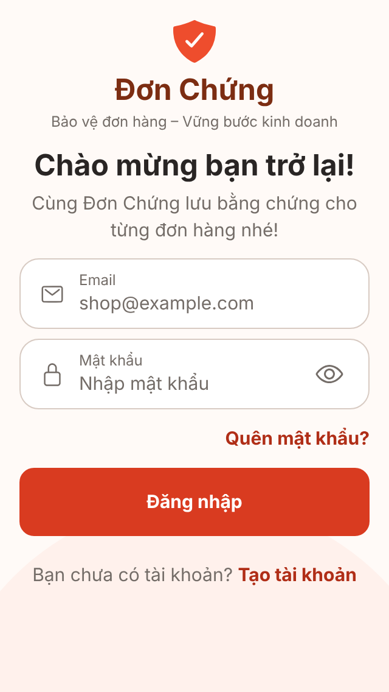
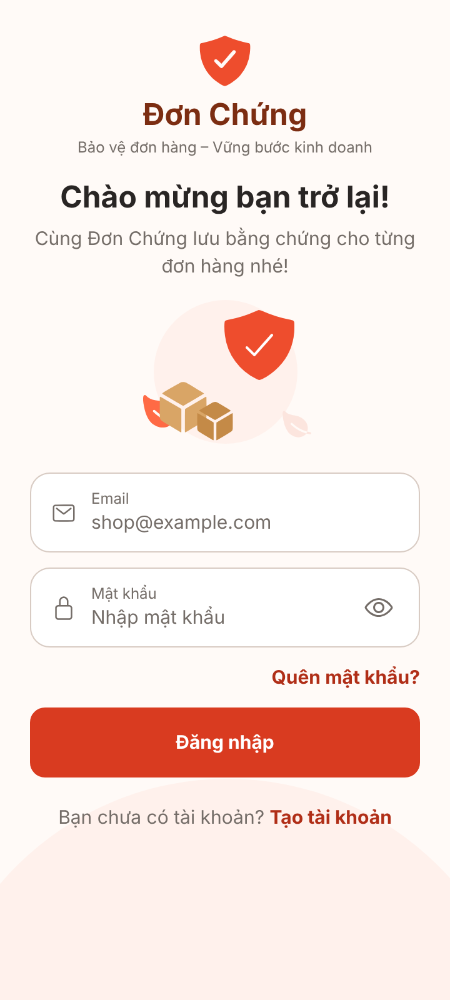
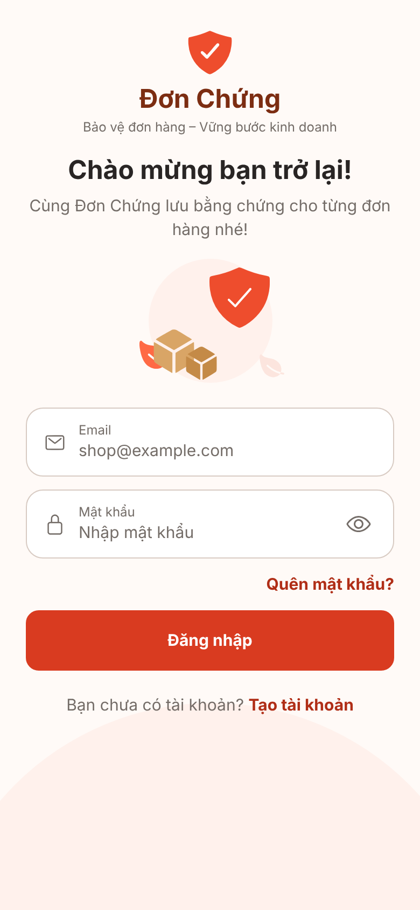

# Ảnh màn Đăng nhập (UI-A03) - rà soát, không đổi mã

**Ảnh bản web (react-native-web trong Chromium) với cổng giả, không phải ảnh iOS/Android; chưa kiểm chứng trên thiết bị.**

Chụp bằng `scripts/screens/capture.cjs`, phiên giả `signed_out`, `--sizes all`, route `/sign-in`, từ `main` tại `ea5e24b`. Chỉ có trạng thái mặc định; lỗi, đang xử lý và banner đặt lại mật khẩu được phủ bằng `SignInScreen.test.tsx`, chưa có ảnh.

Ở 320x568 ảnh minh họa tự ẩn để không cắt nội dung.

  
