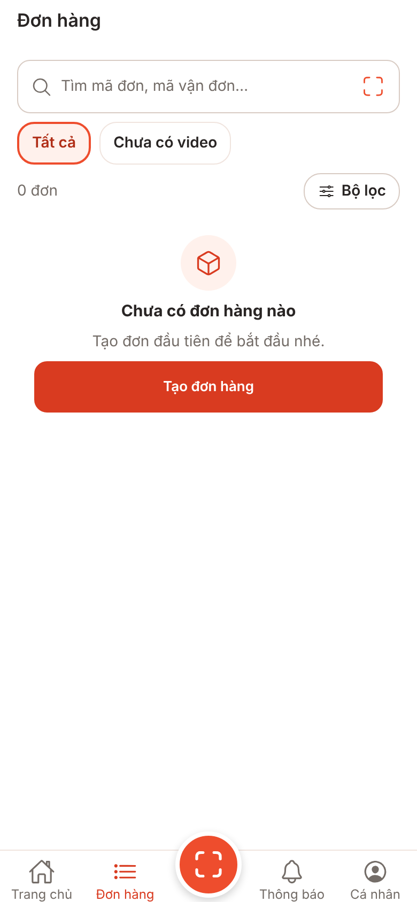
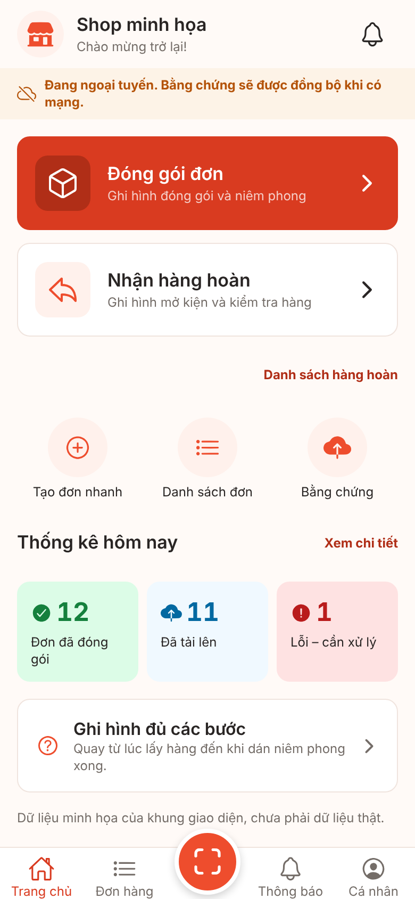
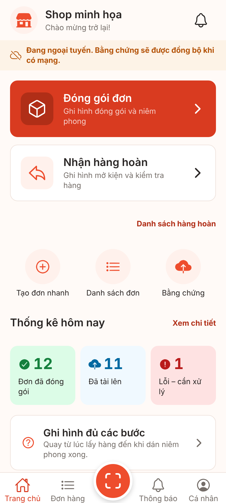
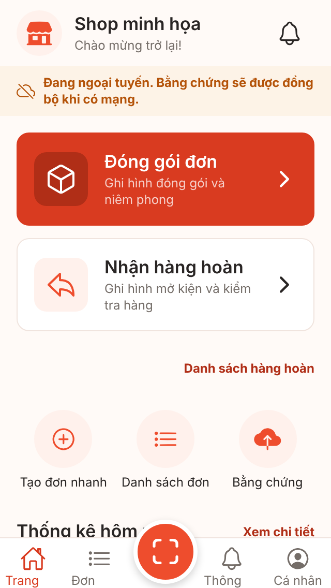
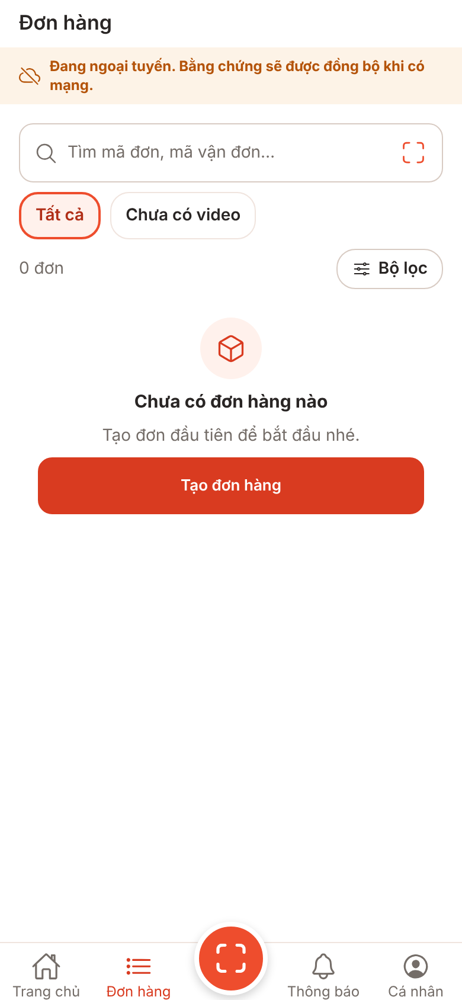
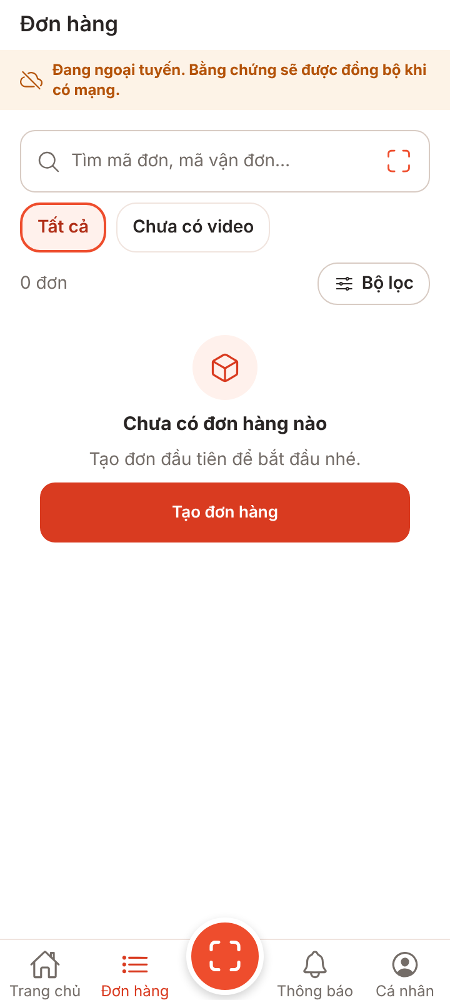
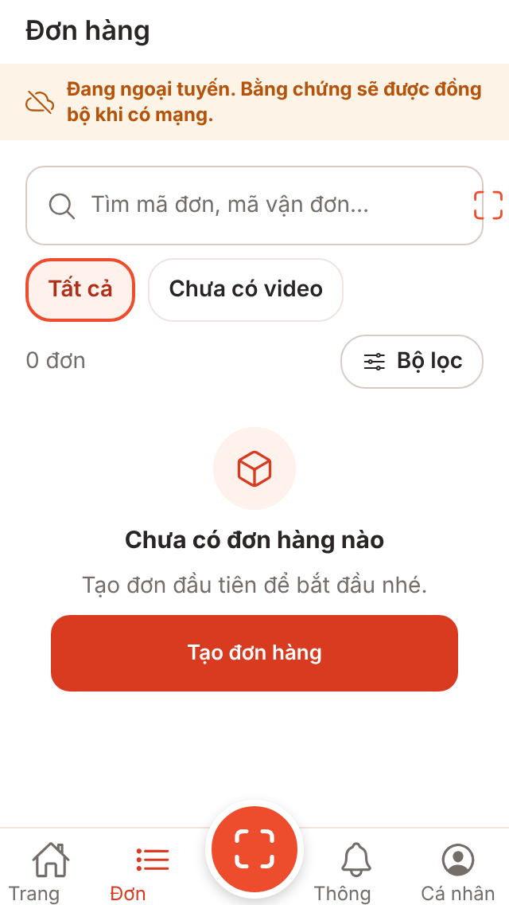

# V1-02 network-retry — ảnh màn hình

**Ảnh bản web (react-native-web trong Chromium), cổng giả, phiên `signed_in`. Không phải ảnh iOS/Android; chưa kiểm chứng trên thiết bị.** Font, bóng, vùng an toàn, chữ lớn hệ thống khác máy thật. Trang chủ vẫn là dữ liệu minh họa của khung giao diện (không thuộc PR này).

PR này **không đổi giao diện màn nào**. Thay đổi nhìn thấy được duy nhất: dải ngoại tuyến UI-F04 có sẵn (`OfflineBanner`, chữ `common:offline.banner` đã có) nay hiện thật khi máy mất mạng, vì `useIsOffline` đọc NetInfo thay vì luôn trả `false`.

## Cách chụp

1. `node scripts/screens/capture.cjs --work <thư mục tạm ngoài repo>/screens-work --out <thư mục ảnh> --port 5102 --routes "/=01-home-online,/orders=02-orders-online"` (xuất web + ảnh có mạng).
2. Ảnh mất mạng: script Playwright riêng (ngoài repo) phục vụ cùng bản xuất bằng `scripts/screens/serve.cjs`, tải trang khi có mạng, gọi `context.setOffline(true)` rồi phát sự kiện `change` trên `navigator.connection` (NetInfo bản web nghe sự kiện này trên Chromium; `setOffline` không tự phát), chờ 1,5 giây rồi chụp. **Không có thay đổi tạm nào trong mã app.**

## Ảnh

### Trang chủ (UI-B01), có mạng: không có dải ngoại tuyến

### Đơn hàng (UI-E01), có mạng

### Trang chủ, mất mạng: dải "Đang ngoại tuyến" (UI-F04)

### Đơn hàng, mất mạng: dải "Đang ngoại tuyến" (UI-F04)

## Ghi chú

- Ở 320x568, nút quét trong ô tìm kiếm tràn ra mép phải và nhãn thanh tab bị cắt: có sẵn từ trước (không do PR này), chỉ ghi lại để theo dõi.
- Trên thiết bị, NetInfo dùng `NWPathMonitor` (iOS) và `ConnectivityManager` (Android); hành vi đổi Wi‑Fi↔4G/5G, chế độ máy bay, Wi‑Fi không ra Internet chưa kiểm chứng (release-hardening-plan mục 9, bước 2).
