# Ảnh màn hình V1-03 auth-email-reset

**Ảnh bản web (react-native-web trong Chromium) với cổng giả, không phải ảnh iOS/Android; chưa kiểm chứng trên thiết bị.** Font, bóng, vùng an toàn, bàn phím, chữ lớn hệ thống khác thiết bị thật. Bản giả không gửi thư thật.

Cách chụp (`scripts/screens/capture.cjs`, phiên giả `signed_out`, 390x844 @2x; Quên mật khẩu thêm 320x568; Kiểm tra hộp thư thêm 320x568 và 360x800). Ảnh Quên mật khẩu và Kiểm tra hộp thư chụp lại sau review PR #47 (bố cục theo độ dài câu mô tả):

- "Trước": `--source origin/main` (`4e59fd3`).
- "Sau": `--source claude/v1-03-auth-email-reset`.
- **Thay đổi tạm, không commit** (chỉ cho ảnh Kiểm tra hộp thư, nhánh nháp `draft/v1-03-shots` không đẩy): `INITIAL_RECOVERY_STATE` trong `src/features/shop/domain/recovery-flow.ts` đặt sẵn `requestedEmail = 'lan.anh@example.com'` và `resendAvailableAt = Date.now() + 60 000`, như người dùng vừa bấm "Gửi email đặt lại" (vào thẳng `/forgot-password/sent` khi chưa gửi thì app chuyển về Quên mật khẩu). Đồng hồ đếm ngược trong ảnh là 00:56 vì công cụ chờ ~3,5 giây trước khi chụp.

Lệch có chủ đích (decisions.md `#### Q-29 / V1-03 — auth-email-reset`): ba màn khách đã xác nhận mất khối nút Apple/Google (cờ `SOCIAL_SIGN_IN_FLAGS` tắt, không sửa tệp màn); màn Quên mật khẩu giữ bố cục, đổi câu mô tả và nhãn nút cho đúng cách gửi thư.

## 1. Chào mừng (UI-A02)

Trước | Sau
---|---
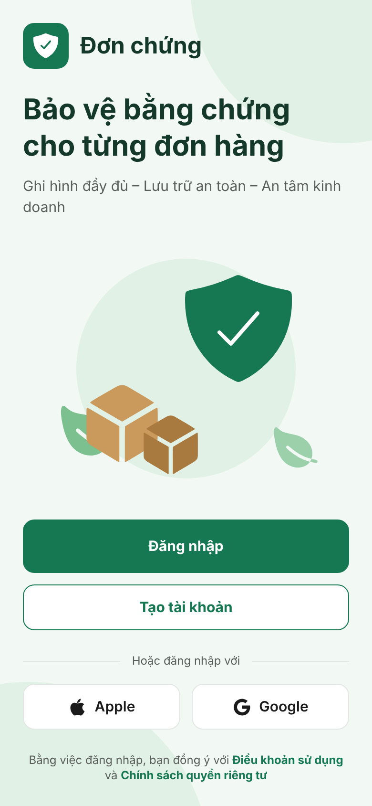 | 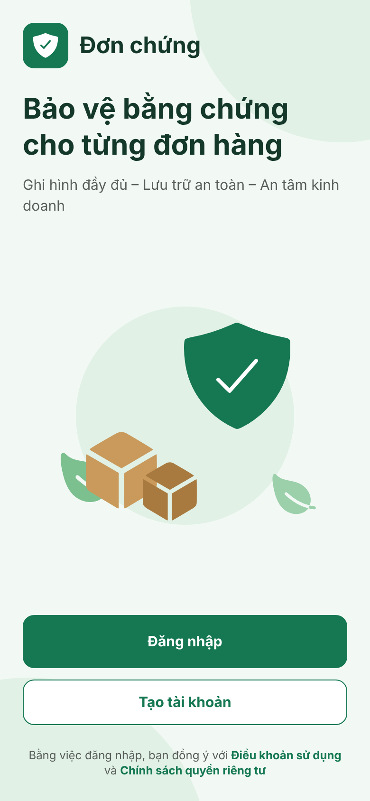

## 2. Đăng nhập (UI-A03)

Trước | Sau
---|---
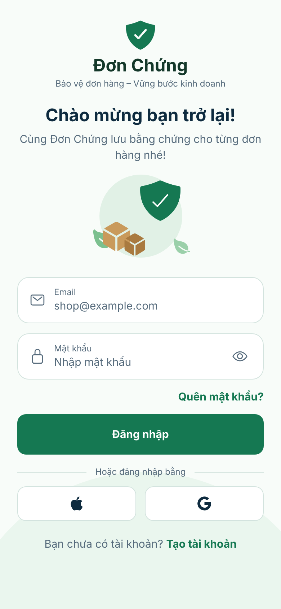 | 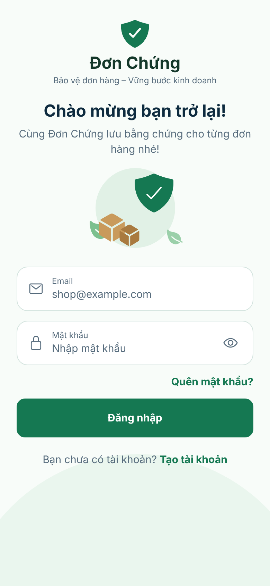

## 3. Đăng ký (UI-A03)

Trước | Sau
---|---
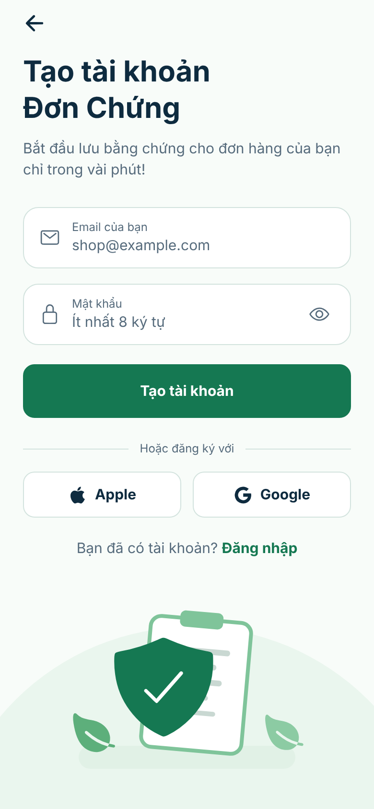 | 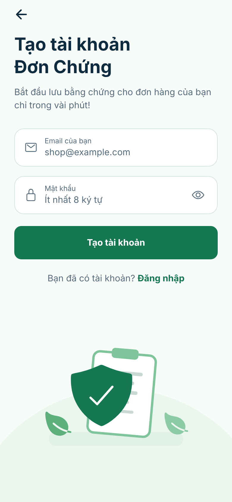

## 4. Quên mật khẩu (UI-A07)

Trước | Sau
---|---
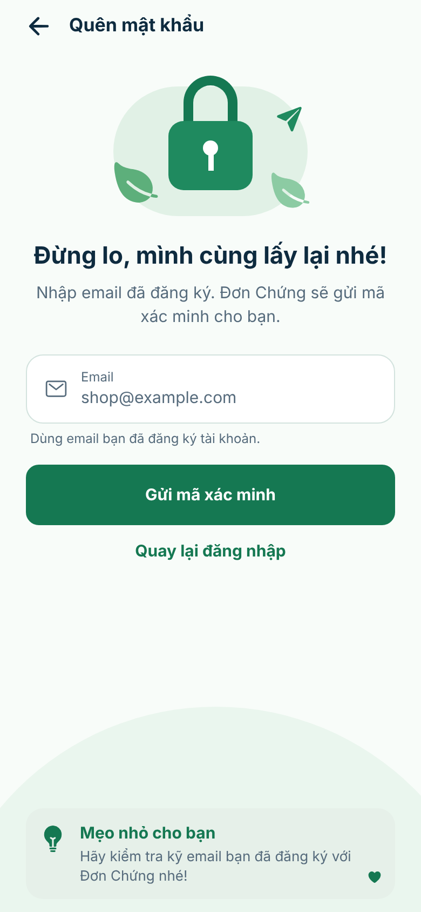 | 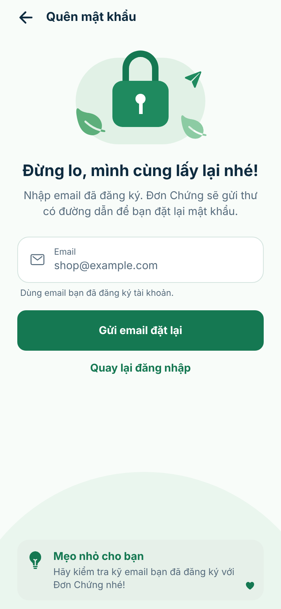
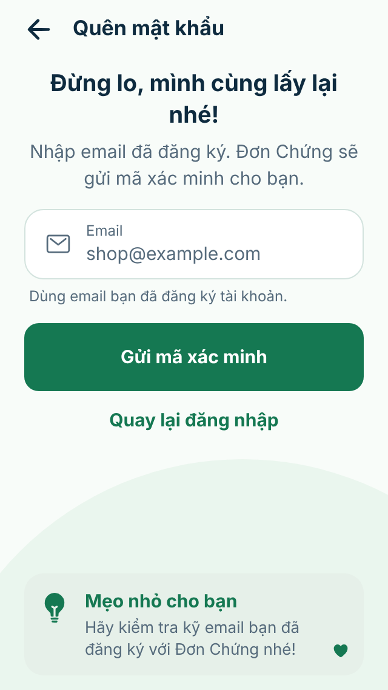 | 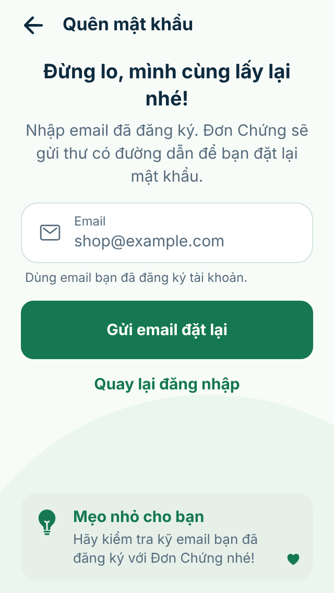

## 5. Kiểm tra hộp thư (UI-A07, `/forgot-password/sent`, màn mới)

390x844 | 360x800 | 320x568
---|---|---
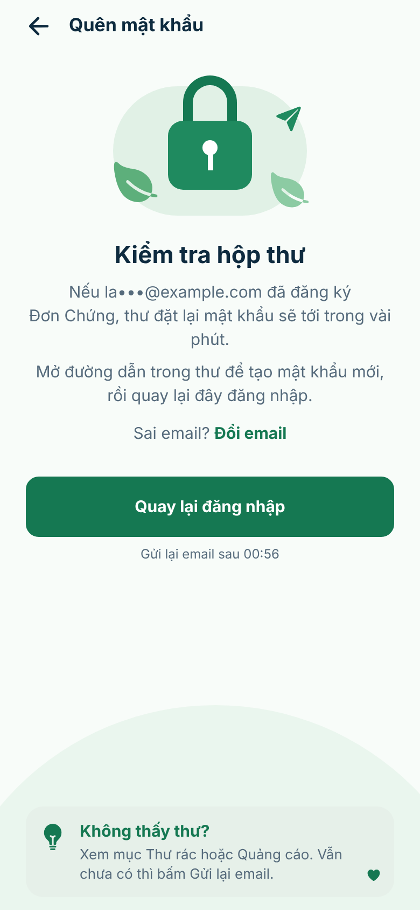 | 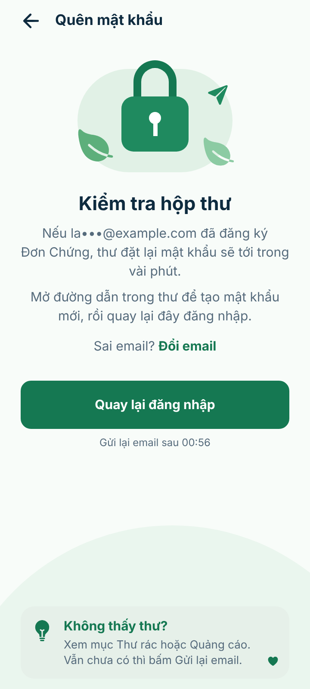 | 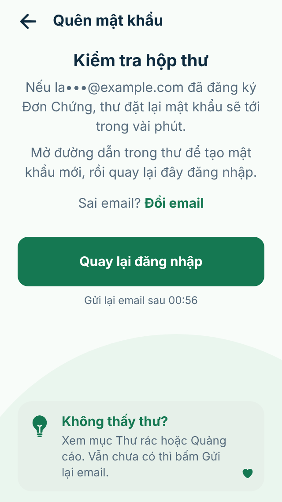
