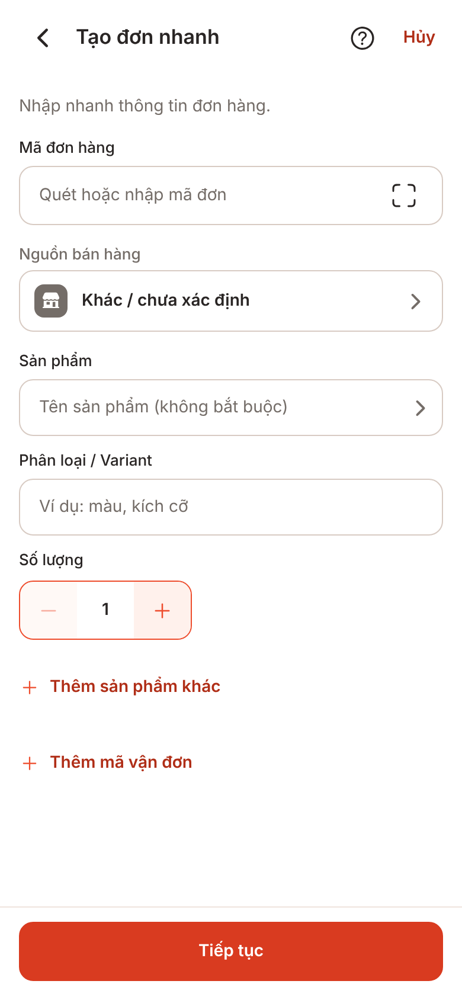
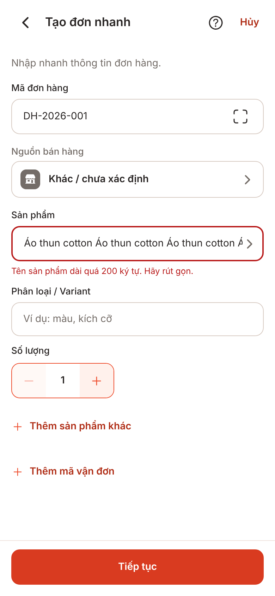
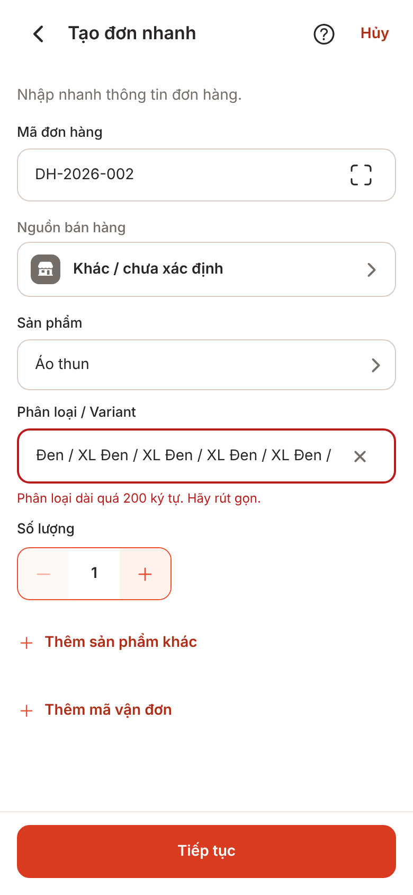
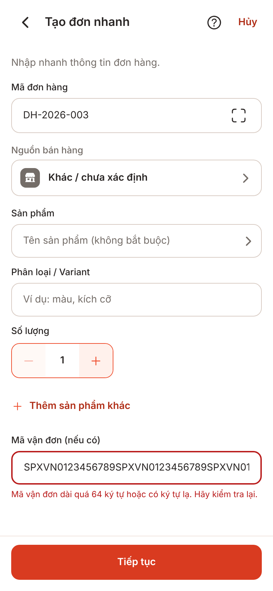

# V1-04 server-audit-rules: lời nhắc độ dài ở Tạo đơn nhanh (UI-B04)

**Ảnh bản web (react-native-web, cổng giả, kho bộ nhớ), không phải ảnh iOS/Android; chưa kiểm chứng trên thiết bị.** Font, bàn phím, vùng an toàn khác thiết bị thật.

| Ảnh | Trạng thái |
|---|---|
| `00-quick-order-390x844.png` | Màn Tạo đơn nhanh mới mở (không đổi giao diện) |
| `01-name-too-long-390x844.png` | Tên sản phẩm 201 ký tự, bấm Tiếp tục: lời nhắc ở ô Sản phẩm |
| `02-variant-too-long-390x844.png` | Phân loại 201 ký tự: lời nhắc ở ô Phân loại |
| `03-tracking-too-long-390x844.png` | Mã vận đơn 65 ký tự: lời nhắc ở ô Mã vận đơn |

Cách chụp: `node scripts/screens/capture.cjs --routes "/quick-order=00-quick-order"` (cổng 5104) để xuất bản web và chụp ảnh 00; ảnh 01–03 bằng một script Playwright tạm ngoài repo (gõ vào ô theo `data-testid`, bấm Tiếp tục) trên cùng bản xuất. Không có thay đổi mã tạm. Màn Sửa đơn (UI-E02) dùng cùng ô và lời nhắc, không chụp vì kho bộ nhớ của bản web không có đơn sẵn.

## Thư viện ảnh

| Tạo đơn nhanh | Tên sản phẩm quá dài | Phân loại quá dài | Mã vận đơn quá dài |
| --- | --- | --- | --- |
|  |  |  |  |
