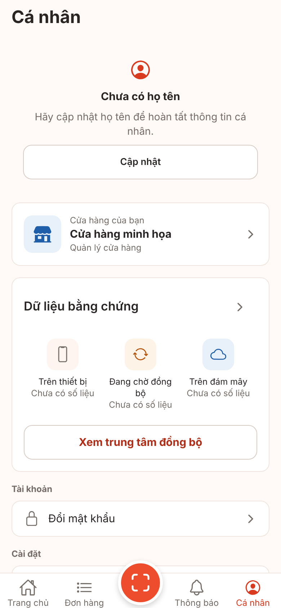
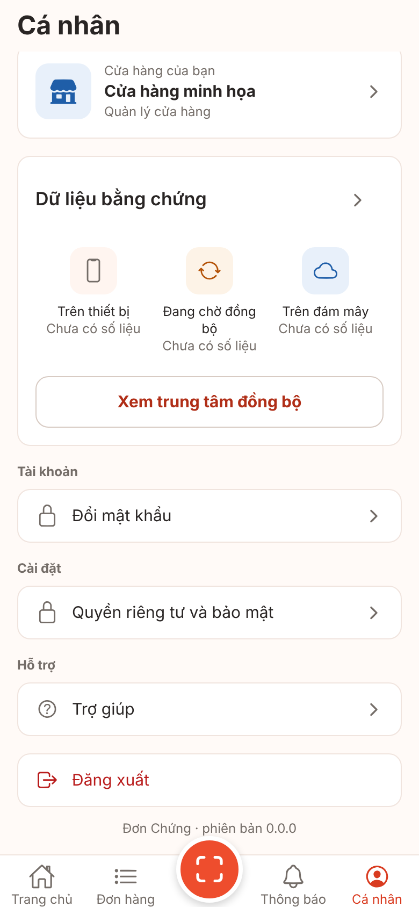
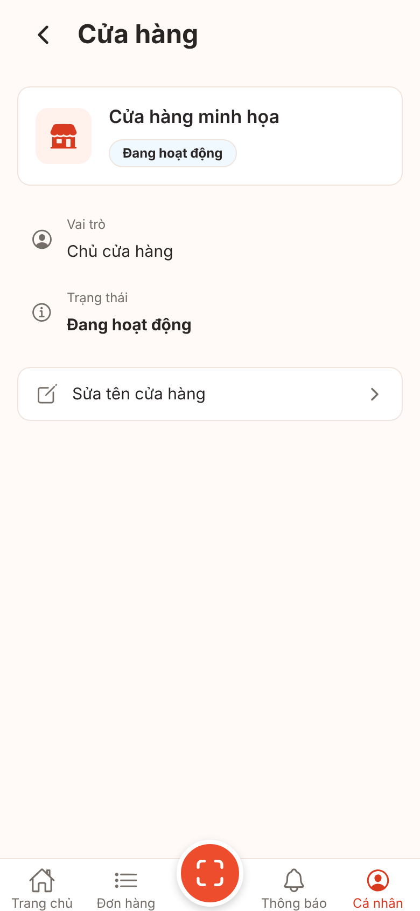
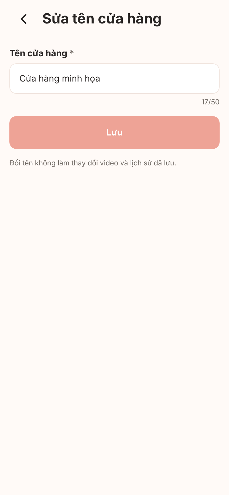
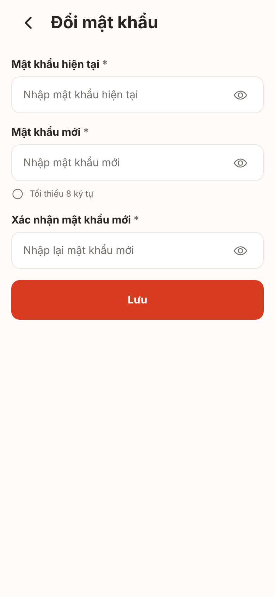
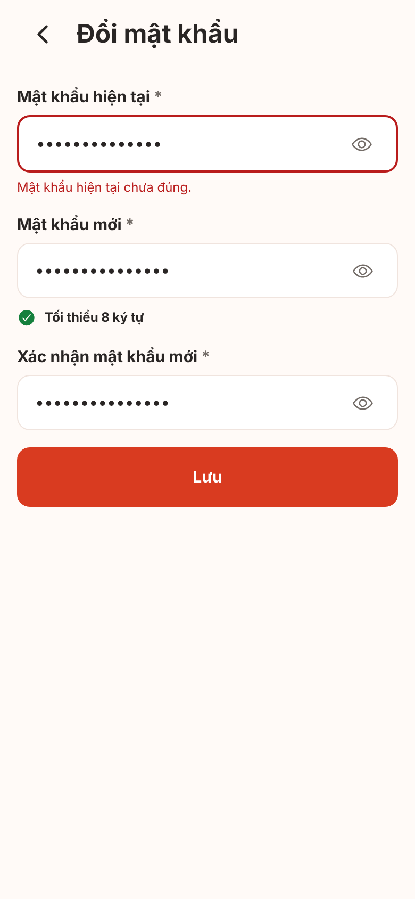
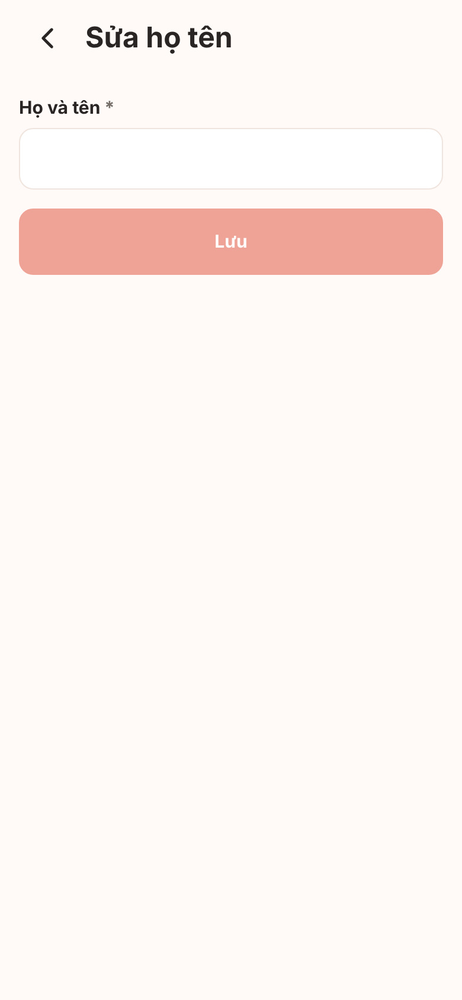

# V1-05 personal-firebase — ảnh màn hình

**Ảnh bản web (react-native-web trong Chromium) với cổng giả, không phải ảnh iOS/Android; chưa kiểm chứng trên thiết bị.** Font, bóng, vùng an toàn, bàn phím, chữ lớn hệ thống khác thiết bị thật. Phần nối Firebase thật của PR này (đổi mật khẩu, họ tên, danh sách/đổi tên cửa hàng) không hiện được ở bản web: các màn con dùng cổng giả và **giao diện không đổi** so với `main`; thay đổi nhìn thấy duy nhất là menu Cá nhân không còn "Cài đặt thông báo".

Cách chụp: `node scripts/screens/capture.cjs --port 5105 --routes "/account=01-ca-nhan,/account/shop-settings=02-cai-dat-cua-hang,/account/shop-settings/edit=03-sua-ten-cua-hang,/account/change-password=04-doi-mat-khau,/account/edit-profile=05-sua-ho-ten"` (phiên `signed_in`, 390x844 @2x). Hai ảnh `01b` (cuộn menu xuống cuối) và `04b` (nhập mật khẩu hiện tại sai rồi bấm Lưu; cổng giả trả `AUTH_WRONG_CURRENT_PASSWORD`, cùng mã mà bản Firebase ánh xạ từ `auth/wrong-password`/`auth/invalid-credential`) chụp bằng script Playwright ngoài repo trên cùng bản xuất. Không có thay đổi tạm trong mã.

## Cá nhân (đầu trang)

## Cá nhân (cuối trang): nhóm Cài đặt chỉ còn Quyền riêng tư và bảo mật

## Cài đặt cửa hàng (một cửa hàng, không có nút chuyển)

## Sửa tên cửa hàng

## Đổi mật khẩu

## Đổi mật khẩu: mật khẩu hiện tại sai

## Sửa họ tên

