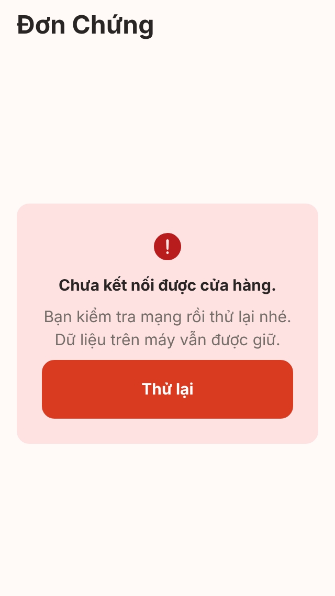
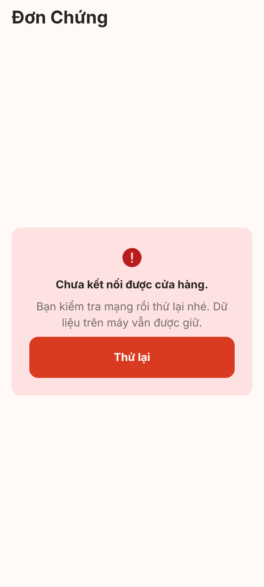
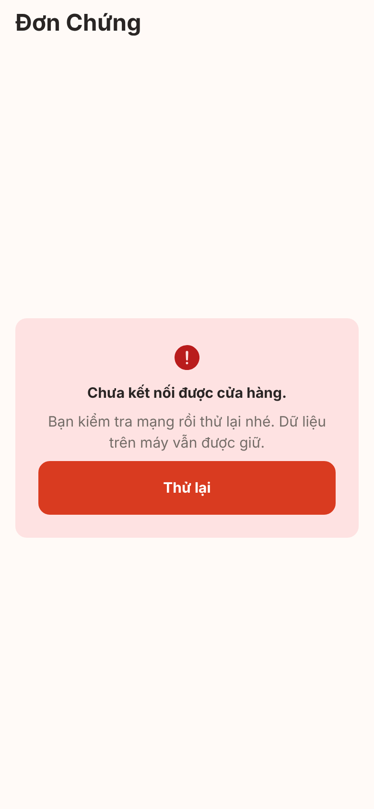

# Ảnh V1-06 session-guard (cổng phiên)

**Ảnh bản web (react-native-web trong Chromium) với cổng giả, không phải iOS/Android; chưa kiểm chứng trên thiết bị.** Chụp 2026-10-30 bằng `node scripts/screens/capture.cjs --sizes all --source tmp/v1-06-shots` (Playwright, hệ số 2). Font, vùng an toàn, Back phần cứng, chữ lớn hệ thống khác thiết bị thật. 0 lỗi trang.

**Thay đổi tạm (nhánh nháp cục bộ `tmp/v1-06-shots`, không commit vào PR, không đẩy):**

- `src/features/personal/data/session-mode.ts`: `requiresKnownShop()` trả `true` (ép chế độ chặt của bản Firebase trên bản web cổng giả).
- `src/features/personal/data/fake-personal-gateways.ts` `getSessionIdentity()`: tham số URL `?gate=fail` ném lỗi (giả lập offline lần đầu chưa có đệm `userShops`), `?gate=pending` treo (đang nạp). Không có tham số: trả danh tính giả có cửa hàng.

Trạng thái "chưa đăng nhập -> Chào mừng" và "chưa có cửa hàng -> Tạo cửa hàng" chỉ là điều hướng tới màn đã có (không có giao diện mới), kiểm bằng test router (`src/bootstrap/navigation/session-guard.test.tsx`), không chụp.

## 1. Chưa kết nối được cửa hàng (offline lần đầu), mở `/quick-order`

Không hiện Tạo đơn nhanh, không lưu được đơn dưới cửa hàng tạm. `/home` (nhóm tab) hiện **y hệt** ảnh này (không có thanh tab), nên không chụp riêng.

| 320x568 | 360x800 | 390x844 |
|---|---|---|
|  |  |  |

## 2. Đang nạp thông tin cửa hàng

Hiện trong lúc chờ phiên đã lưu trên máy (thường rất ngắn khi có bộ nhớ đệm) và khi người dùng bấm Thử lại.

## 3. Đã biết cửa hàng: Tạo đơn nhanh mở bình thường (không đổi giao diện)

