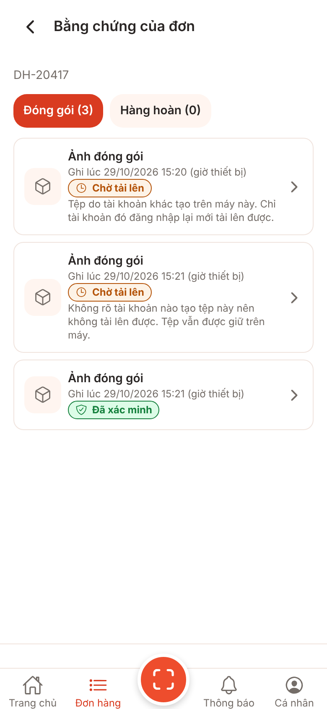
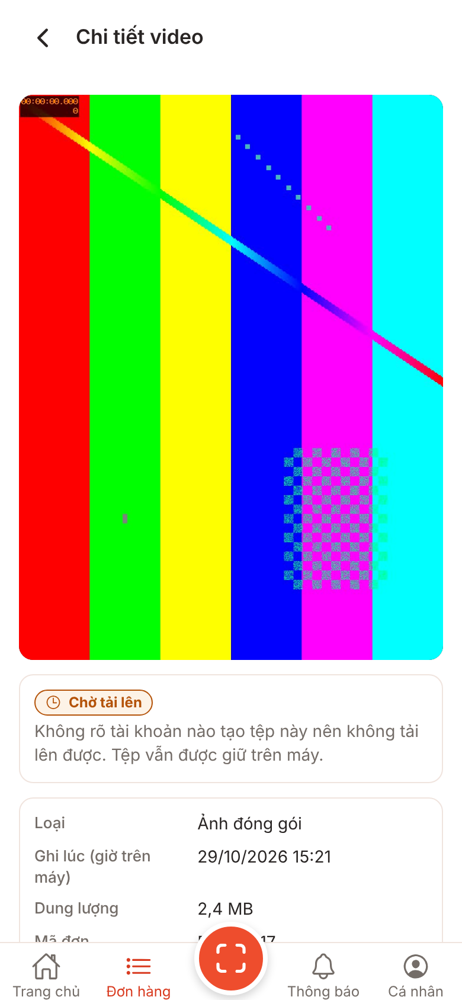

# Ảnh V1-07 uploader-identity: tệp do tài khoản khác tạo trên máy này

**Lưu ý trung thực:** ảnh bản web (react-native-web trong Chromium, 390x844 @2x) với cổng giả, **không phải ảnh iOS/Android**. **Chưa kiểm chứng trên thiết bị.**

Chụp bằng `node scripts/screens/capture.cjs --port 5107` (kế hoạch v1 mục 4) với dữ liệu mẫu tạm, không commit (như V1-17): đơn `DH-20417`, phiên `sess-other` do tài khoản `tai-khoan-khac` tạo, phiên `sess-unknown` không rõ người tạo; ba ảnh mẫu (sinh bằng `ffmpeg testsrc2`, không phải ảnh thật): ảnh `queued` của tài khoản khác, ảnh `uploading` không rõ tài khoản, ảnh `verified` của tài khoản khác. Kho đơn/kho tệp bộ nhớ được bọc tạm để trả các bản ghi này. Số liệu (2,4 MB, giờ) là dữ liệu mẫu.

Ảnh/video hàng hoàn (D03/D06/D07) dùng cùng nhãn và câu; có trong test (`ReturnPhotosSection.test.tsx`, `ReturnSummaryCards.video.test.tsx`), không chụp riêng.

## Ảnh

### UI-E03 Bằng chứng của đơn: tệp của tài khoản khác "Chờ tải lên" + lý do; tệp không rõ tài khoản (trạng thái `uploading`) cũng "Chờ tải lên", không "Đang tải lên"; tệp đã xác minh giữ nhãn, không có câu lý do

### UI-E04 Chi tiết bằng chứng, tệp do tài khoản khác tạo (tiêu đề vẫn "Chi tiết video", xem Q-29 / V1-17 mục 8)

### UI-E04 Chi tiết bằng chứng, tệp không rõ tài khoản tạo

