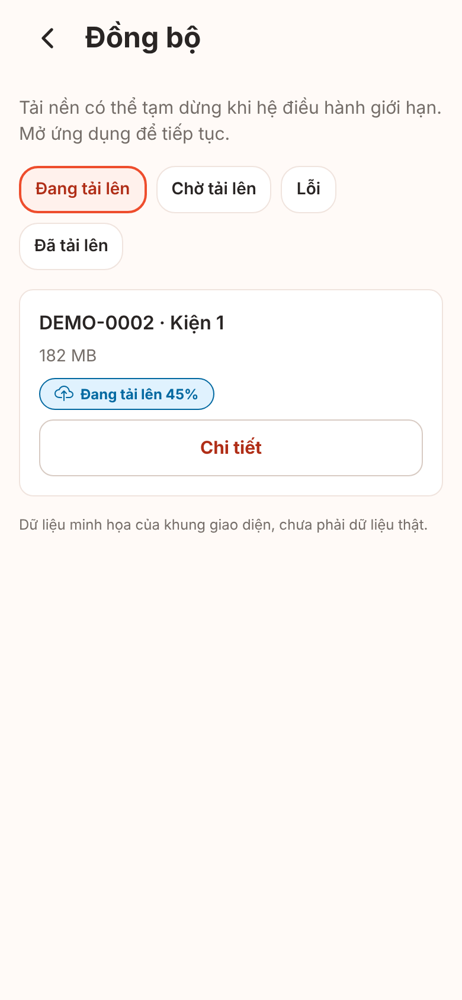
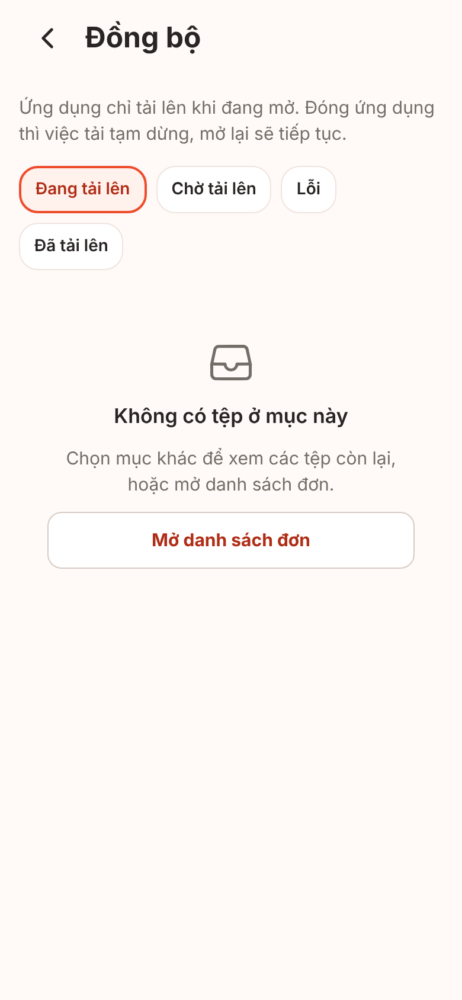
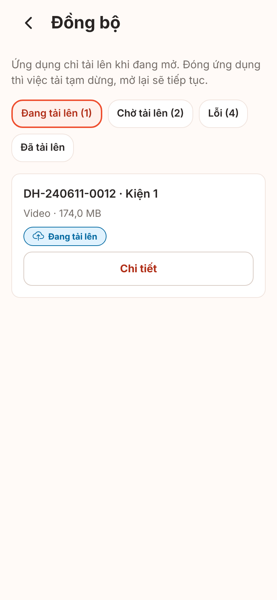
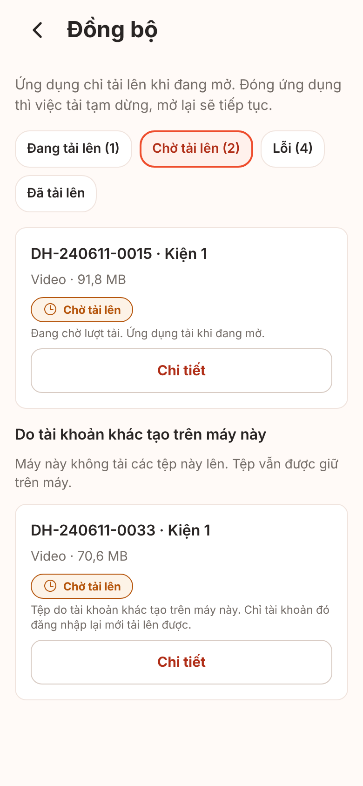
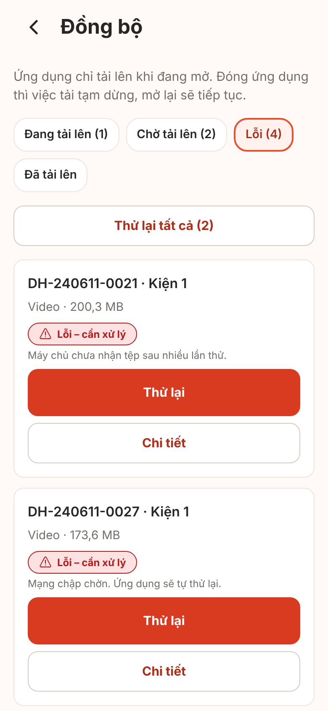
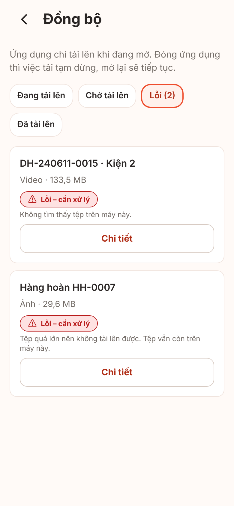
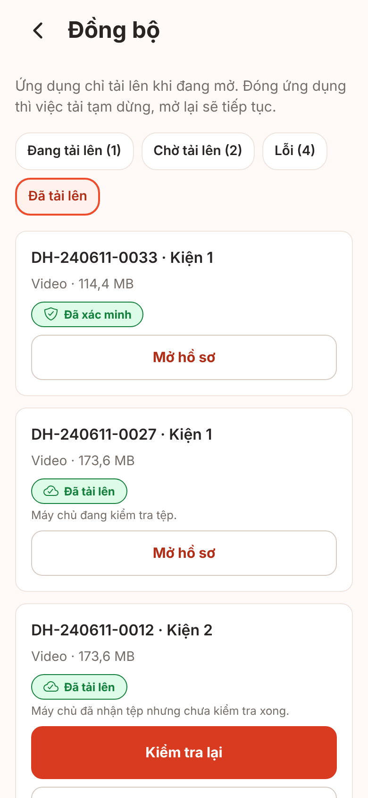
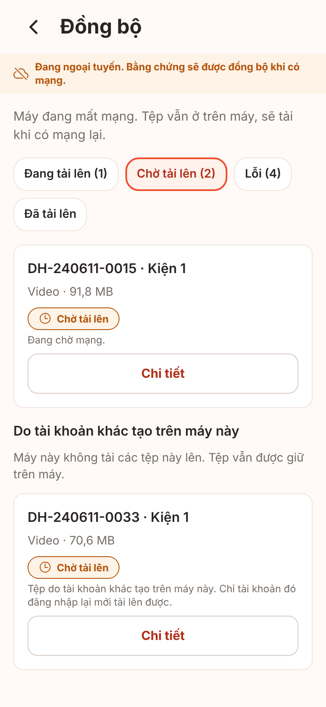
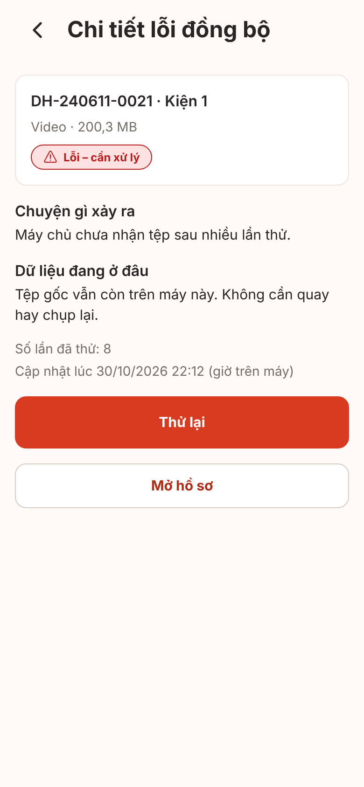
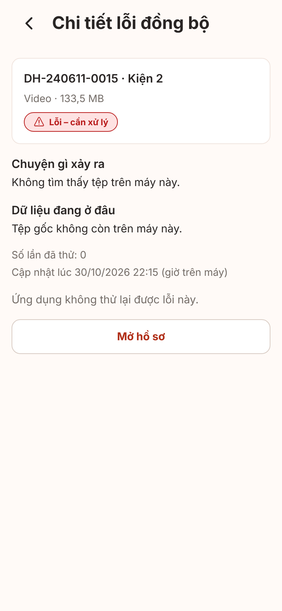

# Ảnh màn hình V1-08 sync-center (Trung tâm đồng bộ UI-F01, Chi tiết lỗi đồng bộ UI-F02)

**Ảnh bản web (react-native-web trong Chromium), cổng giả. Không phải ảnh iOS/Android, chưa kiểm chứng trên thiết bị.** Font, bóng, vùng an toàn, Back phần cứng, chữ lớn hệ thống khác thiết bị thật (kế hoạch v1 mục 4.2). Cỡ 390x844 @2x.

Cách chụp: `node scripts/screens/capture.cjs --routes-file <tệp route> --source <nhánh nháp> --port 5108` (V1-00).

**Thay đổi tạm KHÔNG commit** (trên nhánh nháp đã xóa sau khi chụp), vì bản web không có SQLite/Firebase/NetInfo thật:

- `src/features/upload/ui/demo-sync-stores.ts`: khi URL có `?demo=1`, thay kho đọc của Trung tâm đồng bộ bằng dữ liệu mẫu (mã đơn `DH-240611-…`, hồ sơ hàng hoàn `HH-0007`, không phải dữ liệu khách): một tệp đang tải; hai tệp chờ tải (một của tài khoản khác); lỗi máy chủ từ chối (`PERMISSION_DENIED`), lỗi mạng (`TIMEOUT`), tệp mất (`FILE_MISSING`), ảnh hàng hoàn quá lớn (`UPLOAD_FILE_TOO_LARGE`); tệp đã tải lên 40 phút (có Kiểm tra lại), 2 phút, đã xác minh. `&only=local` chỉ giữ lỗi cục bộ. uid đang đăng nhập ép thành giá trị mẫu.
- `SyncCenterScreen.tsx`: bộ lọc ban đầu đọc từ `?f=` (máy chụp không bấm chip được).
- `src/platform/connectivity.ts`: `?offline=1` báo mất mạng.

Ảnh "trước" lấy từ mốc V1-00 (`v1-00-baseline/04-sync-390x844.png`).

## UI-F01 trước PR (dữ liệu minh họa "DEMO-0002")

## UI-F01 máy chưa có tệp (trạng thái rỗng, câu "chỉ tải khi đang mở")

## UI-F01 Đang tải lên

## UI-F01 Chờ tải lên, nhóm "Do tài khoản khác tạo trên máy này" (không có nút)

## UI-F01 Lỗi: lỗi máy chủ và lỗi mạng có Thử lại, Thử lại tất cả

## UI-F01 Lỗi của chính tệp (tệp mất, ảnh quá lớn): không có Thử lại

## UI-F01 Đã tải lên: Kiểm tra lại cho tệp máy chủ nhận lâu chưa xác minh

## UI-F01 mất mạng

## UI-F02 lỗi máy chủ (có Thử lại)

## UI-F02 lỗi cục bộ: tệp không còn trên máy (không có Thử lại)

