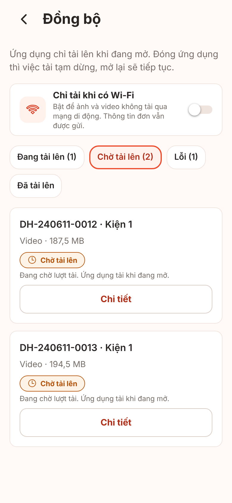
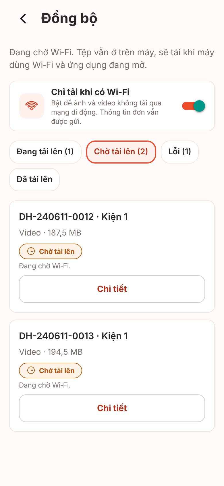
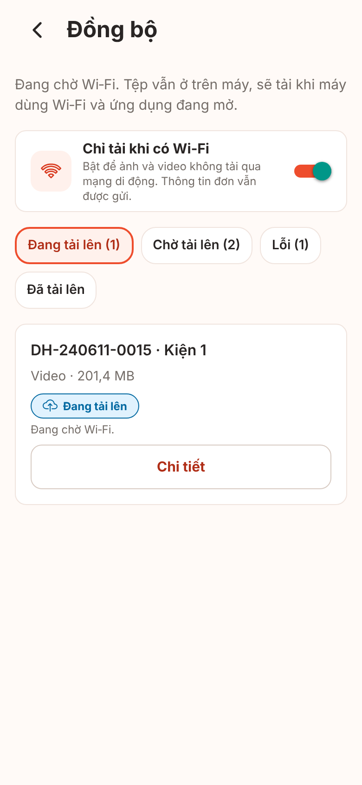
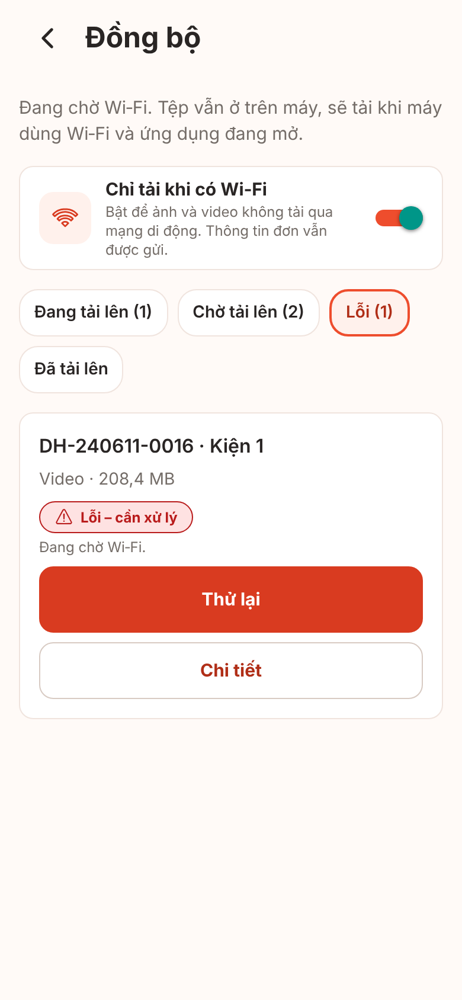
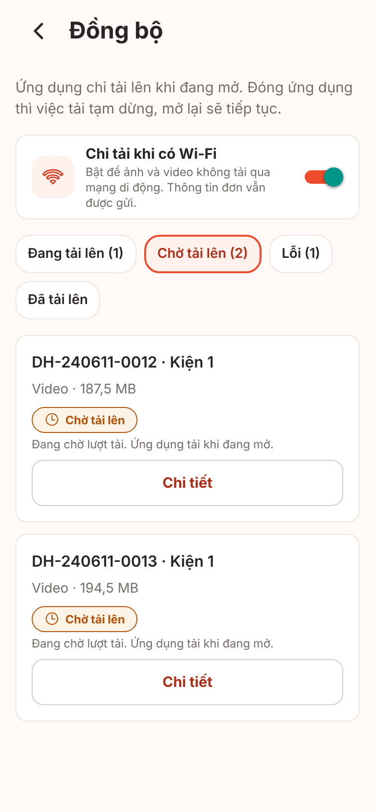
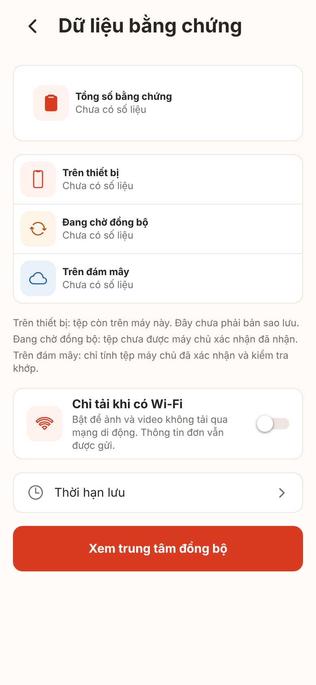
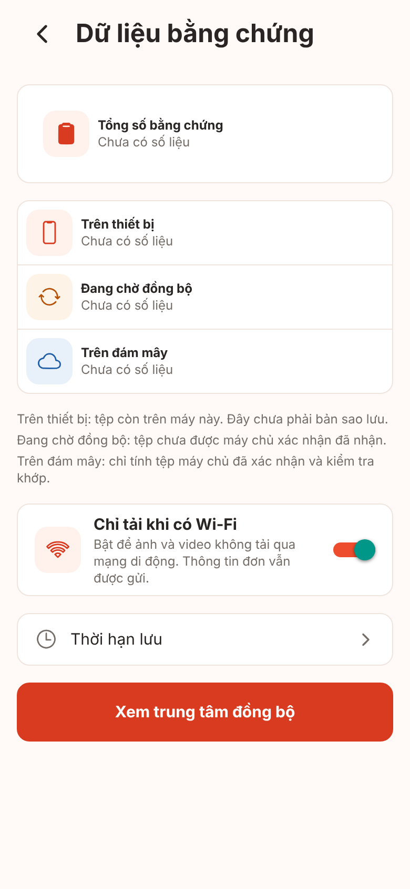

# Ảnh màn hình V1-09 wifi-only (công tắc "Chỉ tải khi có Wi‑Fi")

**Ảnh bản web (react-native-web trong Chromium), cổng giả. Không phải ảnh iOS/Android, chưa kiểm chứng trên thiết bị.** Font, bóng, vùng an toàn, màu công tắc native, chữ lớn hệ thống khác thiết bị thật (kế hoạch v1 mục 4.2). Cỡ 390x844 @2x.

Cách chụp: `node scripts/screens/capture.cjs --routes-file <tệp route> --source <nhánh nháp> --port 5109` (V1-00).

**Thay đổi tạm KHÔNG commit** (trên nhánh nháp đã xóa sau khi chụp), vì bản web không có SQLite/NetInfo thật:

- `src/platform/connectivity.ts`: `?net=cellular` / `?net=wifi` ép loại mạng.
- `src/features/orders/data/device-settings-store.ts`: `?wifiOnly=1` đặt sẵn công tắc bật trong kho bộ nhớ.
- `src/features/upload/ui/use-sync-jobs.ts`: `?demo=1` thay kho đọc của Trung tâm đồng bộ bằng dữ liệu mẫu (mã đơn `DH-240611-…`, không phải dữ liệu khách): hai video chờ tải, một video `uploading` còn lại từ lần trước, một video lỗi mạng; uid ép thành giá trị mẫu.
- `SyncCenterScreen.tsx`: bộ lọc ban đầu đọc từ `?f=`.

## UI-F01 công tắc tắt (mặc định, luôn tải kể cả 4G/5G)

## UI-F01 công tắc bật, máy đang dùng mạng di động: "Đang chờ Wi‑Fi"

## UI-F01 chờ Wi‑Fi, tệp còn dở từ lần trước (nhãn trạng thái tệp giữ nguyên, lý do "Đang chờ Wi‑Fi.")

## UI-F01 chờ Wi‑Fi, bộ lọc Lỗi (vẫn có Thử lại)

## UI-F01 công tắc bật, máy đang dùng Wi‑Fi (tải bình thường)

## Dữ liệu bằng chứng (route con UI-I01): công tắc tắt

## Dữ liệu bằng chứng: công tắc bật

