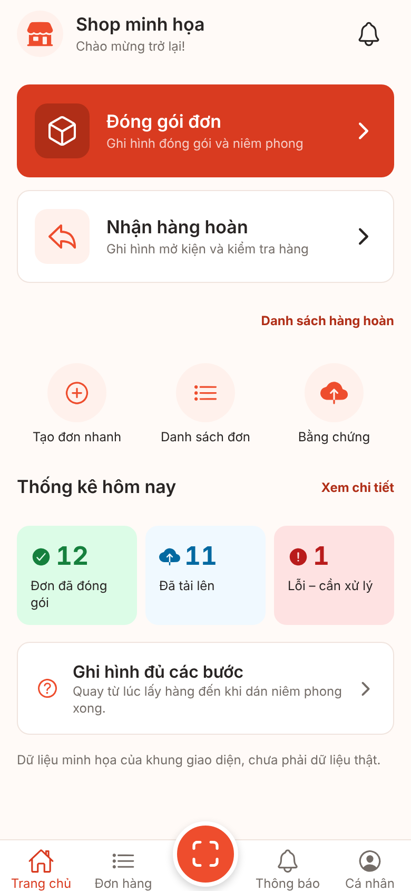
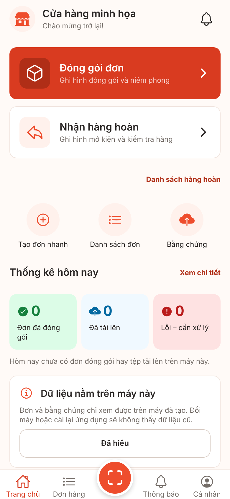
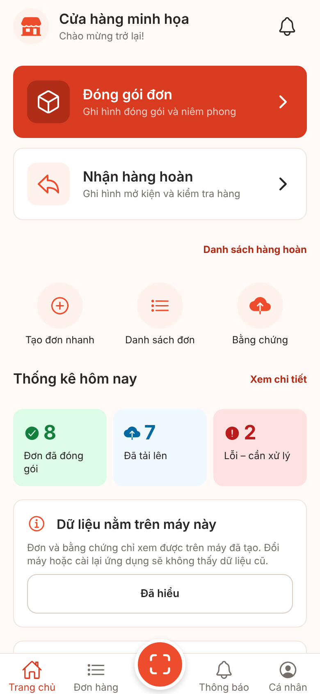
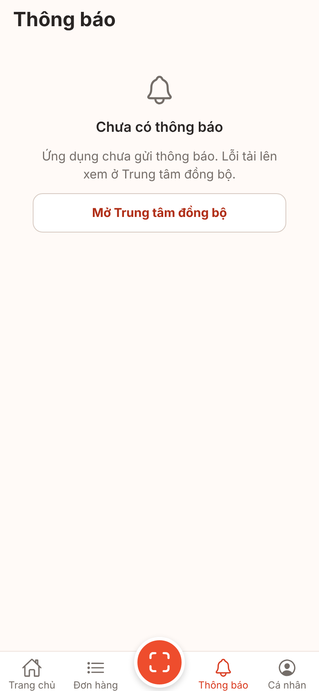
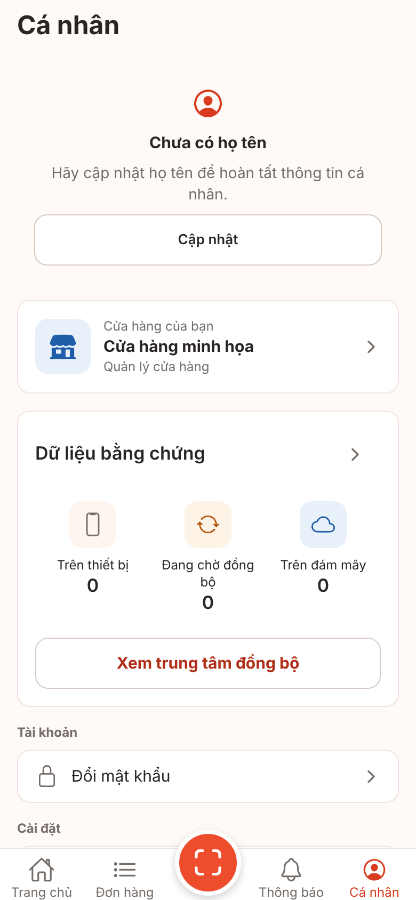
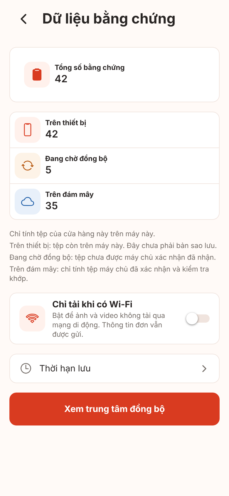

# Ảnh màn hình V1-10 home-real-data (Trang chủ UI-B01, Thông báo UI-I07, Dữ liệu bằng chứng UI-I01)

**Ảnh bản web (react-native-web trong Chromium), cổng giả. Không phải ảnh iOS/Android, chưa kiểm chứng trên thiết bị.** Font, bóng, vùng an toàn, Back phần cứng, chữ lớn hệ thống khác thiết bị thật (kế hoạch v1 mục 4.2). Cỡ 390x844 @2x.

Cách chụp: `node scripts/screens/capture.cjs --routes-file <tệp route> --source <ref> --port 5110` (V1-00), phiên giả `signed_in`.

- Ảnh "máy trống" (01, 03, 04): chụp đúng mã của nhánh, không thay đổi tạm. Kho bộ nhớ của bản web rỗng.
- Tên cửa hàng "Cửa hàng minh họa" là tên của **cổng giả** (dev/test), không phải dữ liệu minh họa trong app: bản Firebase hiện tên cửa hàng thật của tài khoản.

**Thay đổi tạm KHÔNG commit** cho ảnh "có dữ liệu" (02, 05, 06), trên nhánh nháp đã xóa sau khi chụp, vì bản web không có SQLite thật:

- `src/features/upload/ui/use-evidence-stats.ts`: khi URL có `?demo=1`, thay các hàm đếm của kho bằng số mẫu: 8 đơn đã đóng gói hôm nay; hôm nay máy chủ đã nhận 1 tệp `uploaded` + 5 `verified` + 1 ảnh hàng hoàn `verified`; hai tệp lỗi (`needs_attention`, `hash_mismatch`); tổng trên máy: `queued` 2, `uploading` 1, `uploaded` 2, `verified` 31, `needs_attention` 1 và ảnh hàng hoàn `verified` 4, `queued` 1. Phần còn lại (phân loại, cộng số, hiển thị) chạy mã thật.

Ảnh "trước" lấy từ mốc V1-00: [Trang chủ](../v1-00-baseline/01-home-390x844.png), [Cá nhân](../v1-00-baseline/03-account-390x844.png), [Thông báo](../v1-00-baseline/07-notifications-390x844.png).

## Trước PR (mốc V1-00): "Shop minh họa", số 12/11/1, dải "Dữ liệu minh họa…"

## Trang chủ, máy trống: số 0 thật, câu rỗng, thẻ "Dữ liệu nằm trên máy này"

## Trang chủ có dữ liệu (số mẫu tạm, xem trên)

## Tab Thông báo: trạng thái rỗng trung thực, mở Trung tâm đồng bộ

## Cá nhân, máy trống: thẻ Dữ liệu bằng chứng có số thật (0)

## Cá nhân có dữ liệu: trên thiết bị / đang chờ đồng bộ / trên đám mây (chỉ tệp đã xác minh)

## Màn Dữ liệu bằng chứng có dữ liệu

