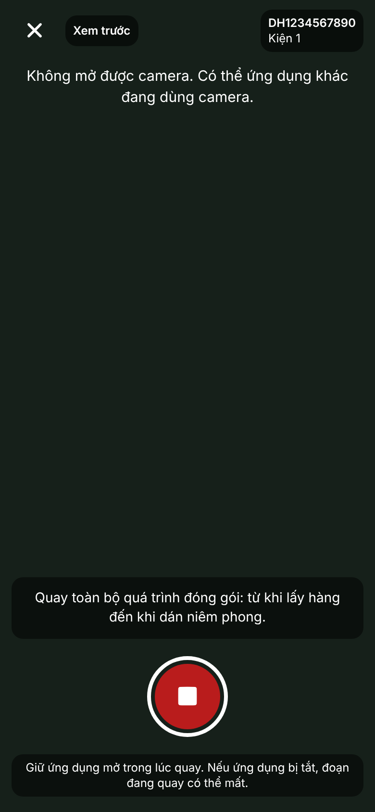
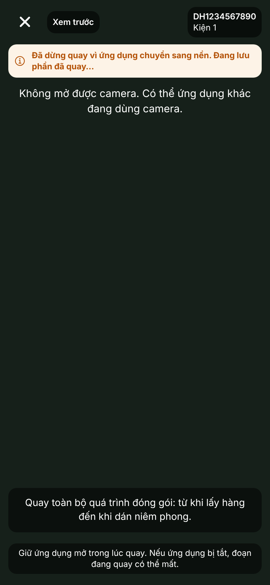
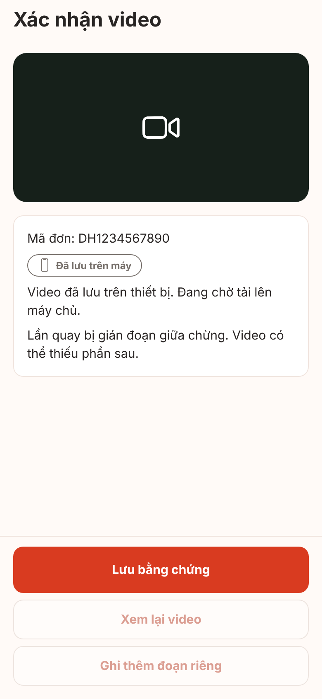
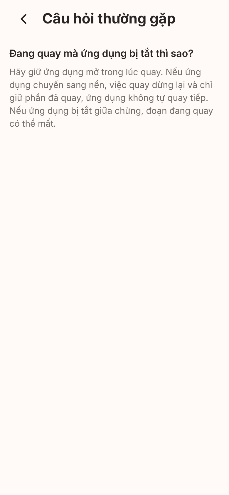

# Ảnh màn hình V1-11 recording-hardening (UI-C03, UI-C04, Trợ giúp UI-I06)

**Ảnh bản web (react-native-web trong Chromium), cổng giả. Không phải ảnh iOS/Android, chưa kiểm chứng trên thiết bị.** Web không có camera nên màn quay chỉ hiện khung "Không mở được camera" thay cho hình xem trước; không quay được, không vào nền được thật. Font, bóng, vùng an toàn, Back phần cứng, chữ lớn hệ thống khác thiết bị thật (kế hoạch v1 mục 4.2). Cỡ 390x844 @2x.

Cách chụp: `node scripts/screens/capture.cjs --routes-file <tệp route> --source <nhánh nháp> --port 5111 --env EXPO_PUBLIC_RECORDER_ENABLED=1` (V1-00), phiên giả `signed_in`. Cờ ghi video bật để hiện màn ghi thật (`PackRecordLive`): dòng chú thích Q-24b chỉ hiện ở chế độ ghi thật.

**Thay đổi tạm KHÔNG commit** (nhánh nháp đã xóa sau khi chụp), vì kho bộ nhớ của bản web rỗng và không mô phỏng được app vào nền:

- `src/features/packing/ui/demo-seed.ts` (tệp tạm): tạo đơn mẫu `DH1234567890` (1 kiện) và phiên `created`; với `?demo=1` ở UI-C04, đưa phiên qua `recording` → `interrupted` và tạo một tệp video ở `queued` (đã lưu trên máy).
- `PackRecordScreen.tsx`, `use-pack-session.ts`: có `?demo` thì đọc phiên từ `demo-seed` thay vì tham số `sessionId`.
- `PackRecordLive.tsx`: `?demo=bg` đặt sẵn pha "đang lưu" và cờ "đã dừng vì vào nền" (thay cho việc phát sự kiện `background` thật).

Phần còn lại (khung quay, chữ, nhãn trạng thái tệp, câu cảnh báo theo trạng thái phiên) chạy mã thật của nhánh.

## UI-C03 màn quay (ghi thật bật): dòng "Giữ ứng dụng mở trong lúc quay…" dưới nút dừng

## UI-C03 sau khi app vào nền lúc đang quay: dải "Đã dừng quay vì ứng dụng chuyển sang nền. Đang lưu phần đã quay…"

Khi quay lại app còn có toast "Đã dừng quay vì ứng dụng chuyển sang nền. Ứng dụng không tự quay tiếp." (không chụp: cần sự kiện AppState thật).

## UI-C04 phiên bị gián đoạn: "Lần quay bị gián đoạn giữa chừng. Video có thể thiếu phần sau."

## Trợ giúp: bài hỏi đáp "Đang quay mà ứng dụng bị tắt thì sao?"

UI-D04 (video mở kiện hàng hoàn) dùng cùng khung `RecordingFrame` và cùng câu chữ; không chụp riêng.
