# Ảnh màn hình V1-15 account-delete-client (Xóa tài khoản, Đang hoàn tất xóa tài khoản)

**Ảnh bản web (react-native-web trong Chromium), cổng giả. Không phải ảnh iOS/Android, chưa kiểm chứng trên thiết bị.** Font, bóng, vùng an toàn, bàn phím, Back phần cứng, chữ lớn hệ thống khác thiết bị thật (kế hoạch v1 mục 4.2). Cỡ 390x844 @2x, khung nhìn (không phải cả trang; ảnh "bottom" là cùng màn đã cuộn xuống).

Cách chụp: xuất web bằng `node scripts/screens/capture.cjs --source <nhánh nháp> --port 5115` (V1-00), rồi một kịch bản Playwright ngoài repo bấm qua luồng trên chính bản xuất đó (tích "Tôi hiểu và đồng ý", bấm "Xóa tài khoản", nhập mật khẩu). Mật khẩu của cổng giả: sai bất kỳ -> "Mật khẩu hiện tại chưa đúng."; `demo-matmang-1` -> mô phỏng mất mạng trước khi gửi (`FAKE_DELETE_OFFLINE_PASSWORD`); `demo-chuaro-1` -> mô phỏng máy chủ đã xóa nhưng mất phản hồi (`FAKE_DELETE_UNCONFIRMED_PASSWORD`); `demo-matkhau-1` -> xóa thành công.

Ảnh 08b, 09, 09b, 09d chụp lại sau review PR #61 (câu "chưa rõ", câu riêng của màn Đang hoàn tất).

**Thay đổi tạm KHÔNG commit** (nhánh nháp đã xóa sau khi chụp), vì bản web không có SQLite/kho tranh chấp có dữ liệu: `use-account-deletion.ts` đọc `?demoUnsynced=`, `?demoDisputes=`, `?demoForeign=` từ URL để thay số tệp chưa tải, số hồ sơ tranh chấp mở và số bản ghi của tài khoản khác. Màn "Đang hoàn tất xóa tài khoản" mở thẳng bằng đường dẫn `/create-shop/deletion-pending` (trên app chỉ vào khi máy chủ trả `account_deleted`).

## Điều kiện đạt (mục "chủ cửa hàng" chỉ là Lưu ý, không chặn)

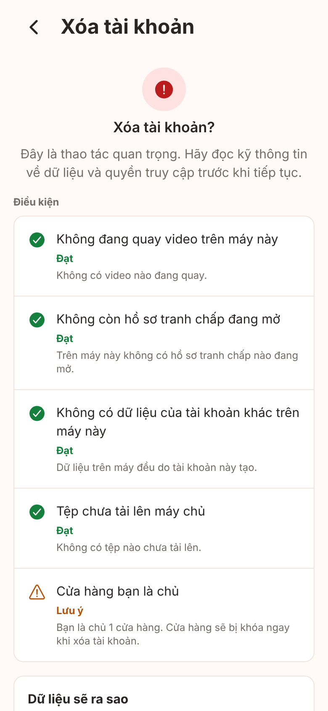

## Đã tích "Tôi hiểu và đồng ý": nút Xóa tài khoản bật, khối "Dữ liệu sẽ ra sao" có câu chung 30 ngày

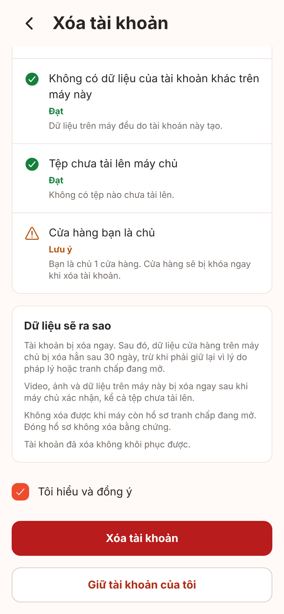

## Chặn: còn hồ sơ tranh chấp mở trên máy

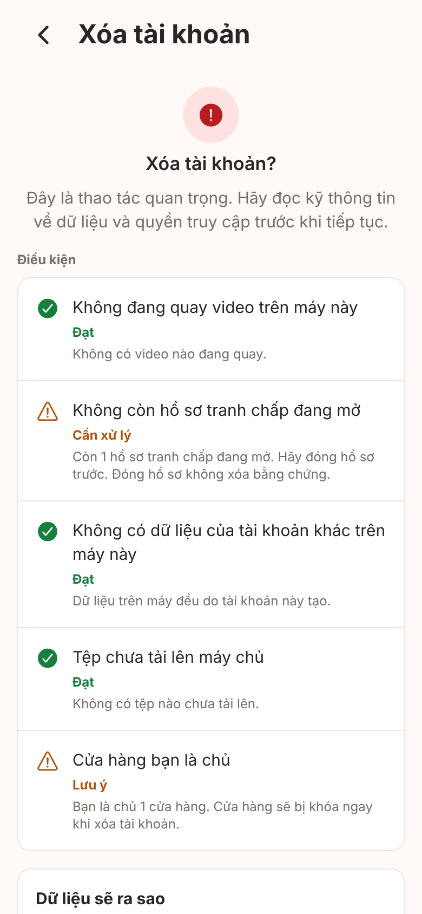

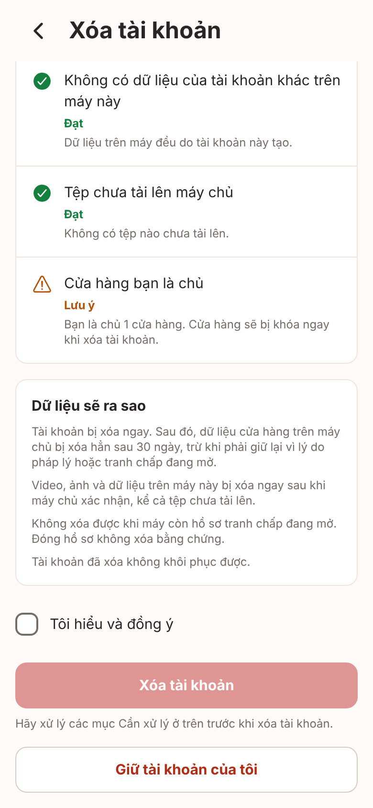

## Chặn: máy còn dữ liệu của tài khoản khác

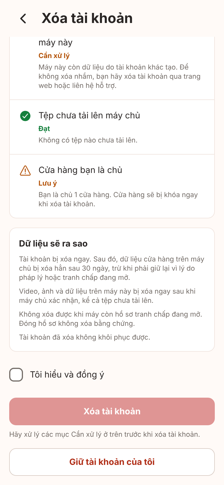

## Cảnh báo tệp chưa tải: tích xác nhận riêng

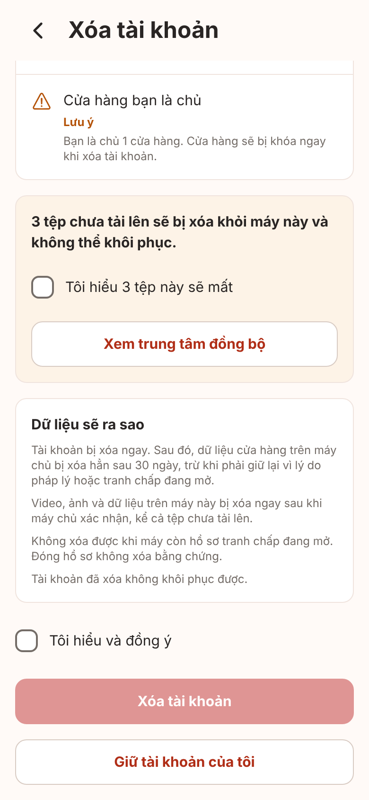

## Bước nhập mật khẩu

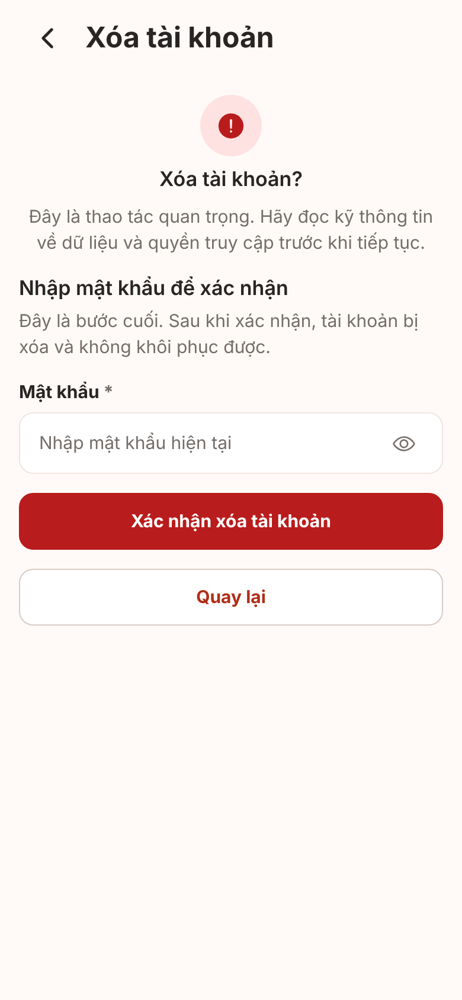

## Sai mật khẩu

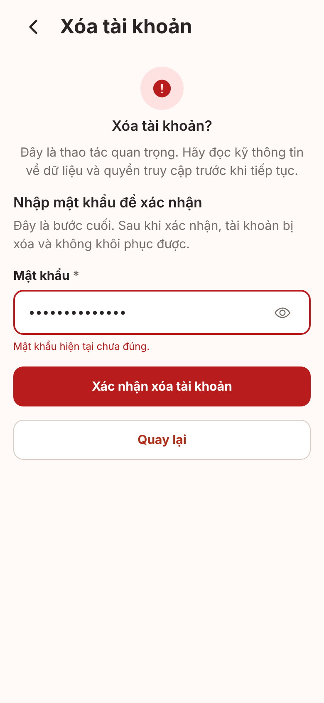

## Lỗi mạng: "Chưa có gì bị xóa"

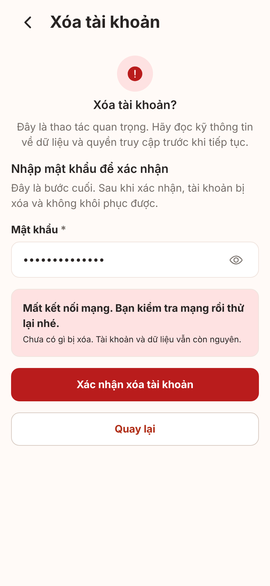

## Đã gửi mà không rõ kết quả: "Chưa rõ tài khoản đã xóa xong chưa", KHÔNG nói "Chưa có gì bị xóa" (review PR #61)

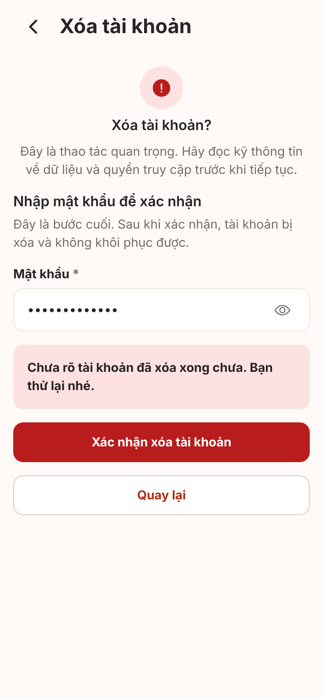

## Máy chủ đã xác nhận: lớp phủ "Đang xóa dữ liệu trên máy này"

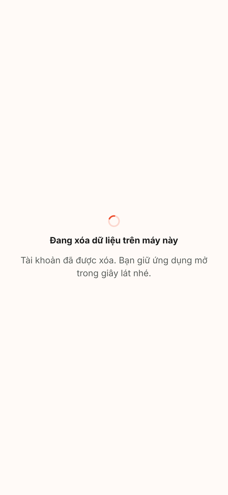

## Về Chào mừng với thông báo đã xóa (màn Chào mừng không đổi giao diện; thông báo là toast phía trên)

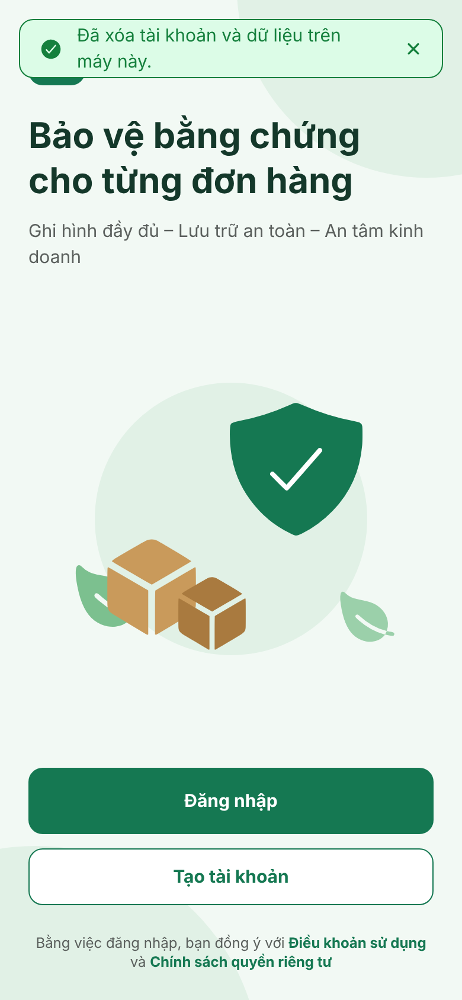

## Đang hoàn tất xóa tài khoản (xóa dở dang)

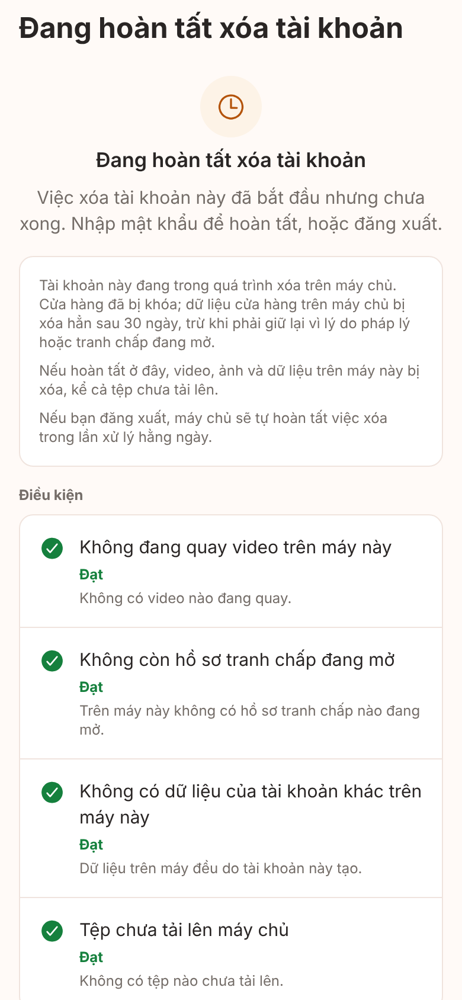

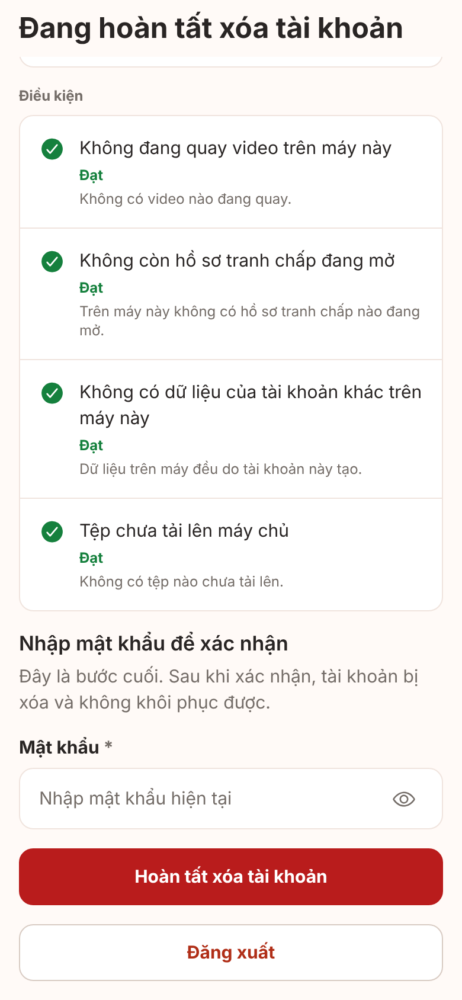

## Đang hoàn tất xóa tài khoản khi còn tranh chấp mở: dữ liệu trên máy được giữ lại, liên hệ hỗ trợ, vẫn đăng xuất được (review PR #61)

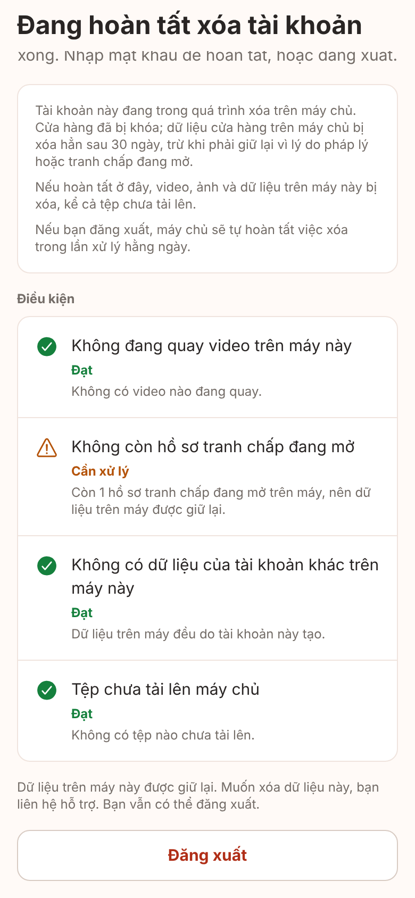
