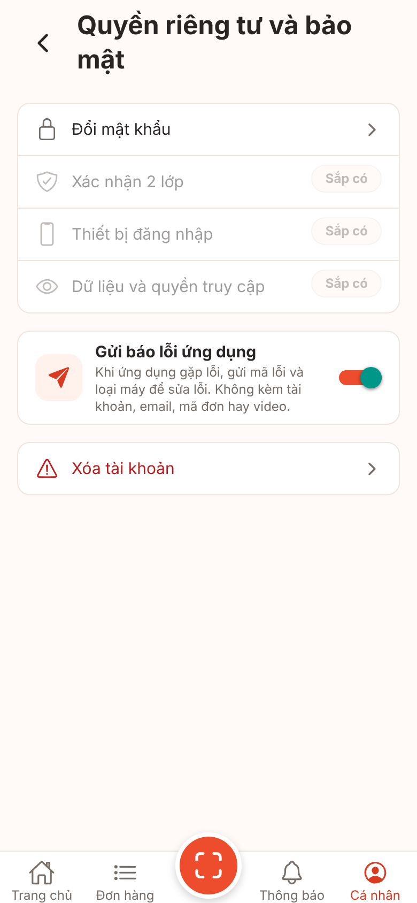
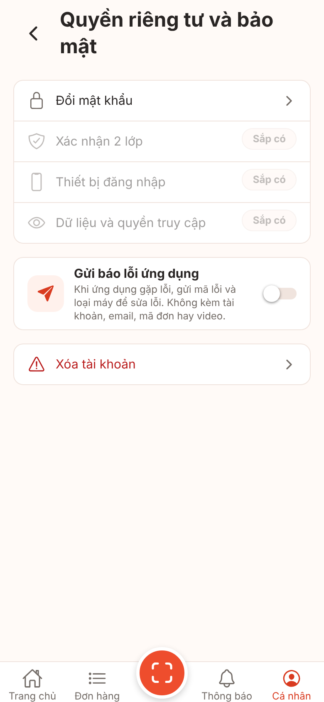

# Ảnh màn hình V1-16 crashlytics (công tắc "Gửi báo lỗi ứng dụng")

**Ảnh bản web (react-native-web trong Chromium), cổng giả. Không phải ảnh iOS/Android, chưa kiểm chứng trên thiết bị.** Font, bóng, vùng an toàn, màu công tắc native (nút gạt xanh là mặc định của react-native-web), chữ lớn hệ thống khác thiết bị thật (kế hoạch v1 mục 4.2). Cỡ 390x844 @2x. Bản web không có Crashlytics: ảnh chỉ cho thấy giao diện công tắc.

Cách chụp: `node scripts/screens/capture.cjs --routes-file <tệp route> --source <nhánh nháp> --port 5116` (V1-00).

**Thay đổi tạm KHÔNG commit** (trên nhánh nháp đã xóa sau khi chụp), vì bản web dùng kho cài đặt trong bộ nhớ (mặc định bật):

- `src/features/orders/data/device-settings-store.ts`: `?crash=0` đặt sẵn `privacy.crash_reports = false` trong kho bộ nhớ.

Chỉ đổi màn UI-I05 (thêm một nhóm có công tắc giữa nhóm bảo mật và nhóm Xóa tài khoản); không đổi màn nào khác.

## UI-I05 Quyền riêng tư và bảo mật: công tắc bật (mặc định)

## UI-I05 Quyền riêng tư và bảo mật: công tắc tắt

