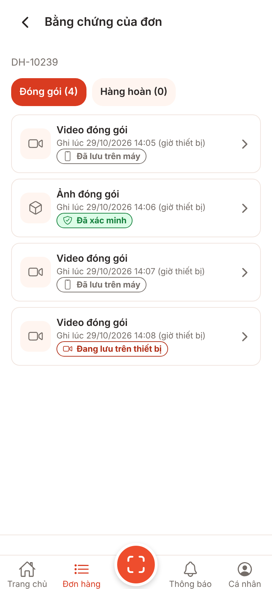
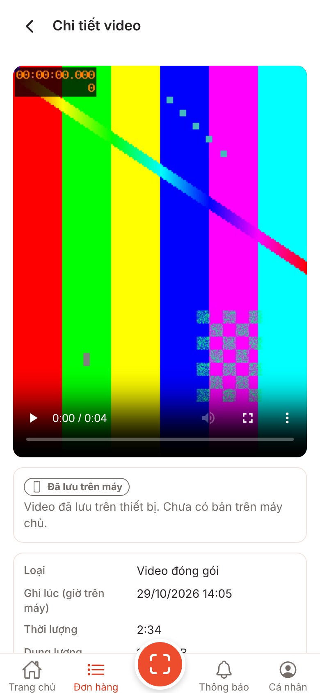
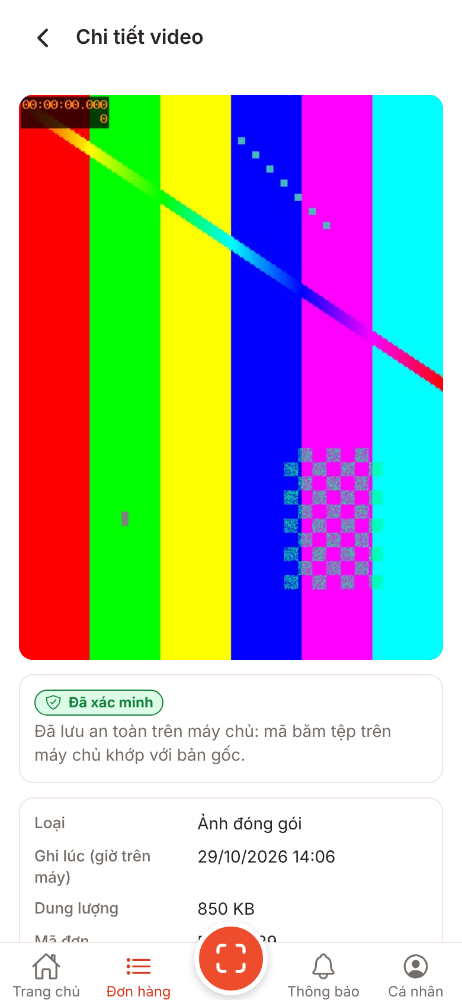
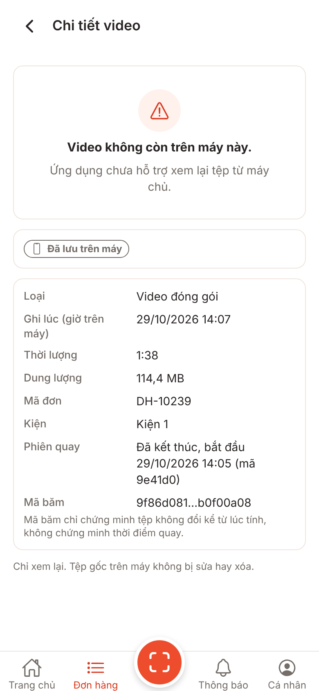
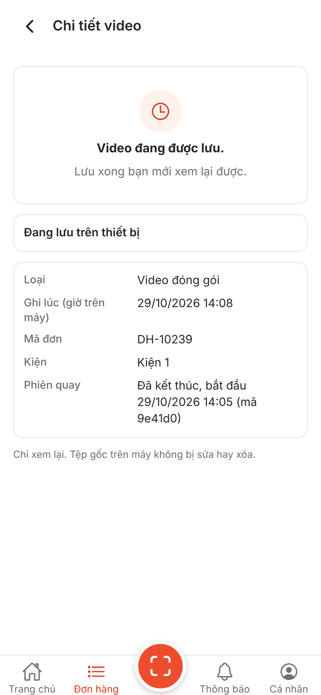
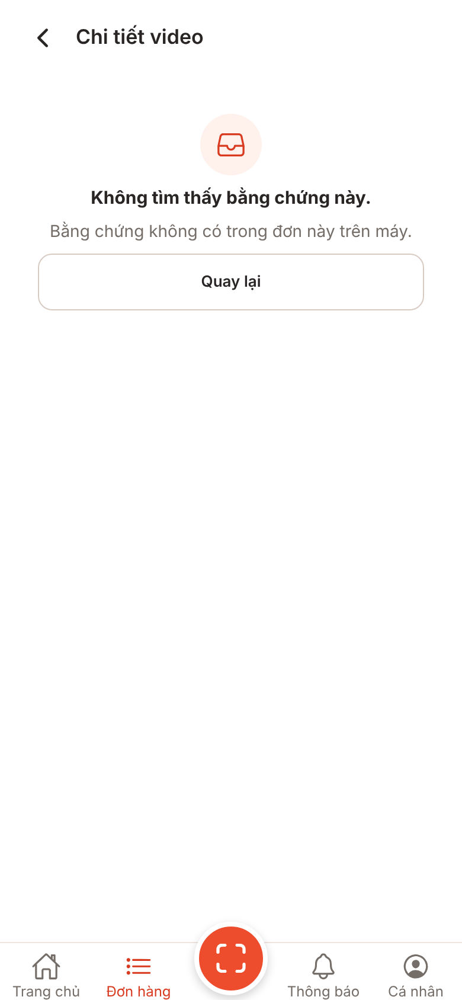

# Ảnh V1-17 local-playback: Chi tiết bằng chứng (UI-E04) và lối vào từ Bằng chứng của đơn (UI-E03)

**Lưu ý trung thực:** ảnh bản web (react-native-web trong Chromium, 390x844 @2x) với cổng giả, **không phải ảnh iOS/Android**. Trên web `expo-video` dùng thẻ `<video>` của trình duyệt (thanh điều khiển của Chromium); trên iOS/Android là thanh điều khiển của AVPlayer/ExoPlayer, khác hình dạng. **Chưa kiểm chứng trên thiết bị** (phát video dài, tua, toàn màn hình, xoay, máy yếu).

Chụp bằng `node scripts/screens/capture.cjs --source <nhánh nháp> --port 5117` (kế hoạch v1 mục 4).

## Thay đổi tạm (chỉ trên nhánh nháp, không commit, không đẩy)

Web dùng kho bộ nhớ rỗng và không có hệ tệp của app, nên để có dữ liệu:

1. `src/features/orders/data/shots-seed.ts` (tạm): đơn mẫu `DH-10239` (ID `order-shots`, Kiện 1, phiên "Đã kết thúc") và bốn tệp mẫu: video `queued` (có tệp), ảnh `verified` (có tệp), video `queued` nhưng tệp đã mất, video `saving_local`. Kho đơn/kho tệp bộ nhớ được bọc để trả các bản ghi này cho shop hiện tại.
2. `src/platform/recording-files.ts` (tạm): đường dẫn `evidence/demo*` coi là còn trên máy và trỏ tới `/shots/...`.
3. `public/shots/demo.webm`, `demo.jpg` (tạm): hình mẫu sinh bằng `ffmpeg testsrc2` (không phải video thật; webm vì Chromium của Playwright không có H.264).

Số liệu (182,4 MB, 2:34, mã băm) là dữ liệu mẫu, không phải đo từ tệp.

## Ảnh

### UI-E03 Bằng chứng của đơn: mỗi mục có mũi tên, chạm để mở UI-E04

### UI-E04 video còn trên máy: trình phát + nhãn "Đã lưu trên máy" (thông tin tệp nằm dưới, cuộn xuống; bố cục giống ảnh 04)

### UI-E04 ảnh đã xác minh (tiêu đề vẫn "Chi tiết video", chờ BA đổi, decisions Q-29 / V1-17 mục 8)

### UI-E04 tệp không còn trên máy: nói thẳng, không hứa xem từ máy chủ; thông tin tệp, liên kết đơn/kiện/phiên, mã băm rút gọn và câu giới hạn của mã băm

### UI-E04 tệp đang lưu: không mở tệp chưa đóng

### UI-E04 không tìm thấy (ID lạ, shop khác hoặc tệp thuộc đơn khác)

## Chưa chụp / điểm cần xem trên thiết bị

- Trạng thái "Không phát được video này." (lỗi trình phát) chỉ có trong test Jest.
- Khung xem tỉ lệ 3:4 chiếm gần hết màn 320x568: thông tin tệp phải cuộn xuống mới thấy. Cần xem trên máy thật nhỏ.
- Toàn màn hình, xoay ngang, chữ lớn hệ thống.
