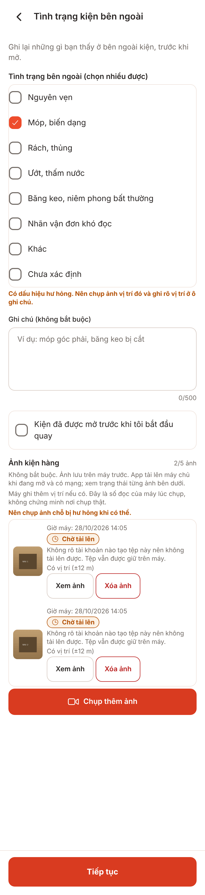
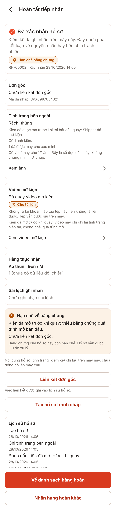
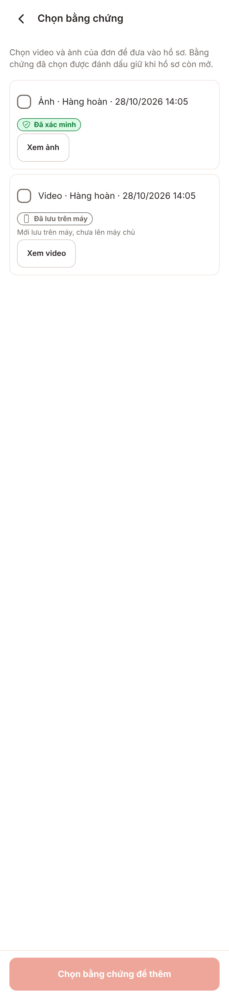
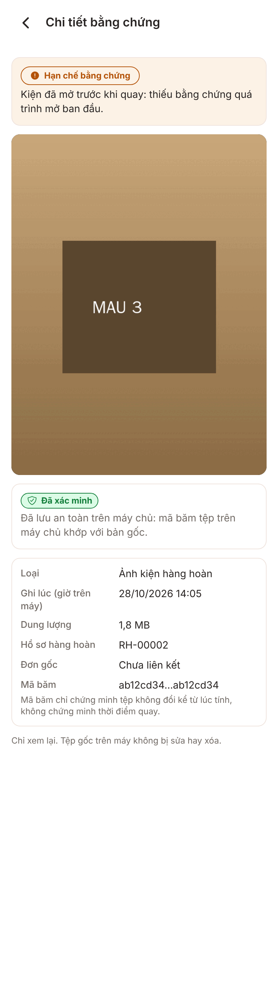
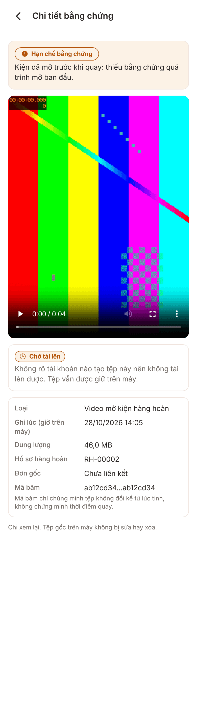
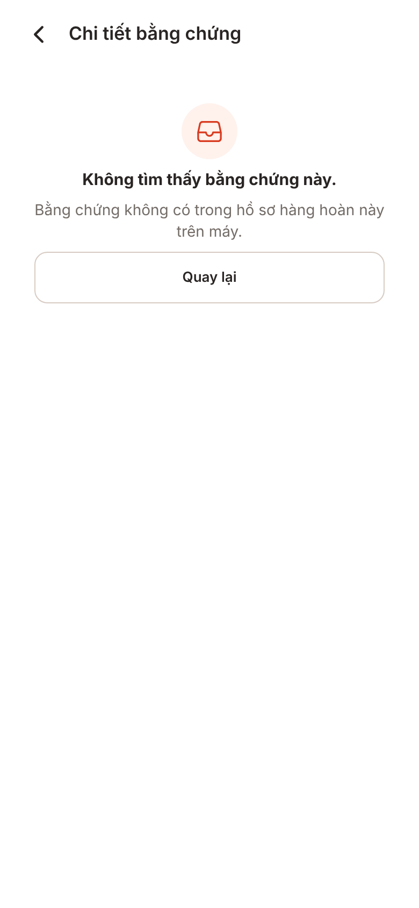
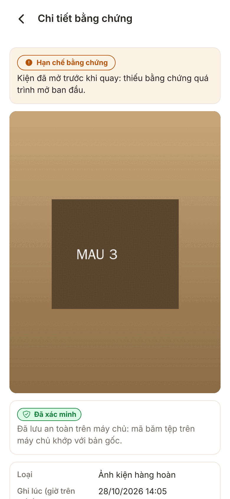

# Ảnh V1-17b returns-disputes-playback: xem ảnh/video hàng hoàn và tệp của tranh chấp (UI-E04)

**Lưu ý trung thực:** ảnh bản web (react-native-web trong Chromium, rộng 390 @2x; một số ảnh dùng chiều cao lớn 1400/1700 để thấy phần dưới của màn cuộn) với cổng giả, **không phải ảnh iOS/Android**. Trên web `expo-video` dùng thẻ `<video>` của trình duyệt (thanh điều khiển của Chromium); trên iOS/Android là thanh điều khiển của AVPlayer/ExoPlayer, khác hình dạng. Web không có camera, SQLite thật hay hệ tệp của app. **Chưa kiểm chứng trên thiết bị.**

Chụp bằng `node scripts/screens/capture.cjs --source <nhánh nháp> --port 5217 --sizes 390x1700` (và `390x844,390x1400` cho màn chi tiết), kế hoạch v1 mục 4.

## Thay đổi tạm (chỉ trên nhánh nháp, không commit vào PR, đã xóa)

1. `src/features/returns/data/shots-seed.ts` + bọc `getReturn`/`listReturns`/`listMedia` ở `create-return-store.ts` (chỉ nhánh kho bộ nhớ của web): hồ sơ `RH-00001` (đang ở D03, hai ảnh "Đã lưu trên máy") và `RH-00002` (kiện mở trước khi quay, một ảnh "Đã xác minh", một video mở kiện, đã xác nhận). Ảnh có vị trí mẫu để chứng tỏ màn chi tiết KHÔNG hiện vị trí.
2. `create-dispute-store.ts`: hồ sơ tranh chấp mẫu cho `RH-00002` (có hạn chế bằng chứng).
3. `src/platform/recording-files.ts`: đường dẫn `evidence/shots-*` coi là còn trên máy và trỏ tới `/shots/...`.
4. `public/shots/p1..p3.jpg` (hình mẫu `convert`), `v1.webm` (`ffmpeg testsrc2`, không phải video thật; webm vì Chromium của Playwright không có H.264).

Dữ liệu mẫu không có người tạo (`createdBy`), nên nhãn của tệp chưa lên máy chủ là "Chờ tải lên" kèm câu "Không rõ tài khoản nào tạo tệp này…" (V1-07). Trên máy thật, tệp do chính tài khoản tạo hiện "Đã lưu trên máy". Dung lượng, mã băm là số mẫu.

## Ảnh

### D03 Tình trạng bên ngoài: mỗi ảnh đã lưu có nút "Xem ảnh" cạnh nút "Xóa ảnh" (Xóa giữ nguyên điều kiện Q-26j)

### D07 Hoàn tất: hàng "Xem ảnh 1" (khối Tình trạng bên ngoài) và "Xem video mở kiện" (khối Video); D06 dùng chung khối này

### G03 Chọn bằng chứng: nút "Xem ảnh"/"Xem video" tách khỏi ô chọn

### Chi tiết ảnh hàng hoàn: nhãn "Hạn chế bằng chứng" + lý do, nhãn "Đã xác minh", loại, hồ sơ, đơn gốc, mã băm + câu giới hạn; không có vị trí

### Chi tiết video mở kiện: trình phát (web: thẻ video của Chromium phát được tệp webm mẫu; không tự phát)

### Không tìm thấy: mở ảnh của hồ sơ RH-00002 dưới đường dẫn của hồ sơ RH-00001

### Mở từ tranh chấp (route `/disputes/[disputeId]/evidence/[evidenceId]`), cùng nội dung

