# Ảnh màn hình V1-18 content-help-legal

**Ảnh bản web (react-native-web trong Chromium), cổng giả, phiên `signed_in`. Không phải ảnh iOS/Android; chưa kiểm chứng trên thiết bị.** Font, vùng an toàn, chữ lớn hệ thống và cách thu nhỏ chữ (`adjustsFontSizeToFit` chỉ có trên iOS/Android) khác thiết bị thật.

Cách chụp: `node scripts/screens/capture.cjs --sizes 320x568,390x844 --routes "..."` (`scripts/screens/README.md`), bản xuất từ cây làm việc của nhánh. Ảnh "trước" chụp cùng cách trên `origin/main` `c749cc7`. **Không có thay đổi tạm.** Cờ ghi video tắt (mặc định) nên bài "Quay đóng gói" là bản "chưa ghi video"; bản khi bật cờ chỉ kiểm bằng unit test.

Không chụp được: điều kiện "dữ liệu tài khoản khác" của Xóa tài khoản (cần dữ liệu SQLite của uid khác) và nút bấm được ở đó (cần URL/email thật; hôm nay còn giữ chỗ nên không có nút, giống trước PR).

## Trợ giúp

### Trung tâm trợ giúp (390x844): gợi ý tìm ngắn hơn, thêm bài đề xuất "Khi nào video và ảnh được tải lên?"

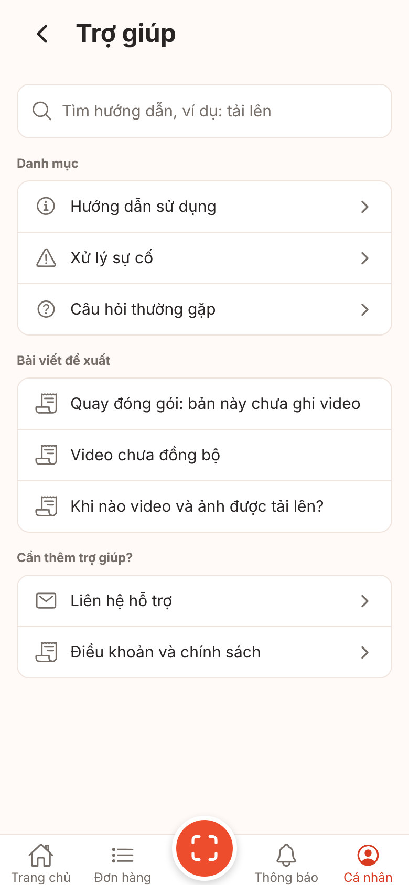

### Câu hỏi thường gặp: các bài mới (tải lên, đổi máy/gỡ app, mã băm, thời hạn lưu, xóa tài khoản)

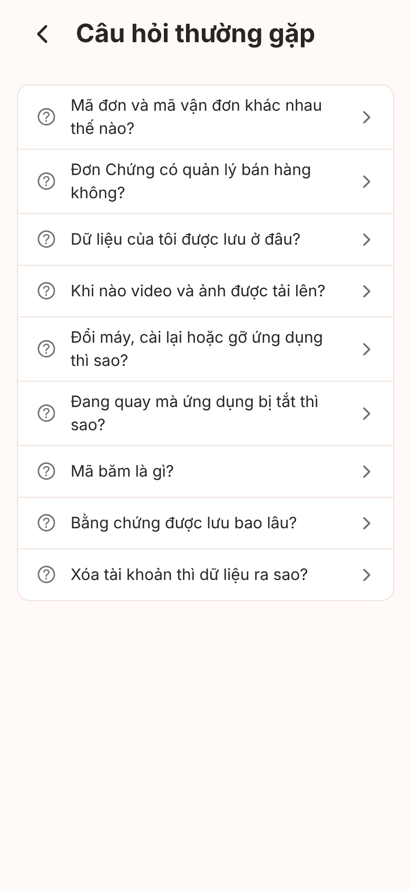

### Hướng dẫn sử dụng: thêm "Chỉ tải khi có Wi‑Fi"

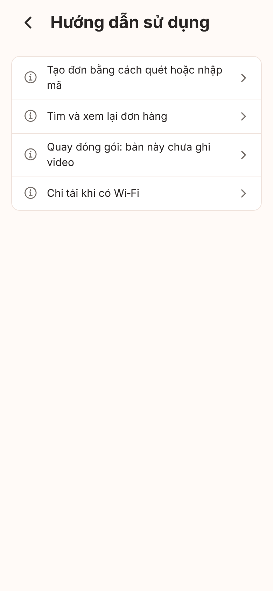

### Bài "Chỉ tải khi có Wi‑Fi" (có lưu ý điểm phát Wi‑Fi từ điện thoại khác)

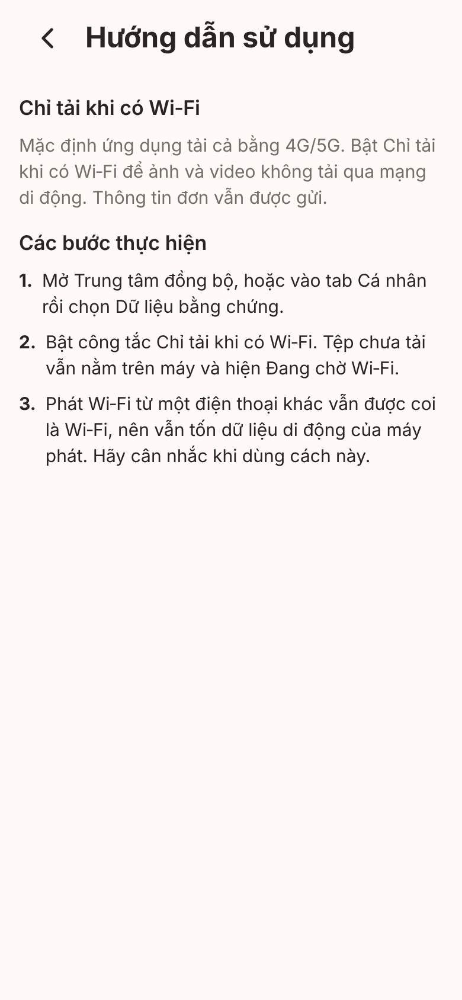

### Bài "Khi nào video và ảnh được tải lên?" (chỉ khi ứng dụng đang mở)

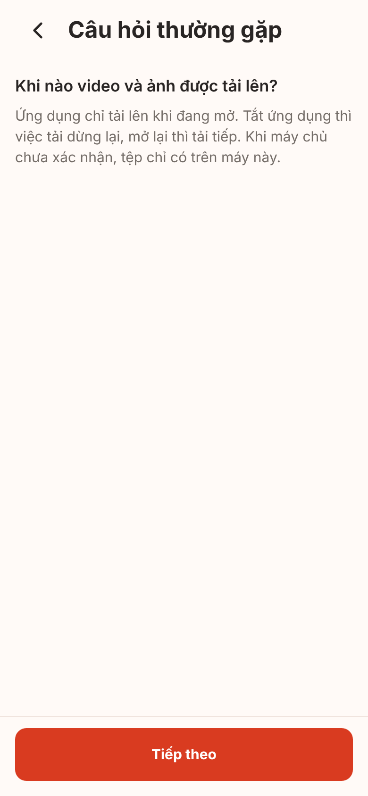

### Bài "Đổi máy, cài lại hoặc gỡ ứng dụng thì sao?"

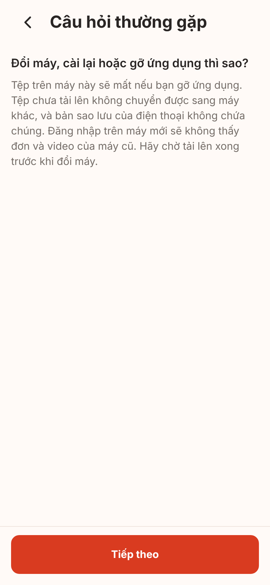

### Bài "Quay đóng gói" khi cờ ghi video tắt (bản "chưa ghi video", như trước)

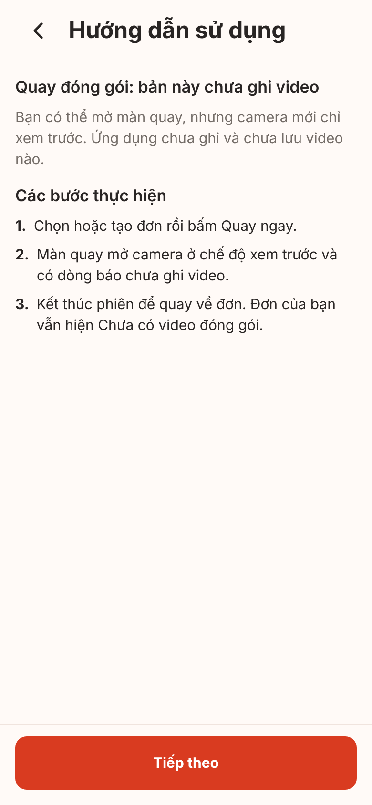

## Thời hạn lưu (route con UI-I01): câu v1 thay cho "theo gói"/"Chưa có thông tin"

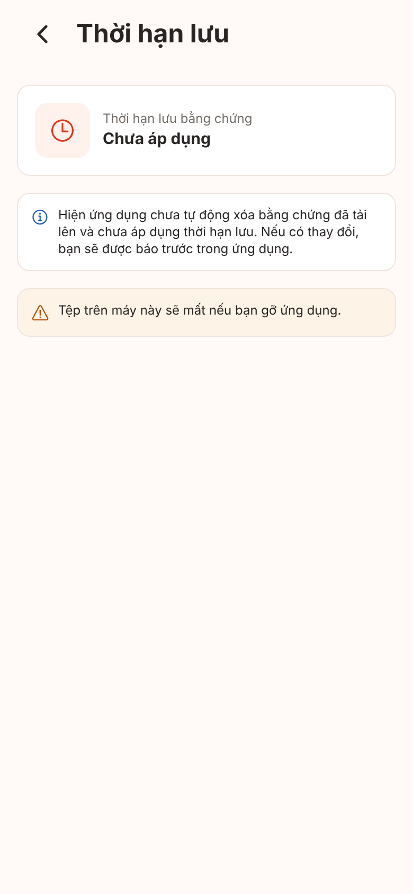

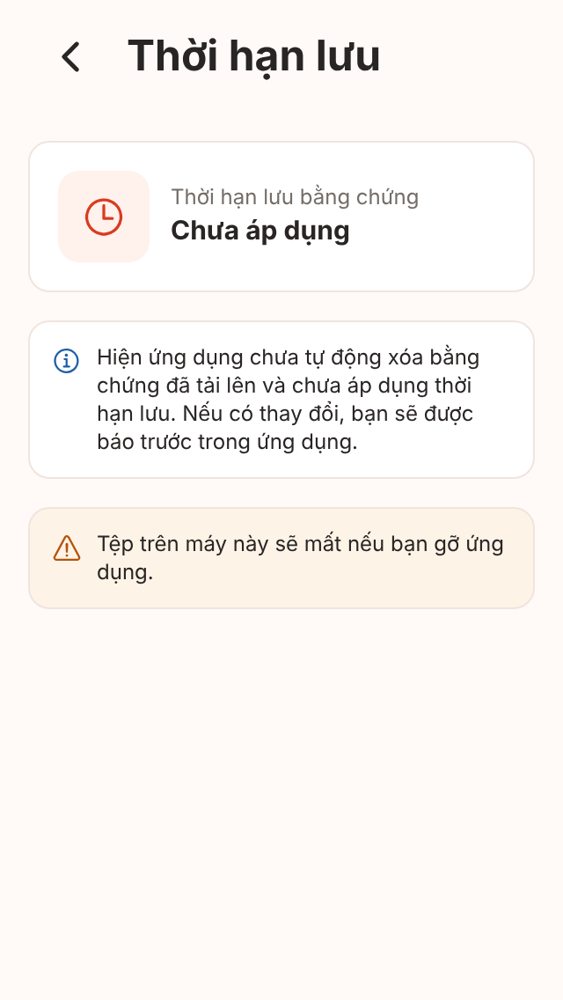

## Điều khoản và chính sách: URL từ `public-links.ts`, còn giữ chỗ nên vẫn khóa "Sắp có"

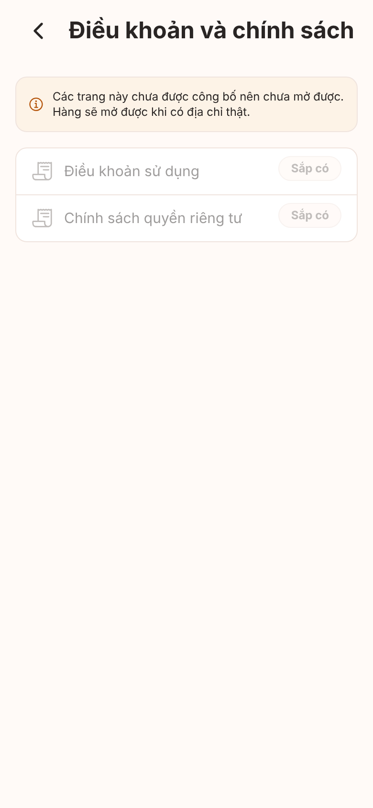

## Tràn chữ ở 320x568: trước và sau

### Đơn hàng: nút quét tràn ra ngoài ô tìm; nhãn tab "Trang chủ", "Đơn hàng", "Thông báo" bị cắt còn "Trang", "Đơn", "Thông"

Trước:

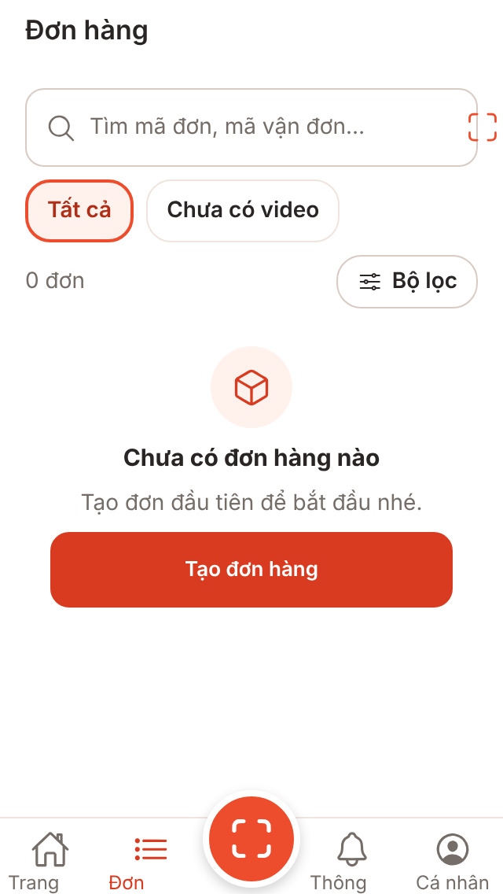

Sau (nút quét nằm trong ô; nhãn tab một dòng, cỡ caption x 0,85 ở màn dưới 360 pt). Bản web cắt nhẹ phần chân chữ ("g") do `numberOfLines` trên web đặt `overflow: hidden`; trên iOS/Android chữ không bị khung ô cắt như vậy (cần kiểm trên thiết bị):

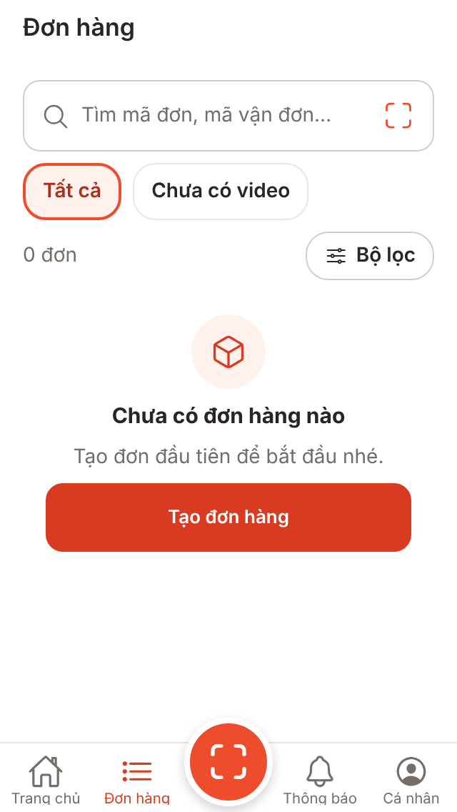

### Tìm đơn hàng (UI-B03): nút quét tràn ra ngoài ô tìm

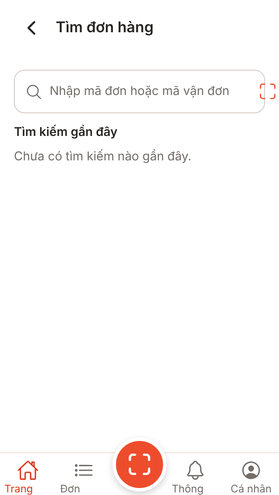

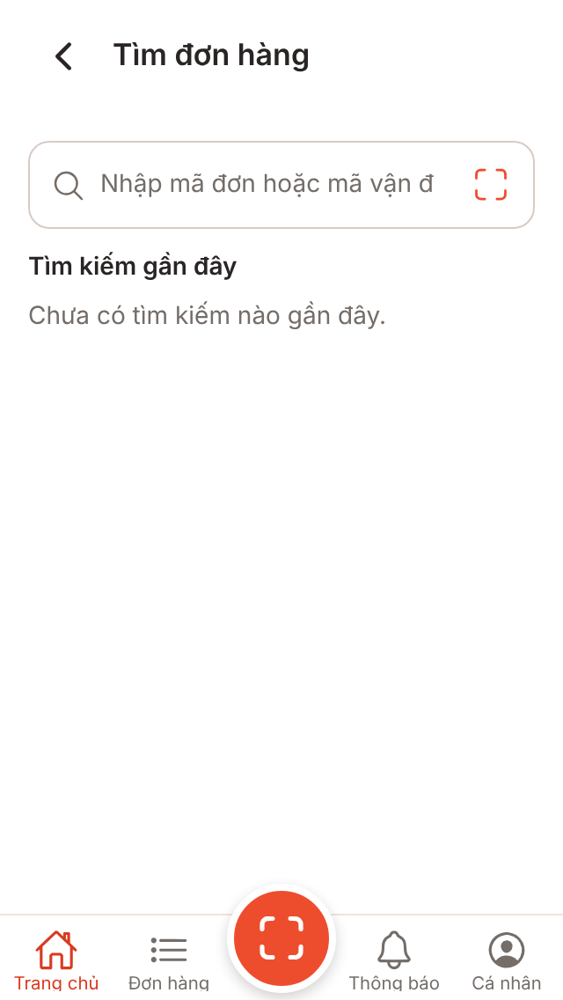

### Trợ giúp: gợi ý tìm bị cắt ("video chưa đ")

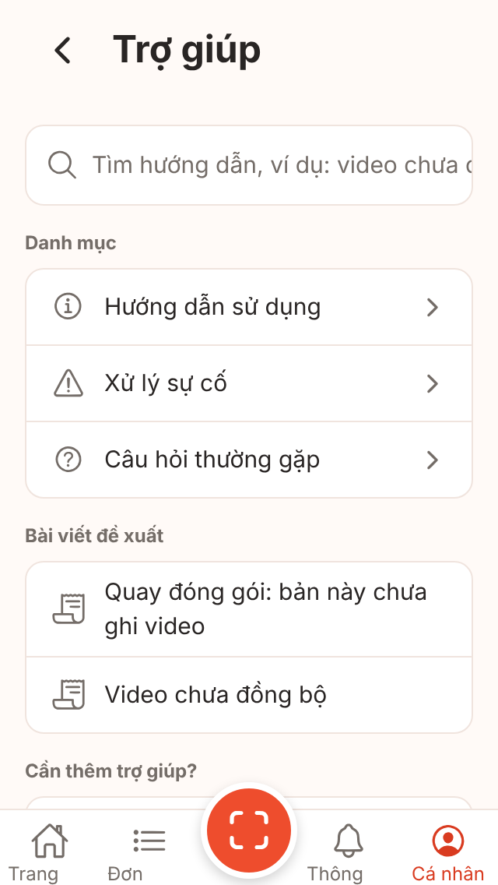

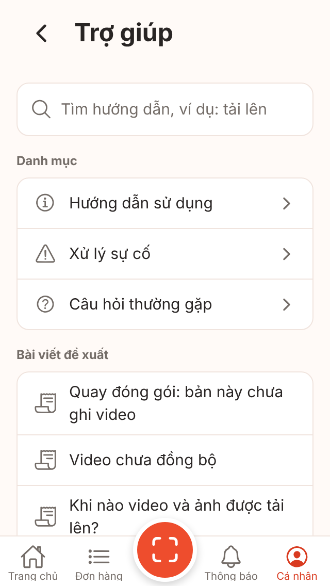

### Thanh tab ở 390x844 giữ nguyên như trước

