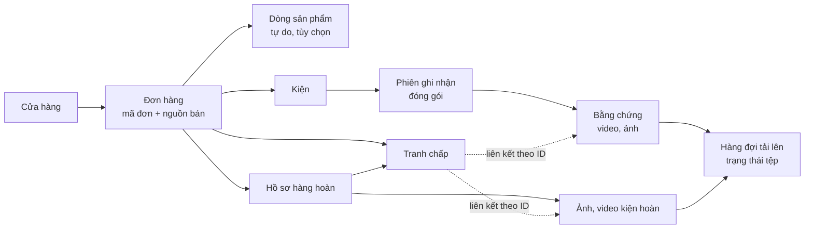
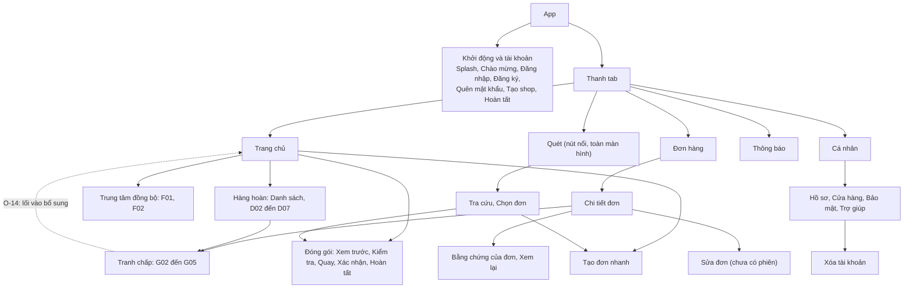
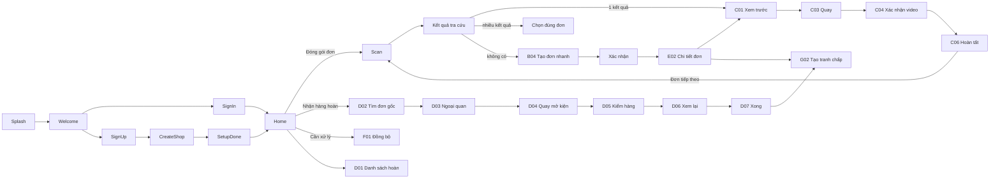
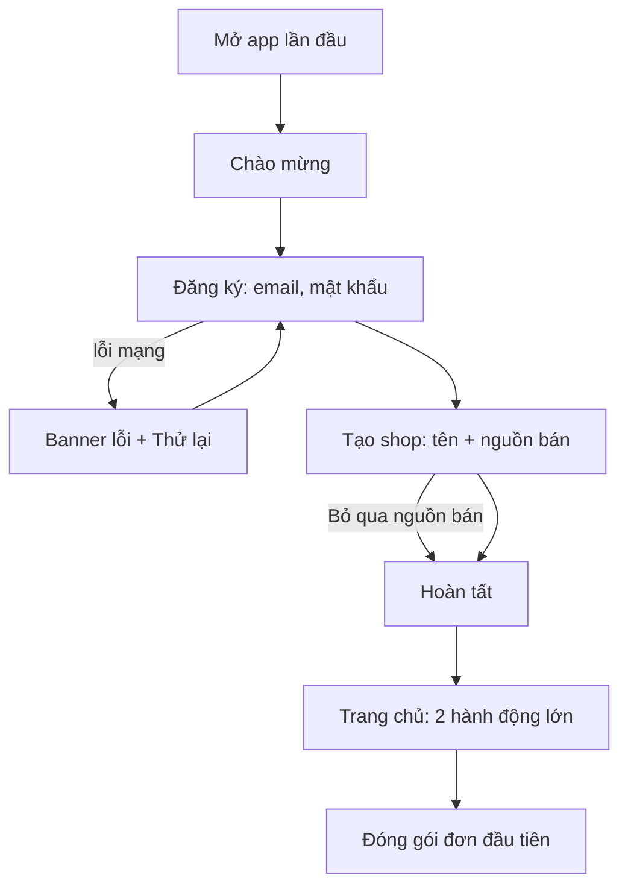
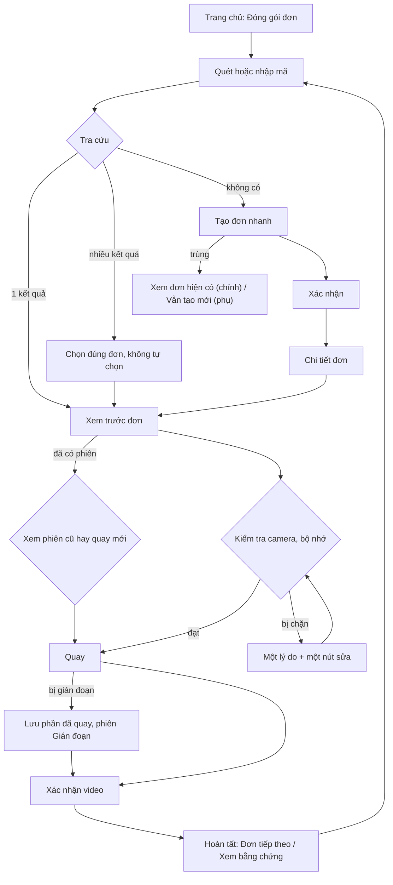
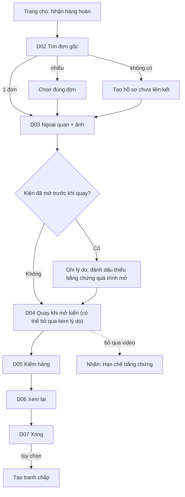
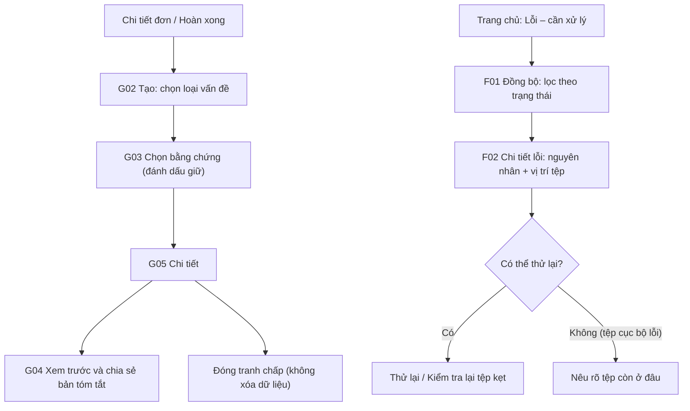

# Thiết kế lại kiến trúc UX — Đơn Chứng

> **Trạng thái:** đề xuất thiết kế, **chưa triển khai mã**, chưa được BA/người dùng duyệt (trừ các mục ghi `decided`).
> **Căn cứ:** `docs/ui-ux-audit.md` (mã vấn đề H-1, QO-1, PK-1…), `docs/09-ui-ux-design.md`, `docs/03`–`05`, `docs/engineering/layout.md`, bảng route `src/core/navigation/routes.ts`, tab `src/bootstrap/navigation/tab-config.ts`.
> **Nguyên tắc nền:** không đổi yêu cầu nghiệp vụ; không bỏ chức năng; không thêm tính năng mới. Chỉ thay đổi cách tổ chức, thứ tự, mật độ, trạng thái, phản hồi và khả năng truy cập của chức năng **đã có**. Bản gốc bất biến, không tự liên kết, ngôn ngữ trung thực (CLAUDE.md bất biến 1–11) luôn thắng khi có xung đột.

## Cách đọc tài liệu

Mỗi thay đổi mang một trong ba nhãn:

| Nhãn | Nghĩa |
|---|---|
| `decided` | Đã chốt trong docs/người dùng duyệt; giữ nguyên, không đề xuất lại |
| `proposed` | Đề xuất của tài liệu này, không đụng quyết định mở; cần BA/người dùng xem trước khi làm |
| `open` | Đang là câu hỏi mở trong docs (O-xx); trình bày **2–3 phương án**, **không chọn hộ** |

Mỗi thay đổi nêu **lý do** theo nhu cầu người dùng (N) hoặc nguyên tắc usability (U):

- **N1** Người bán đóng gói hàng chục đơn mỗi ngày, tay bận/đeo găng, đứng, nhìn lướt. 
- **N2** Cần biết ngay "bằng chứng của tôi đã an toàn chưa" mà không bị hứa quá mức.
- **N3** Mạng yếu/offline là chuyện thường; không được làm người dùng nghi ngờ dữ liệu.
- **N4** Khi có tranh chấp, người dùng gấp, căng thẳng, cần tìm lại đúng hồ sơ.
- **U1** Nielsen 1 (trạng thái hệ thống), **U2** Nielsen 5/9 (ngăn lỗi, khôi phục lỗi), **U3** Nielsen 7 (hiệu quả), **U4** Nielsen 8 (tối giản), **U5** Định luật Hick/Fitts (ít lựa chọn, đích chạm lớn), **U6** WCAG 2.2 AA, **U7** HIG/M3 (phản hồi nền tảng).

### Ánh xạ nhanh: vấn đề audit → hướng giải quyết

| Audit | Vấn đề | Hướng giải quyết trong tài liệu | Mục |
|---|---|---|---|
| QO-1, QO-4 | Tạo đơn nhanh thiếu return-key; đường tới camera dài | Mẫu form chung; 3 phương án O-19 | §4.1, §6.3, §8.1 |
| PK-1, PK-2 | 2 nút luôn tắt ở Xác nhận video | Bỏ khỏi đường chính tới khi chạy được | §6.6 |
| SC-1, DS-1 | Tìm kiếm/Tranh chấp khó tìm | Lối vào bổ sung (phương án O-14) | §4.2, §6.10 |
| H-1…H-3 | Trang chủ dày, không skeleton, lối vào Hoàn nằm lẻ | Phân cấp lại Trang chủ | §6.1 |
| RT-1, RT-3 | D05, D03 quá dày | Thu gọn theo mức quan trọng | §6.8, §6.9 |
| SY-1…SY-3 | Thẻ đồng bộ nặng, không nhãn a11y | Thẻ tóm tắt + nhãn nhóm | §6.11 |
| DS-A, DS-J, DS-K | Viền < 3:1, đệm đáy, bàn phím trong sheet | Yêu cầu a11y xuyên suốt | §9 |
| OD-1, DS-I | Lạm dụng thẻ | Quy tắc thẻ vs danh sách | §8.4 |
| A-2 | Auth thiếu banner offline | Quy tắc offline chung | §8.7 |

---

## 1. Nguyên tắc thiết kế áp dụng

| # | Nguyên tắc | Cách áp dụng | Lý do |
|---|---|---|---|
| P1 | **Một hành động chính mỗi màn**, tối đa một nút `primary`; hành động phụ là liên kết/nút phụ | Mọi màn có đúng một CTA chính, ghim chân màn trong vùng ngón cái | U5, N1 |
| P2 | **Tác vụ chính ≤ 3 hành động** từ Trang chủ (Home → Quét → Quay) cho đơn đã có | Đã có (docs/09 §2); giữ | U3, N1 |
| P3 | **Lộ diện tiến trình** ở luồng nhiều bước (Tạo shop, Hàng hoàn, Xóa tài khoản) | Chỉ báo "Bước x/y" hoặc thanh `StepProgress` có sẵn | U1 |
| P4 | **Trạng thái trung thực**: "Đã lưu trên máy" ≠ "Đã an toàn" | Nhãn chuẩn docs/09 §3, không tự đặt nhãn mới | N2, bất biến 3, 11 |
| P5 | **Thẻ chỉ cho khối cần nhấn mạnh**, còn lại danh sách/nền phẳng | Quy tắc §8.4 | U4, DS-I |
| P6 | **Exception-first**: mỗi luồng có nhánh ngoại lệ hiển thị rõ | Mở trước khi quay, nhiều kết quả, trùng, offline, lỗi tệp | CLAUDE.md |
| P7 | **Disabled phải có lý do** hiển thị cạnh nút | Quy tắc §8.5 | U1, U2 |
| P8 | **Cùng vị trí, cùng ý nghĩa**: nút chính ở chân, hủy/đóng ở góc trái, trợ giúp ở góc phải | Chuẩn `Screen` (header + footer) | U5 |
| P9 | **Không chặn tác vụ chính vì thông tin phụ** | Thiếu sản phẩm không chặn quay (bất biến 10); hàng hoàn thiếu video không chặn xác nhận (Q-26, `decided`) | bất biến |
| P10 | **Phản hồi mọi hành động quan trọng** (nhìn + xúc giác tùy chọn + đọc cho trình đọc màn hình) | §8.6 | U7, U6 |

---

## 2. Kiến trúc thông tin (IA)

### 2.1 Mô hình khái niệm hiển thị cho người dùng

**Quy tắc hiển thị (`decided`, bất biến 1–3):** người dùng chỉ thấy "Đơn" và "Bằng chứng" ở bề mặt; Kiện/Phiên chỉ lộ khi có nhiều hơn một (quay bổ sung, nhiều kiện). Mã đơn là thuộc tính tìm kiếm, không phải định danh. Trạng thái tệp tách khỏi trạng thái đơn.

### 2.2 Cây IA toàn app (cập nhật)

**Thay đổi so với hiện trạng**

| # | Thay đổi | Nhãn | Lý do |
|---|---|---|---|
| IA-1 | Giữ 5 tab và nút Quét nổi | `decided` (D-16, Q-22b) | Đã duyệt |
| IA-2 | Hàng hoàn, Đồng bộ giữ ngoài thanh tab, vào từ Trang chủ | `decided` (D-16) | Đã duyệt |
| IA-3 | Nhóm lại lối vào ở Trang chủ theo **việc**: "Đóng gói", "Nhận hàng hoàn", rồi "Cần xử lý" (đồng bộ lỗi, hồ sơ dở dang) | `proposed` | Người dùng nghĩ theo việc phải làm, không theo tên tính năng (U5, N1). Dữ liệu đã có sẵn (ô đếm "Lỗi – cần xử lý") |
| IA-4 | Lối vào Danh sách tranh chấp và Tìm kiếm | `open` (O-14; §4.2) | Hiện chỉ có deep link/màn Quét (audit DS-1, SC-1) |
| IA-5 | Vai trò tab Thông báo | `open` (O-26/O-27; §4.3) | Tab hiện gần như rỗng (audit NT-1) |
| IA-6 | 9 màn placeholder (A05, B05, C05, E05, F03, H02–H04, I03) **giữ ngoài IA**, không điều hướng tới; ghi chú "sau v1" | `proposed` | Không phải đích có giá trị cho người dùng; tránh dẫn người dùng vào ngõ cụt (U4) |
| IA-7 | Tên nhãn trạng thái chỉ dùng bảng chuẩn docs/09 §3 (Đã lưu trên máy · Chờ tải lên · Đang tải lên · Đã tải lên · Đã xác minh · Lỗi – cần xử lý), cùng icon+chữ ở mọi nơi | `decided` | Nhất quán, bất biến 3, 11 |

### 2.3 Quy tắc đặt nhãn
- Động từ hành động, ngắn, tiếng Việt thường ngày: "Quay đóng gói", "Nhận hàng hoàn", "Thử lại". Không viết tắt kỹ thuật (SHA‑256 chỉ xuất hiện kèm một câu giải thích đúng nghĩa: "chỉ cho thấy tệp không đổi kể từ lúc tính").
- Không dùng "an toàn", "đầy đủ", "hoàn tất toàn bộ" khi còn lỗi hoặc tệp chưa xác minh (bất biến 11).
- Dữ liệu người dùng nhập gắn "do bạn nhập"; không giả làm dữ liệu từ sàn (bất biến 10).

---

## 3. Cấu trúc điều hướng

### 3.1 Điều hướng chính

| Thành phần | Quy tắc | Nhãn | Lý do |
|---|---|---|---|
| Thanh tab | 5 mục: Trang chủ · Đơn hàng · Quét (nút nổi) · Thông báo · Cá nhân. Hiện ở màn gốc tab; **ẩn** ở màn quay, quét toàn màn hình, form nhiều bước | `decided` | D-16 |
| Nút Quét | Mở quét toàn màn hình, ẩn tab bar | `decided` | D-16, N1 |
| Mẫu điều hướng | **push** cho đi sâu (Đơn → Chi tiết → Bằng chứng); **sheet** cho lựa chọn ngắn không rời ngữ cảnh (chọn nguồn bán, kết quả tra cứu, bộ lọc); **dialog** chỉ cho xác nhận hoặc chặn có hệ quả | `proposed` | Hiểu "mình đang ở đâu" (U1); tránh dialog để hiển thị thông tin |
| Quay lại | Góc trái header; cử chỉ vuốt hệ thống giữ nguyên; màn có dữ liệu chưa lưu hỏi trước khi thoát (`useConfirmBeforeLeave`) | `decided`/hiện có | Ngăn lỗi (U2) |
| Khi đang quay | Không thể chuyển đơn/kiện/tab; thoát cần xác nhận | `decided` | Bất biến 2 |
| Thành công | Điều hướng kèm phản hồi; nút kế tiếp rõ ("Đơn tiếp theo", "Xem bằng chứng") | `proposed` | U1, N1 |
| Cổng phiên | Chưa đăng nhập/chưa có shop: mọi màn nghiệp vụ (kể cả deep link) chuyển về Chào mừng/Tạo shop | `decided` (V1-06) | Bất biến 8 |

### 3.2 Bản đồ điều hướng giữa các nhóm

### 3.3 Lối vào sâu
Deep link vào mọi màn nghiệp vụ đi qua cổng phiên; link tới bản ghi không thuộc shop trả về `NotFound` (bất biến 8). Màn "đang chờ" (placeholder) không có link công khai.

---

## 4. Quyết định mở: các phương án (không chọn hộ)

> Quy ước: mọi phương án giữ nguyên bất biến 1–11. "Khuyến nghị tham khảo" chỉ là gợi ý của tài liệu, người dùng/BA quyết.

### 4.1 O-19 — Đường tới camera cho đơn **mới**

Hiện trạng (`decided` theo Q-22a, người dùng đã duyệt): Quét → kết quả "không có" → Tạo đơn nhanh → Xác nhận → "Tạo đơn hàng" → Chi tiết đơn → "Quay đóng gói" → (Xem trước) → (Kiểm tra nếu bị chặn) → Quay. Khoảng **5 chạm + gõ mã + gõ tên sản phẩm**, 6 màn.

| | A. Giữ Q-22a | B. "Tạo và quay" ngay ở bước Xác nhận | C. Phân nhánh theo đơn mới/đã có |
|---|---|---|---|
| Mô tả | Giữ nguyên | Bước Xác nhận có 2 nút: **Tạo và quay** (chính) và "Chỉ tạo đơn" (phụ). Bỏ điểm dừng ở Chi tiết khi chọn "Tạo và quay" | Đơn **đã tồn tại**: Quét → Xem trước → Quay (không qua Chi tiết). Đơn **mới**: như B |
| Số chạm đơn mới | ≈ 5 | ≈ 3 | ≈ 3 (mới), 2 (đã có) |
| Lợi | Không phải duyệt lại; đã chốt | Phù hợp D-10 ("một chạm Bắt đầu quay"); người dùng đang tay bận | Tối ưu cho đơn đã có (phổ biến nhất) |
| Hại | Chậm, nhiều màn | Phải thay Q-22a (cần người dùng duyệt) | Hai đường khác nhau, cần giải thích nhất quán |
| Rủi ro nghiệp vụ | Không | Phải giữ bước kiểm tra lại dữ liệu đơn; ID phiên/kiện vẫn tạo **trước** quay; không bỏ kiểm trùng | Như B; đơn đã có phiên vẫn phải hỏi "xem phiên cũ hay quay mới" (04:40) |
| Cần quyết | – | Supersede Q-22a | Supersede Q-22a (chỉ nhánh đơn mới) |
| Khuyến nghị tham khảo | – | – | **C** cân bằng tốc độ và nhất quán |

### 4.2 O-14 — Lối vào Danh sách tranh chấp

Hiện trạng: `/disputes` không có điều hướng tới; chỉ vào được từ Chi tiết đơn/Hoàn xong để **tạo** mới (audit DS-1).

| | A. Từ ngữ cảnh | B. Thẻ "Cần xử lý" ở Trang chủ | C. A + B |
|---|---|---|---|
| Mô tả | Chi tiết đơn có mục "Tranh chấp của đơn này"; Hoàn xong có liên kết; thêm 1 dòng "Tranh chấp" trong Cá nhân | Trang chủ hiện thẻ khi **có** tranh chấp đang mở | Cả hai |
| Lợi | Gắn đúng ngữ cảnh (N4); ít đổi Trang chủ | Thấy ngay việc cấp bách; phù hợp "việc cần xử lý" của docs/09 | Dễ tìm nhất |
| Hại | Phải nhớ đơn nào | Thêm một khối ở Trang chủ vốn đã dày | Nhiều chỗ phải bảo trì |
| Rủi ro | Không | Không tự mở tranh chấp (bất biến 5) | Như B |
| Khuyến nghị tham khảo | – | – | **A** trước, **B** chỉ hiện khi có tranh chấp mở (không chiếm chỗ khi trống) |

### 4.3 O-26/O-27 — Tab Thông báo và Trang chủ

Hiện trạng: tab Thông báo là trạng thái rỗng trung thực + nút mở Đồng bộ (`NotificationListScreen.tsx`); Trang chủ bỏ "Đơn gần đây", "Việc cần xử lý" (D-16 hệ quả).

| | A. Giữ nguyên rỗng trung thực | B. Thông báo = "Việc cần xử lý" từ dữ liệu có thật | C. Dồn "Cần xử lý" lên Trang chủ, đổi vai trò tab |
|---|---|---|---|
| Mô tả | Tab rỗng, nút mở Đồng bộ | Liệt kê: tệp lỗi cần xử lý, phiên bị gián đoạn, hồ sơ hoàn dở dang, tranh chấp mở. Không đẩy thông báo hệ thống | Trang chủ có khối "Cần xử lý" đầu trang; tab Thông báo đổi vai trò (cần BA) |
| Lợi | Không làm gì thêm | Tab có giá trị; hiển thị "Lỗi" thay vì giấu sau ô đếm (N2) | Việc cấp bách ngay trước mắt |
| Hại | Tab thừa 1/5 chỗ | Trùng một phần với ô đếm Trang chủ | Đổi cấu trúc tab: chạm D-16 |
| Rủi ro | Không | Không giả tạo thông báo; chỉ dùng dữ liệu đã có (bất biến 6, 11) | Cần chốt lại D-16 |
| Khuyến nghị tham khảo | – | **B** | – |

### 4.4 O-02 — Nhập video từ thư viện
Hiện trạng: nút thư viện đã gỡ khỏi màn quay. **Tài liệu không đề xuất thay đổi**; nếu quyết bật lại, nhãn "nhập từ thư viện" bắt buộc (bất biến 6).

---

## 5. Hành trình người dùng

### 5.1 Lần đầu: đăng ký → dùng thử

**Số bước:** Chào mừng → Đăng ký → Tạo shop → Hoàn tất → Trang chủ (4 màn). `proposed`: gộp "Hoàn tất" vào Trang chủ bằng một thẻ chào lần đầu (giảm 1 màn, U3), cần BA vì D-15 giữ thiết kế Splash/onboarding.

### 5.2 Đóng gói (nhiều nhánh)

**Nhánh ngoại lệ bắt buộc (`decided`):** nhiều kết quả không tự chọn; trùng đơn không tự gộp; phiên cũ không bị ghi đè; thiếu sản phẩm không chặn quay (gắn "Chưa khai báo sản phẩm"); gián đoạn không ghép đoạn.

### 5.3 Nhận hàng hoàn (Q-26)

### 5.4 Tranh chấp và xử lý lỗi đồng bộ

### 5.5 Đăng xuất và xóa tài khoản
Đăng xuất: nếu còn tệp chưa tải → dialog chặn kèm nút "Mở Trung tâm đồng bộ"; đang quay → chặn. Xóa tài khoản: Điều kiện → (cảnh báo tệp chưa tải + ô tích riêng) → Nhập mật khẩu → Máy chủ xác nhận → xóa dữ liệu máy. Chặn khi đang quay/còn tranh chấp mở/máy có dữ liệu tài khoản khác (`decided`, V1-15). **Không thay đổi quy tắc**; chỉ cải thiện cách trình bày từng bước (§6.12).

---

## 6. Đặc tả UX từng màn (12 nhóm cốt lõi)

> Mẫu mỗi màn: **Mục tiêu · Thông tin quan trọng · Phân cấp · Điều hướng/tương tác · Tối giản thao tác · 7 trạng thái · Chuyển cảnh · A11y**. "Hiện tại" lấy từ mã; "Đề xuất" là `proposed` nếu không ghi khác. Quy tắc chung (form, thẻ, dialog…) ở §8; a11y chung ở §9 — mục A11y ở đây chỉ ghi phần riêng của màn.

### 6.1 Trang chủ (UI-B01) — `HomeScreen`

- **Mục tiêu chính:** bắt đầu đóng gói hoặc nhận hàng hoàn ngay; biết có gì cần xử lý.
- **Thông tin quan trọng nhất:** (1) hành động "Đóng gói đơn", (2) "Nhận hàng hoàn", (3) có lỗi/tệp chờ cần xử lý không, (4) số liệu hôm nay.
- **Phân cấp (wireframe chữ):**
  1. Đầu trang: tên cửa hàng + ngày.
  2. Hai thẻ hành động lớn: **Đóng gói đơn** (chính) · **Nhận hàng hoàn**.
  3. Khối **Cần xử lý** (chỉ hiện khi có): "N tệp lỗi", "N hồ sơ dở dang" → tới Đồng bộ/hồ sơ (dùng `SyncStatusBar`).
  4. Số liệu hôm nay: 3 ô (đóng gói · đã tải · lỗi), chạm → danh sách đã lọc.
  5. Lối phụ: Tạo đơn nhanh · Đơn hàng · Danh sách hoàn (dạng `ListItem`).
  6. Thẻ thông báo thiết bị / mẹo: hạ xuống cuối, đóng được.
- **Điều hướng/tương tác:** kéo để làm mới; thẻ hành động là đích chạm lớn ≥ 56 pt. **Lý do:** U5, N1, audit H-2/H-3.
- **Tối giản thao tác:** liên kết "Danh sách hoàn" từ chữ trơ trọi → hàng có chevron cùng nhóm với Nhận hàng hoàn (tìm lại hồ sơ dở dang: 1 chạm thay vì tìm). 7 khối → 4 nhóm.
- **Trạng thái:**

| Trạng thái | Hành vi |
|---|---|
| Initial | Hai thẻ hành động hiện ngay (không phụ thuộc dữ liệu) |
| Loading | Skeleton chỉ cho 3 ô số liệu + khối "Cần xử lý" (không che hai thẻ hành động) |
| Empty | Lần đầu/ngày mới: số liệu 0 kèm một câu hướng dẫn ngắn "Quét mã đơn để bắt đầu" |
| Error | Chỉ khối số liệu báo "Chưa tải được số liệu" + Thử lại; hành động chính vẫn dùng được |
| Success | Sau khi đóng gói xong quay lại: số liệu cập nhật, không cần toast |
| Offline | Banner chung; số liệu đọc từ máy (vẫn đúng); nêu "Đang chờ mạng" ở khối Cần xử lý nếu có tệp chờ |
| Disabled | "Đóng gói đơn" chưa chọn được khi chưa có cửa hàng ghi được (`useWritableShopId`): giữ nút, hiện lý do dưới nút |

- **Chuyển cảnh:** Đóng gói → Quét (toàn màn hình, ẩn tab) ; Nhận hoàn → D02 (push); Cần xử lý → F01 (push, có bộ lọc sẵn); thẻ số liệu → danh sách đã lọc.
- **A11y:** tiêu đề màn là `header`; mỗi ô số liệu đọc "Đã đóng gói hôm nay: 12, nhấn để xem"; khối Cần xử lý là `liveRegion polite` khi số thay đổi; không dùng màu đỏ một mình.

### 6.2 Quét và kết quả tra cứu (UI-B02, `OrderMatchSheet`)

- **Mục tiêu:** có đúng đơn trong 1–2 giây hoặc biết ngay vì sao chưa.
- **Thông tin quan trọng nhất:** khung quét, trạng thái tra cứu, lối nhập tay.
- **Phân cấp:** khung ngắm (trung tâm) → hướng dẫn một dòng → ở chân: Đèn · Nhập mã · (Tìm kiếm).
- **Điều hướng/tương tác:** quét xong tra cứu tự động (không nút Tìm, `decided`); kết quả hiện ở sheet dưới. Sheet **không có KAV** hiện tại → **phải** xử lý bàn phím khi nhập tay (audit SC-4). **Tìm kiếm** (B03): thêm lối từ Đơn hàng/Trang chủ (`open`, đi cùng quyết định lối vào ở §4.2). 
- **Tối giản:** nhập tay có `autoFocus` khi mở sheet nhập (hiện không); sau tra cứu, nút chính phụ thuộc kết quả (xem bảng).
- **Kết quả tra cứu (sheet):**

| Kết quả | Nút chính | Nút phụ |
|---|---|---|
| 1 đơn | Mở đơn / Xem trước | Quét lại |
| Nhiều đơn | Chọn đúng đơn (danh sách, **không** tự chọn) | Quét lại |
| Không có | Tạo đơn với mã này | Quét lại |
| Trùng (đã có phiên) | Xem đơn hiện có | Vẫn tạo đơn mới (phụ, `proposed` Q-22ad) |

- **Trạng thái:**

| Trạng thái | Hành vi |
|---|---|
| Initial | Camera mở, khung ngắm, hướng dẫn |
| Loading | Chỉ báo nhỏ trong sheet; tạm dừng quét tiếp (cửa sổ lặp đã có) |
| Empty | "Không tìm thấy đơn" + Tạo đơn với mã này |
| Error | Lỗi tra cứu + Thử lại (một nút); không xóa mã đã quét |
| Success | Sheet kết quả |
| Offline | Tra cứu trong máy vẫn chạy (kho cục bộ); không cần mạng. Nêu rõ nếu dữ liệu chỉ ở máy |
| Disabled | Chưa có quyền camera: thẻ giải thích + "Cho phép camera" / "Mở cài đặt" + **Nhập mã thủ công vẫn dùng được** |

- **Chuyển cảnh:** 1 đơn → Xem trước (C01) ; không có → Tạo đơn nhanh (B04) ; đóng → ở lại camera.
- **A11y:** khung quét có mô tả; báo "Đã quét mã…" qua thông báo; nút Đèn/Quay lại có nhãn (đã có); với người không dùng được camera, Nhập mã luôn hiện; sheet có `accessibilityViewIsModal`.

### 6.3 Tạo đơn nhanh và Xác nhận (UI-B04) — `QuickOrderScreen`

- **Mục tiêu:** tạo đơn tối thiểu (mã đơn + nguồn) rồi quay ngay; không bắt khai sản phẩm.
- **Thông tin quan trọng:** mã đơn (điền sẵn từ lần quét), nguồn bán; sản phẩm là tùy chọn.
- **Phân cấp:** (1) Mã đơn — đã điền sẵn, chỉ chỉnh khi sai; (2) Nguồn bán (sheet chọn, mặc định nguồn dùng gần nhất); (3) **Sản phẩm (tùy chọn)** — mặc định thu gọn "Thêm sản phẩm", mở ra thì tên · biến thể · số lượng; (4) Mã vận đơn (tùy chọn). Chân màn: **Tiếp tục** (chính).
- **Tương tác:** thứ tự ô có `returnKeyType="next"` → ô sau, ô cuối `"done"` (mẫu sẵn ở `SignInScreen`); số lượng dùng bàn phím số; gợi ý sản phẩm chỉ từ lịch sử cửa hàng. **Lý do:** U3, audit QO-1/QO-2; bất biến 10 (thiếu sản phẩm không chặn).
- **Tối giản:** phần Sản phẩm thu gọn → người không khai sản phẩm đi từ 4 nhóm ô còn 2 nhóm (mã + nguồn).
- **Xác nhận:** hiển thị tóm tắt nguyên văn + nhãn "do bạn nhập"; nút chính "Tạo đơn hàng"; nếu O-19 chọn B/C, thêm "Tạo và quay" (§4.1).
- **Trạng thái:**

| Trạng thái | Hành vi |
|---|---|
| Initial | Mã đơn điền sẵn; nguồn mặc định; sản phẩm thu gọn |
| Loading | Nút "Tạo đơn hàng" ở trạng thái loading; chặn bấm đôi (`savingRef`, đã có) |
| Empty | Không áp dụng (form) |
| Error | Lỗi từng ô tại chỗ khi bấm Tiếp tục; lỗi lưu: thẻ lỗi + Thử lại, dữ liệu đã nhập giữ nguyên (idempotent) |
| Success | Sang Chi tiết đơn (hoặc quay, tùy O-19) |
| Offline | Vẫn tạo được (kho cục bộ); ghi chú "Đơn sẽ được đăng khi có mạng" nếu liên quan |
| Disabled | "Tiếp tục" chỉ tắt khi **thiếu mã đơn**; hiện câu "Cần nhập mã đơn" dưới ô, không tắt im lặng |

- **Chuyển cảnh:** từ Quét (không có) hoặc Trang chủ; thoát có dữ liệu → hộp thoại "Bỏ đơn đang nhập?" (đã có); trùng → sheet "Xem đơn hiện có / Vẫn tạo".
- **A11y:** mỗi ô có nhãn; lỗi trong live region; nút Hủy ở header có nhãn; thứ tự focus theo thứ tự đọc; gom "Sản phẩm" thành nhóm có nhãn.

### 6.4 Xem trước đơn và Kiểm tra trước khi quay (UI-C01, C02)

- **Mục tiêu:** xác nhận đúng đơn rồi quay; kiểm tra thiết bị chỉ lộ ra khi có vấn đề (D-10).
- **Thông tin quan trọng:** mã đơn + nguồn, số kiện, sản phẩm đã khai (hoặc "Chưa khai báo sản phẩm"), cảnh báo đã có phiên.
- **Phân cấp:** mã đơn (lớn) → kiện (chọn nếu >1; `FilterChips`) → sản phẩm (danh sách phẳng) → cảnh báo (nếu có). Chân màn: **Bắt đầu quay**.
- **Tối giản:** gộp các thẻ rời thành một khối thông tin phẳng (hiện nhiều thẻ, audit). C02 chỉ hiện khi bị chặn: **một** lý do + **một** nút sửa (ví dụ "Cho phép camera"), liên kết phụ "Về đơn" — thay vì 4 nút (audit PK-6).
- **Trạng thái:**

| Trạng thái | Hành vi |
|---|---|
| Initial | Thông tin đơn, nút Bắt đầu quay |
| Loading | Skeleton thông tin đơn |
| Empty | Đơn không có dòng sản phẩm → "Chưa khai báo sản phẩm" (không chặn) |
| Error | Không mở được đơn: thẻ lỗi + Thử lại/Về danh sách |
| Success | Vào Quay |
| Offline | Quay vẫn được; lưu cục bộ; ghi chú tải lên sau |
| Disabled | Đã có phiên: nút chính đổi thành lựa chọn "Xem phiên cũ" / "Quay phiên mới" (không ghi đè); thiếu camera/bộ nhớ → C02 |

- **Chuyển cảnh:** → Quay (replace, có latch); lùi → Chi tiết đơn.
- **A11y:** đọc "Đơn {mã}, nguồn {nguồn}"; cảnh báo là `alert`; số lượng đọc kèm đơn vị.

### 6.5 Quay đóng gói (UI-C03)

- **Mục tiêu:** quay trọn vẹn từ trước đóng gói đến niêm phong, không lo hệ thống.
- **Thông tin quan trọng:** đang ghi (chấm đỏ **kèm chữ "Đang ghi" + đồng hồ**, `decided` D-18), mã đơn/kiện ghim, nút Dừng.
- **Phân cấp:** trên cùng: mã đơn + kiện (nhỏ, tương phản cao); giữa: hình camera; dưới: nút **Dừng** lớn (88 pt).
- **Tương tác:** vào là tự bắt đầu (đã có); thoát cần xác nhận; khóa chuyển đơn; giữ màn hình sáng. Đề xuất: haptics nhẹ khi bắt đầu/dừng (`open`: thêm phụ thuộc, §8.6), `accessibilityHint` cho nút Dừng (audit PK-4).
- **Trạng thái:**

| Trạng thái | Hành vi |
|---|---|
| Initial (chuẩn bị) | "Đang chuẩn bị camera"; không cho thoát lúc đang mở |
| Loading (đang lưu) | "Đang lưu video…"; chặn thoát |
| Empty | Không áp dụng |
| Error | Lỗi camera/bộ nhớ: lưu phần đã quay, phiên `Gián đoạn`, nêu rõ phần còn lại; **không** báo thành công |
| Success | Sang Xác nhận video |
| Offline | Không ảnh hưởng quay; không đề cập mạng trên màn quay (tránh xao nhãng) |
| Disabled | Nút Dừng bị tắt đúng khoảng ngắn khi đang chuẩn bị/lưu, có chữ giải thích |

- **Gián đoạn (vào nền, camera bị ngắt):** dừng có chủ đích, lưu phần đã quay, phiên `interrupted`; khi quay lại hiện toast 10 giây + trạng thái ở Xác nhận. Không ghép đoạn (`decided`).
- **Chuyển cảnh:** Dừng → Xác nhận (replace); thoát (đã xác nhận) → Chi tiết đơn.
- **A11y:** đồng hồ đọc "Đang ghi, 1 phút 12 giây" theo chu kỳ thưa (không đọc mỗi giây); thông báo bắt đầu/dừng; không phụ thuộc chấm đỏ.

### 6.6 Xác nhận video và Hoàn tất (UI-C04, C06)

- **Mục tiêu:** biết video đã lưu thế nào, rồi sang đơn tiếp theo.
- **Thông tin quan trọng:** trạng thái tệp (nhãn chuẩn), thời lượng, mã đơn, cảnh báo nếu gián đoạn/thiếu.
- **Phân cấp:** ảnh/khung video → trạng thái (`EvidenceStatusBadge`) → thời lượng + mã đơn → cảnh báo (gián đoạn/ chưa quay). Chân màn: **Lưu** (chính) — **một** nút.
- **Thay đổi chính (`proposed`):** hai nút "Xem lại video" và "Ghi thêm đoạn riêng" luôn tắt và `onPress` rỗng được **gỡ khỏi bố cục** cho tới khi luồng thật sẵn sàng (không xóa chức năng: chưa tồn tại). **Lý do:** nút không bấm được là nút gây hiểu nhầm lỗi (U1, U2); audit PK-1. Nếu BA muốn giữ hiển thị sớm, dùng dòng chữ "Sắp có" không dạng nút.
- **Hoàn tất (C06):** hai lối rõ: **Đơn tiếp theo** (chính, tới Quét) · **Xem bằng chứng**; nhắc trung thực "Đã lưu trên máy. Sẽ tải lên khi có mạng." (không dùng "an toàn").
- **Trạng thái:**

| Trạng thái | Hành vi |
|---|---|
| Initial | Video vừa quay, nhãn "Đã lưu trên máy" |
| Loading | "Đang lưu…", nút Lưu tắt có chữ |
| Empty | Phiên không có video (Chưa quay): `PackNotRecorded` giải thích và đường về |
| Error | Lưu một phần/lỗi: nêu phần mất, không báo đầy đủ |
| Success | C06 |
| Offline | Giữ nhãn "Chờ tải lên"; không hứa tải xong |
| Disabled | Nút Lưu tắt khi còn đang lưu (`saving`), kèm chữ "Đang lưu video" |

- **Chuyển cảnh:** Lưu → Hoàn tất (replace); Đơn tiếp theo → Quét.
- **A11y:** nhãn trạng thái đọc cả lý do; ảnh thumbnail có mô tả "Ảnh minh họa" chỉ khi thực sự là minh họa (hiện chuỗi ghi "minh họa").

### 6.7 Đơn hàng: Danh sách (UI-E01) và Chi tiết (UI-E02)

**Danh sách (E01)**
- **Mục tiêu:** tìm đơn nhanh, biết đơn nào thiếu/ lỗi bằng chứng.
- **Phân cấp:** ô tìm (một hàng) → chip trạng thái → danh sách `OrderCard`. Nút Tạo đơn: hạ thành nút nổi/hàng đầu thay vì chen cạnh ô tìm (`proposed`; lý do: hàng đầu hiện có 4 điều khiển, U4); Bộ lọc nâng cao: vùng nhìn thấy ≥ 40 pt (audit OD-2).
- **Trạng thái:**

| Trạng thái | Hành vi |
|---|---|
| Initial | Danh sách đơn gần nhất |
| Loading | `SkeletonCard` |
| Empty | Hai biến thể (chưa có đơn / không khớp bộ lọc) có hành động |
| Error | `ErrorState` + Thử lại |
| Success | Danh sách; cuộn vô hạn; lỗi tải thêm có hàng Thử lại |
| Offline | Vẫn đọc từ máy; banner |
| Disabled | Nút Tạo đơn tắt kèm lý do khi chưa ghi được shop |

**Chi tiết (E02)**
- **Mục tiêu:** hiểu đơn đang ở đâu và làm bước kế tiếp (quay / xem bằng chứng / tranh chấp).
- **Phân cấp (giảm 6 thẻ → 2 khối + danh sách):** (1) đầu: mã đơn + nguồn + `EvidenceStatusBadge` tổng hợp; (2) **khối nổi duy nhất**: hành động tiếp theo (Quay / Xem bằng chứng); (3) `ListGroup`: Sản phẩm · Kiện · Mã vận đơn (sao chép được) · Lịch sử · Tranh chấp của đơn (lối vào O-14 phương án A).
- **Lý do:** audit OD-1/DS-I (hộp lồng hộp), U4.
- **Trạng thái:** như bảng chung §8.3; thêm: *Disabled* — "Sửa đơn" tắt khi đã có phiên với lý do hiển thị "Đơn đã có bản ghi nên không sửa được" (`ORDER_HAS_SESSION`, `decided` Q-22ah; audit OD-4).
- **Chuyển cảnh:** Quay → Xem trước; Bằng chứng → E03; Tranh chấp → G02/G05.
- **A11y:** mỗi `ListItem` có nhãn đầy đủ; mã sao chép báo "Đã sao chép".

### 6.8 Nhận hàng hoàn: Tìm đơn gốc và Ngoại quan (UI-D02, D03)

- **Mục tiêu:** ghi nhận kiện hoàn trung thực, **không tự ghép đơn**, trước khi mở.
- **D02 — Thông tin quan trọng:** mã đang tìm, kết quả (1/nhiều/không), lựa chọn.
  - Một nút chính theo kết quả (như bảng §6.2); "Tạo hồ sơ chưa liên kết" luôn có khi không chắc (không ép đơn tương tự).
  - Trùng mã hoàn (`RETURN_CODE_DUPLICATE`): "Mở hồ sơ cũ" chính, "Tạo lượt hoàn mới" phụ.
- **D03 — Ngoại quan:** chia 3 phần có tiêu đề + chỉ báo bước: (1) **Dấu hiệu bên ngoài** (nhiều lựa chọn; không mặc định "nguyên vẹn"; "Chưa xác định" hợp lệ); (2) **Ảnh** (≤ 5; xóa ảnh nhầm theo Q-26j); (3) **Kiện đã mở trước khi quay?** (nhánh ngoại lệ, bắt buộc lý do khi Có). Chân màn: **Tiếp tục: quay mở kiện**. **Lý do:** chia theo mức quan trọng, một việc mỗi nhóm (U4); audit RT-3.
- **Trạng thái (D03):**

| Trạng thái | Hành vi |
|---|---|
| Initial | Các nhóm trống, không chọn sẵn |
| Loading | Skeleton khi tải hồ sơ dở dang |
| Empty | Chưa có ảnh: gợi ý ngắn "Chụp tối đa 5 ảnh" |
| Error | Lỗi lưu ảnh: giữ ảnh đã chụp, Thử lại; lỗi bộ nhớ đầy có hướng giải quyết |
| Success | Sang D04 |
| Offline | Lưu cục bộ; ghi chú "Nội dung hồ sơ chỉ ở máy này" (Q-26c) |
| Disabled | Tiếp tục tắt đến khi nhập lý do (khi "đã mở") — hiện câu "Cần ghi lý do"; vị trí không hiển thị tọa độ (Q-26k) |

- **Chuyển cảnh:** → D04 (video mở kiện; có thể bỏ qua kèm lý do → nhãn "Hạn chế bằng chứng"); lùi giữ dữ liệu; có "Lưu để sau" xuyên suốt.
- **A11y:** nhóm checkbox có nhãn nhóm; số ảnh "3 trên 5"; nút xóa ảnh có nhãn "Xóa ảnh 2"; vùng chạm ≥ 44.

### 6.9 Kiểm hàng và Xem lại (UI-D05, D06)

- **Mục tiêu:** đối chiếu hàng nhận với dữ liệu đơn mà **không kết luận nguyên nhân**.
- **D05 — Phân cấp mỗi dòng (thu gọn theo mức quan trọng):** hàng thường: *Tên · Số lượng nhận* (+ huy hiệu so sánh) — gọn một dòng; chỉ khi **có chênh lệch** mới mở: Loại chênh lệch (chip) · Ghi chú. Nút xóa dòng có vùng ≥ 44 pt (audit RT-5). Khi không có đơn gốc: "Chưa có dữ liệu đối chiếu", **không** hiển thị "0 dự kiến" (`decided`, 05:118).
- **Lý do:** hiện mỗi dòng tối đa 7 điều khiển (audit RT-1); bất biến 5 (không tự kết luận).
- **Trạng thái (D05):**

| Trạng thái | Hành vi |
|---|---|
| Initial | Dòng sao chép từ đơn gốc (không ghi đè), số lượng nhận để trống/mặc định rõ |
| Loading | Skeleton |
| Empty | Hồ sơ chưa liên kết: danh sách trống + "Thêm dòng nhận"; thẻ "Chưa có dữ liệu đối chiếu" |
| Error | Lỗi tại dòng; tóm tắt lỗi sau khi bấm Tiếp tục |
| Success | Sang D06 |
| Offline | Lưu cục bộ |
| Disabled | Tiếp tục tắt khi dòng thiếu tên/số lượng hợp lệ; nêu dòng nào |

- **D06 Xem lại:** tóm tắt (Chênh lệch trước, rồi chi tiết); nút chính **Xác nhận**; phụ: Sửa mục · Lưu để sau. Thiếu video: bắt buộc lý do + nhãn **Hạn chế bằng chứng** (`decided` Q-26h), tệp lỗi không bao giờ gắn "đầy đủ bằng chứng".
- **A11y:** mỗi dòng là một nhóm đọc "Dòng 2: Áo, số lượng nhận 1, chênh lệch: thiếu"; chip loại chênh lệch là `radio`/`checkbox` có trạng thái; tóm tắt có tiêu đề cấp.

### 6.10 Tranh chấp (UI-G02…G05, trọng tâm G05)

- **Mục tiêu:** gom đúng bằng chứng, xem trước và chia sẻ bản tóm tắt, **không hứa kết quả**.
- **Thông tin quan trọng (G05):** loại vấn đề, trạng thái (mở/đóng), số tệp bằng chứng và nhãn *giữ*/*hạn chế*, hạn chế "chỉ trên máy này".
- **Phân cấp:** đầu: đơn/hồ sơ liên quan + trạng thái → nút chính **Xem trước và chia sẻ tóm tắt** → `ListGroup`: Bằng chứng đã chọn · Ghi chú · Lịch sử → cuối: **Đóng tranh chấp** (hành động phụ/phá hủy nhẹ, có xác nhận; không xóa dữ liệu). Giảm 4 thẻ → 1 khối nổi + danh sách (audit DS-2).
- **Lối vào (O-14):** xem §4.2.
- **Trạng thái:**

| Trạng thái | Hành vi |
|---|---|
| Initial | Chi tiết với nút chia sẻ khả dụng khi đủ điều kiện |
| Loading | Skeleton |
| Empty | Chưa chọn bằng chứng: "Chưa chọn bằng chứng" + Chọn bằng chứng |
| Error | Lỗi tải/lưu + Thử lại |
| Success | Sau khi chia sẻ: giữ ở màn, ghi sự kiện lịch sử |
| Offline | Hoàn toàn cục bộ; nhắc "Chưa đồng bộ" |
| Disabled | Chia sẻ tắt cho tới khi sẵn sàng, kèm lý do ("Cần chọn ít nhất 1 tệp"); Đóng bị tắt sau khi đã đóng |

- **Ràng buộc nghiệp vụ:** không nhãn "đầy đủ" khi thiếu phần bắt buộc; tệp chưa tải/đọc lỗi liệt kê rõ; tranh chấp không tự mở; hàng hoàn thiếu video mang "Hạn chế bằng chứng" ở mọi nơi.
- **A11y:** danh sách bằng chứng đọc "Video đóng gói, đang giữ cho tranh chấp, đã tải lên"; hộp thoại đóng có hệ quả đọc rõ; checkbox ở G03 có nhãn tên tệp.

### 6.11 Trung tâm đồng bộ (UI-F01, F02)

- **Mục tiêu:** biết bằng chứng của mình đang ở đâu và xử lý tệp lỗi.
- **Thông tin quan trọng:** số tệp theo bốn mục, tệp lỗi cần xử lý, nhắc "app chỉ tải khi đang mở".
- **Phân cấp:** (1) tóm tắt một câu: "3 tệp đang chờ · 1 lỗi"; (2) `FilterChips` bốn mục kèm số; (3) danh sách tệp **gọn**: mỗi thẻ một hàng thông tin + **một** hành động chính ("Thử lại" hoặc "Kiểm tra lại"); "Chi tiết/Mở" thành chạm vào cả hàng thay vì nút riêng; (4) công tắc "Chỉ tải khi có Wi‑Fi" ở **cuối nhóm cài đặt nhỏ** hoặc giữ đầu (cả hai giữ được; tài liệu không bắt buộc).
- **Lý do:** thẻ hiện có tối đa 2 nút đầy đủ cho từng tệp, danh sách dài thì nặng (audit SY-3); nhãn nhóm a11y (SY-1).
- **Trạng thái:**

| Trạng thái | Hành vi |
|---|---|
| Initial | Bộ lọc mặc định "Cần xử lý" nếu có lỗi, ngược lại "Tất cả" |
| Loading | Skeleton + live region |
| Empty | Theo bộ lọc: "Không có tệp lỗi" / "Mọi tệp đã tải lên" (trung thực; chưa xác minh thì không nói "an toàn") |
| Error | Không tải được danh sách → Thử lại; lỗi tệp riêng → F02 |
| Success | Sau Thử lại: chip đổi sang "Đang tải lên"; toast ngắn xác nhận đã xếp hàng lại |
| Offline | Ghi chú "Đang chờ mạng", Thử lại không tốn lượt (đã có) |
| Disabled | Thử lại tắt cho lỗi tệp cục bộ; hiện lý do + hướng giải quyết; tệp của tài khoản khác ở nhóm riêng, không nút |

- **Kéo để làm mới** (hiện chưa có, audit SY-2). **F02:** nguyên nhân (1 câu), nơi tệp còn lưu, một hành động chính (Thử lại / Kiểm tra lại), liên kết "Mở hồ sơ".
- **A11y:** mỗi thẻ là một phần tử có nhãn tổng hợp "Video đơn A123, đang chờ tải lên, thử lần 2"; hành động có nhãn riêng; số đếm chip đọc kèm tên.

### 6.12 Cá nhân và Xóa tài khoản (UI-I01, I05)

- **Mục tiêu:** quản lý hồ sơ/cửa hàng an toàn; xóa tài khoản có ý thức đầy đủ.
- **Cá nhân (I01):** Phân cấp: hồ sơ (tên, email) → cửa hàng đang dùng (+ Chuyển) → dữ liệu bằng chứng → nhóm menu → **Đăng xuất** (cuối). Giữ trạng thái cũ/làm mới lỗi (đã tốt, `ProfileScreen`).
- **Bảo mật (I05):** các hàng "sắp có" (khóa) **xuống cuối nhóm**, hàng hoạt động lên trước (`proposed`; lý do: ưu tiên việc làm được, audit PR-2).
- **Xóa tài khoản — chia bước có chỉ báo "Bước x/3" (`proposed` về hình thức; quy tắc `decided`):**
  1. **Điều kiện & hệ quả** (danh sách ngắn, từng điều kiện chặn có trạng thái đạt/chưa đạt: đang quay, tranh chấp mở, dữ liệu tài khoản khác).
  2. **Xác nhận hiểu** (cảnh báo tệp chưa tải + ô tích riêng "Tôi hiểu N tệp này sẽ mất"; ô tích đồng ý).
  3. **Nhập mật khẩu** → nút `destructive` "Xóa tài khoản".
- **Lý do:** hành động phá hủy nên chậm có chủ đích, nhưng từng bước chỉ một ý (U2, U4; audit PR-4).
- **Trạng thái (Xóa tài khoản):**

| Trạng thái | Hành vi |
|---|---|
| Initial | Bước 1; điều kiện chặn hiện ngay với liên kết sửa |
| Loading | Nút loading; chặn thoát; "Chưa có gì bị xóa" nếu thất bại |
| Empty | Không áp dụng |
| Error | Mật khẩu sai/lỗi mạng: nêu rõ "Chưa có gì bị xóa" (`decided`) |
| Success | Màn "Đang xóa tài khoản" rồi quay về Chào mừng; xóa tệp cục bộ **sau khi máy chủ xác nhận** |
| Offline | Chặn bước 3 với lý do "Cần có mạng để xóa"; dữ liệu giữ nguyên |
| Disabled | "Tiếp tục/Xóa" tắt khi chưa đạt điều kiện/chưa tích; luôn kèm câu lý do |

- **A11y:** nút phá hủy có nhãn đầy đủ + hint hệ quả; ô tích có nhãn đủ nghĩa; thông báo thay đổi bước; focus chuyển về tiêu đề bước mới.

---

## 7. Các màn còn lại (mẫu tóm tắt)

| Nhóm / Màn | Mục tiêu | Thay đổi chính (`proposed` trừ khi ghi) | Trạng thái đặc thù | A11y đặc thù |
|---|---|---|---|---|
| Splash (A01) | Vào app nhanh | Không đổi thiết kế (`decided` D-15); rà thời gian tối thiểu khi phiên đã sẵn sàng | Offline: chuyển thẳng theo phiên cục bộ | Không phụ thuộc hoạt họa |
| Chào mừng (A02) | Chọn đăng nhập/đăng ký | Liên kết pháp lý vùng chạm ≥ 44 (audit A-1) | – | Liên kết có vai trò `link` |
| Đăng nhập/Đăng ký (A03) | Vào tài khoản | **Banner offline** (audit A-2); thẻ quy tắc mật khẩu phản hồi từng điều khi gõ (nhất quán với Mật khẩu mới) | Lỗi: banner + Thử lại, ô lỗi inline | `autoComplete`, `returnKeyType` đã có |
| Quên mật khẩu (A07) | Nhận thư đặt lại | Giữ phản hồi trung lập (`decided`) | Thành công: "Kiểm tra hộp thư" + gửi lại có đếm ngược | Live region cho đếm ngược |
| Tạo shop (A04) | Có cửa hàng ghi được | Giữ `StepProgress`, Bỏ qua nguồn bán | Lỗi tên: inline | Đếm ký tự đọc được |
| Hoàn tất (A06) | Xác nhận sẵn sàng | Cân nhắc gộp vào Trang chủ (cần BA, §5.1) | – | – |
| Tìm kiếm (B03) | Tìm đơn đã lưu | Thêm lối vào ngoài Quét (phụ thuộc O-14/IA-4); giữ lịch sử và xác nhận xóa lịch sử | Rỗng: gợi ý nhập mã; Offline: tìm trong máy | Ô tìm có nhãn; kết quả là danh sách |
| Sửa đơn (E02-sub) | Sửa khi chưa có phiên | Nhóm trường, thu gọn dòng sản phẩm (cùng mẫu §6.3); cảnh báo rời khi bẩn (đã có) | Disabled có lý do | Như §6.3 |
| Bằng chứng của đơn (E03) | Xem các tệp của đơn | Danh sách phẳng thay vì thẻ-nút lồng nhau | Rỗng: "Chưa có bằng chứng — Quay đóng gói" | Mỗi hàng đọc loại+trạng thái |
| Xem lại (E04) và media hoàn/tranh chấp | Xem lại tệp, chỉ đọc | Giải thích SHA‑256 bằng một câu đúng nghĩa; khung theo tỉ lệ thật | Tệp không còn trên máy: xin xem từ máy chủ (V1-29) | Điều khiển phát có nhãn; mô tả khi không phát được |
| D01 Danh sách hoàn | Tìm lại hồ sơ | Kéo làm mới; lối vào từ Trang chủ theo nhóm | Rỗng có hướng "Nhận hàng hoàn" | Thẻ có nhãn tổng hợp |
| D04 Quay mở kiện | Quay trước khi mở | Như §6.5; bỏ qua video luôn kèm lý do | Gián đoạn: không quay bù (Q-26) | Như §6.5 |
| D07 Hoàn tất hoàn | Xong hồ sơ | Ba lối ra gom thành một chính + hai phụ (Về danh sách chính) | Hạn chế bằng chứng: nhãn nổi | Nhãn đọc to |
| Thông báo (I07) | Việc cần xử lý | Theo quyết định O-26 (§4.3) | Rỗng trung thực | Danh sách có tiêu đề |
| Hồ sơ/Cửa hàng/Chuyển cửa hàng | Quản lý | Giữ; chặn khi đang quay/chưa tải (`decided`) | Offline: dữ liệu cũ + nhãn | Hộp thoại chặn có nút hành động |
| Trợ giúp (I06) | Tự phục vụ | Làm rõ "Liên hệ hỗ trợ sẽ mở ứng dụng thư"; nối đủ `returnKeyType`; Điều khoản/Chính sách khóa xếp cuối | Khóa "sắp có" có chữ | Hàng khóa báo `disabled` + lý do |
| Placeholder (9 màn) | – | Giữ ngoài IA (IA-6) | "Sắp có" | – |

---

## 8. Đặc tả tương tác dùng chung

### 8.1 Form
- **Thứ tự ô** theo thứ tự đọc và thứ tự quan trọng; ô bắt buộc trước, tùy chọn thu gọn (U4).
- **`returnKeyType`:** `next` giữa các ô, `done`/`go`/`search` ở ô cuối; `onSubmitEditing` chuyển focus (mẫu `SignInScreen`). Số lượng: bàn phím số. Mật khẩu: `secureTextEntry` + hiện/ẩn.
- **Kiểm tra:** lỗi hiện **sau khi ô đã chạm hoặc sau khi bấm gửi**, ở ngay dưới ô, có icon + chữ; focus nhảy vào ô lỗi đầu tiên; lỗi không dùng màu một mình.
- **Chống gửi đôi:** nút loading + khóa bấm (đã có `busyRef`/`savingRef`).
- **Dữ liệu bẩn:** thoát hỏi "Bỏ thay đổi?" (nút phá hủy: "Bỏ"; nút an toàn: "Ở lại").
- **Mật độ:** ≤ 5 ô nhìn thấy cùng lúc; nhóm có tiêu đề; mục tùy chọn thu gọn. *Lý do:* tải nhận thức (Hick), audit QO-2, RT-1, OD-3.

### 8.2 Danh sách
- Skeleton khi tải lần đầu; kéo để làm mới ở Trang chủ, Hàng hoàn, Tranh chấp, Đồng bộ, Đơn hàng; cuộn vô hạn có hàng Thử lại khi lỗi; trạng thái rỗng luôn có một hành động.
- Hàng chạm được cả hàng, chevron cho điều hướng; hành động phá hủy không đặt trên hàng.

### 8.3 Bảng 7 trạng thái chuẩn (dùng cho mọi màn dữ liệu)

| Trạng thái | Quy tắc chung |
|---|---|
| Initial | Phần tĩnh hiện ngay; dữ liệu đến sau; không nhảy bố cục |
| Loading | Skeleton đúng hình; nút đang xử lý có `loading`; không chặn phần dùng được |
| Empty | Một câu nêu lý do + một hành động; không đổ lỗi |
| Error | Tiêu đề+gợi ý ≤ 2 câu, <20 từ, có nút Thử lại; dữ liệu cũ vẫn hiện nếu có |
| Success | Phản hồi tối thiểu đủ (đổi nhãn/toast ngắn); không chặn tiếp tục |
| Offline | Banner chung; chức năng cục bộ vẫn dùng; nói rõ cái gì cần mạng; không bao giờ nói "đã an toàn" khi chưa xác minh |
| Disabled | Có lý do hiển thị cạnh điều khiển; không tắt im lặng (P7) |

### 8.4 Thẻ vs danh sách
- **Thẻ (`Card`)** chỉ cho: hành động chính của màn, cảnh báo/lỗi cần nhấn, khối tóm tắt cần tách khỏi nền. **Tối đa 2 thẻ nổi mỗi màn.**
- Thông tin tham chiếu (thuộc tính, lịch sử, danh sách tệp) dùng `ListGroup`/`ListItem` phẳng.
- Không đặt thẻ trong thẻ. *Lý do:* U4, audit DS-I (95 chỗ thẻ).

### 8.5 Nút và hành động
- Mỗi màn: 1 nút `primary` ở chân; nút phụ `secondary`/liên kết; phá hủy dùng `destructive` + xác nhận.
- **Disabled có lý do** (P7); không dùng nút `disabled` + `onPress` rỗng làm chỗ giữ chỗ (audit PK-1).
- Vùng chạm ≥ 44/48; thao tác tay bận (quay, quét): đích chạm ≥ 56.

### 8.6 Phản hồi và haptics
- Thành công quan trọng (bắt đầu/dừng quay, quét được mã, gửi lại thành công): thông báo nhìn thấy **và** đọc cho trình đọc màn hình; haptics nhẹ là **`open`** vì cần thêm phụ thuộc `expo-haptics` (chưa có). *Lý do:* người đang bận tay, U7.
- Toast cho kết quả không chặn; banner cho trạng thái kéo dài (offline); inline cho lỗi trường; dialog chỉ cho xác nhận/chặn có hệ quả.

### 8.7 Offline và đồng bộ
- Banner offline có ở **mọi** màn (kể cả auth/onboarding; audit A-2). Câu chữ trung thực: "Đã lưu trên máy. Sẽ tải lên khi có mạng"; không hứa tải nền khi app đóng (bất biến 11).
- Tác vụ cục bộ không bị chặn; tác vụ cần máy chủ (xóa tài khoản, xin URL xem từ máy chủ) nêu rõ yêu cầu mạng.

### 8.8 Chuyển cảnh và chuyển động
- Điều hướng dùng chuyển cảnh mặc định của nền tảng; sheet trượt lên, dialog mờ dần (đã có). Không thêm hoạt ảnh trang trí.
- Mọi chuyển động tùy chọn phải tôn trọng **reduce motion** (`AccessibilityInfo.isReduceMotionEnabled`); skeleton shimmer, nếu thêm, tắt khi reduce motion (P3 của audit).

### 8.9 Văn bản lỗi và thông báo
Tối đa 2 câu, dưới 20 từ, một ý, từ thường ngày; chỉ nêu tác động khi người dùng có thể lo mất dữ liệu; có nút khi có việc làm ngay. Mã lỗi nghiệp vụ không hiện ra người dùng; dùng `resolveErrorMessage` thống nhất. *Cần BA duyệt câu chữ mới (C-1).*

---

## 9. Yêu cầu truy cập (a11y) xuyên suốt

| Nhóm | Yêu cầu | Căn cứ |
|---|---|---|
| Vùng chạm | ≥ 44 pt iOS / 48 dp Android; nút thao tác tay bận ≥ 56; nhỏ hơn chỉ khi có vùng chạm bù đã kiểm | WCAG 2.5.8, HIG, M3 |
| Tương phản chữ | ≥ 4,5:1 (đã đạt); chữ trắng trên cam 600 không dùng cho chữ thường | WCAG 1.4.3 |
| **Tương phản viền điều khiển** | **≥ 3:1** cho viền ô nhập, nút phụ, ô tìm (hiện 1,58:1) | WCAG 1.4.11, audit DS-A |
| Không dựa vào màu | Mọi trạng thái có icon + chữ; chấm đỏ ghi luôn kèm chữ và đồng hồ | WCAG 1.4.1, D-18 |
| Nhãn và vai trò | Mọi điều khiển có `accessibilityRole` + nhãn; thẻ/khối thông tin gom thành một phần tử có nhãn tổng hợp (đặc biệt thẻ đồng bộ) | WCAG 4.1.2, audit SY-1 |
| Hint | Nút có hệ quả (Dừng quay, Xóa, Thử lại) có `accessibilityHint` ngắn | audit PK-4 |
| Thứ tự focus | Theo thứ tự đọc; sau điều hướng/đổi bước, focus về tiêu đề | WCAG 2.4.3 |
| Thông báo trạng thái | Lỗi trường, toast, thay đổi số "Cần xử lý": `accessibilityLiveRegion`/thông báo hệ thống | WCAG 4.1.3 |
| Cỡ chữ | Cho phóng tới 200%; tile/badge/chip/StatTile cần giới hạn phóng hợp lý và kiểm vỡ bố cục | WCAG 1.4.4, audit DS-L |
| Reflow/giãn chữ | Bố cục dọc không cuộn ngang; khoảng cách đọc được khi tăng giãn | WCAG 1.4.10, 1.4.12 |
| Reduce motion | Tôn trọng tùy chọn hệ thống cho mọi chuyển động | WCAG 2.3.3 |
| An toàn vùng hiển thị | Cộng `insets.bottom` khi không có footer; `BottomSheet` tránh bàn phím | audit DS-J, DS-K |
| Camera/quét | Luôn có đường thay thế không dùng camera (nhập tay); khung quét có mô tả; kết quả quét được đọc | WCAG 2.5.1, 1.1.1 |

**Kịch bản kiểm VoiceOver/TalkBack (G-11):** Đóng gói đơn từ Trang chủ → Quét/nhập tay → Quay (bắt đầu/dừng) → Xác nhận; Trung tâm đồng bộ (Thử lại một tệp); Xóa tài khoản đến bước nhập mật khẩu; Tạo đơn nhanh bằng bàn phím với phóng chữ 200%.

---

## 10. Truy vết, rủi ro và việc cần duyệt

### 10.1 Ma trận thay đổi → lý do → bất biến → duyệt

| # | Thay đổi | Lý do | Bất biến liên quan | Nhãn | Audit |
|---|---|---|---|---|---|
| 1 | Trang chủ phân nhóm theo việc, khối "Cần xử lý" | N2, U5 | 11 (trung thực) | proposed | H-2, H-3, SY-5 |
| 2 | Skeleton + kéo làm mới (Trang chủ, Hoàn, Tranh chấp, Đồng bộ) | U1 | – | proposed | H-1, SY-2, RT-6 |
| 3 | Tạo đơn nhanh: nối return-key, sản phẩm thu gọn | U3, N1 | 10 | proposed | QO-1, QO-2 |
| 4 | Đường tới camera (3 phương án) | U3, N1 | 2, 5, 10 | **open** (O-19) | QO-4 |
| 5 | Gỡ 2 nút luôn tắt ở Xác nhận video | U1, U2 | 6 | proposed | PK-1, PK-2 |
| 6 | Precheck: một lý do + một nút | U5 | – | proposed | PK-6 |
| 7 | Chi tiết đơn: bớt thẻ, một hành động tiếp theo | U4 | – | proposed | OD-1 |
| 8 | Kiểm hàng thu gọn theo chênh lệch | U4 | 5, 6 | proposed | RT-1, RT-5 |
| 9 | Ngoại quan chia 3 nhóm | U4 | 6 (nhánh mở trước) | proposed | RT-3 |
| 10 | Lối vào Tranh chấp, Tìm kiếm | N4 | 5 | **open** (O-14) | DS-1, SC-1 |
| 11 | Vai trò tab Thông báo | N2 | 6, 11 | **open** (O-26/27) | NT-1 |
| 12 | Thẻ đồng bộ gọn + nhãn nhóm a11y | U6 | 3, 11 | proposed | SY-1, SY-3 |
| 13 | Xóa tài khoản chia bước | U2 | 4 (ngoại lệ R-2A) | proposed (hình thức) | PR-4 |
| 14 | Viền điều khiển ≥ 3:1; đệm đáy; bàn phím trong sheet | U6, N1 | – | proposed | DS-A, DS-J, DS-K |
| 15 | Banner offline cho auth/onboarding | U1, N3 | – | proposed | A-2 |
| 16 | Haptics, ripple Android, reduce-motion | U7 | – | **open** (thêm phụ thuộc / O-17 dark) | PK-5, DS-C |
| 17 | Gộp "Hoàn tất" onboarding vào Trang chủ | U3 | – | proposed (cần BA, D-15) | A-7 |

### 10.2 Rủi ro khi triển khai
- **O-19 B/C làm đảo Q-22a** (đã duyệt): bắt buộc người dùng xác nhận trước khi sửa mã. Mọi phương án giữ: ID phiên/kiện tạo trước khi quay, kiểm trùng, không tự chọn khi nhiều kết quả.
- **Thay đổi màu viền** chạm golden test màu và hai bảng màu song song (jade/cam); cần kiểm trực quan toàn app.
- **Thu gọn thông tin** (Kiểm hàng, Tranh chấp) không được che nhãn "giữ"/"hạn chế"/"chênh lệch".
- **Câu chữ mới** cần BA duyệt (C-1); không tự viết nhãn trạng thái ngoài bảng chuẩn.
- **Mọi hành vi lúc chạy** (bàn phím, vùng chạm bù, thứ tự đọc, phóng chữ) cần xác minh trên thiết bị — chưa làm được trong tài liệu này (xem `docs/ui-ux-audit.md` Phụ lục C).

### 10.3 Việc cần BA/người dùng duyệt
1. Chọn phương án **O-19**, **O-14**, **O-26/O-27** (§4).
2. Cho phép gỡ 2 nút tắt ở Xác nhận video hay giữ dạng "Sắp có" (§6.6).
3. Thêm `expo-haptics` (§8.6) và dark mode (O-17).
4. Gộp "Hoàn tất" onboarding (§5.1, D-15).
5. Thang chữ nhóm form 13/14 sp (ngoại lệ docs/09 dòng 58).
6. Câu chữ lỗi/nhãn mới (C-1).

### 10.4 Gợi ý cập nhật tài liệu hiện có (chưa thực hiện)
`docs/09-ui-ux-design.md` (IA, Trang chủ, tab Thông báo), `docs/engineering/layout.md` (bảng route đã lỗi thời so với mã), `docs/design-system.md` (quy tắc thẻ, viền điều khiển, trạng thái disabled).

### 10.5 Phụ thuộc kỹ thuật (không triển khai ở đây)
Các thành phần đã có và dùng lại: `Screen` (`refreshControl`, `footer`), `FilterChips`, `ListGroup`/`ListItem`, `SyncStatusBar` (hiện chưa dùng), `EvidenceStatusBadge`, `ConfirmDialog`, `BottomSheet`, `Skeleton`/`SkeletonCard`, `StepProgress`, `useConfirmBeforeLeave`, `resolveErrorMessage`. Thành phần/tính năng mới cần cân nhắc: xử lý bàn phím trong `BottomSheet`, `expo-haptics`, token viền điều khiển mới.
